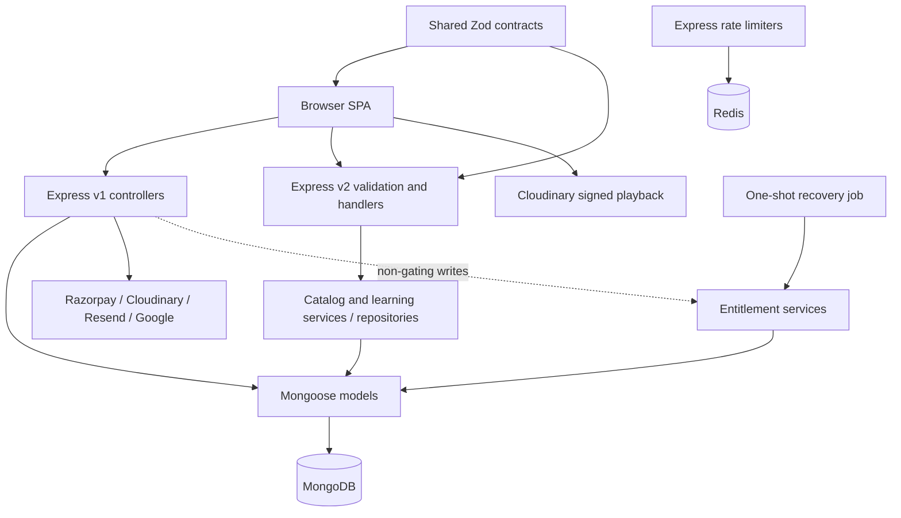
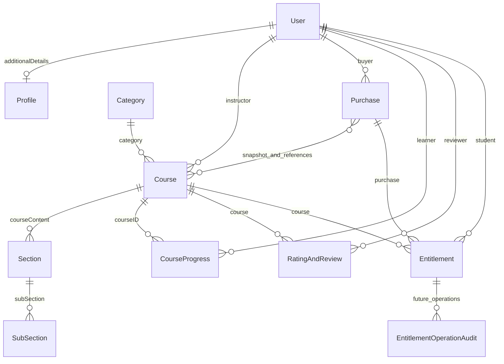

SOURCE CODE IS THE FINAL SOURCE OF TRUTH.

This document is a detailed StudyNotion knowledge map for AI question answering.
For implementation-specific questions, inspect the actual source code.
If this document conflicts with source code, trust the source code.

# StudyNotion — Detailed AI Context

Consolidated from `PROJECT_CONTEXT.md` and the 17 `docs/ai-context/` documents already completed in this conversation. Source audit baseline: `7b367c0`, 2026-10-04. Consolidation adds no new repository audit, runtime evidence, or test execution. Paths refer to the repository, not files attached to this ChatGPT Project. If source is unavailable, explain from this snapshot and identify what would require source confirmation; do not claim to have inspected it.

Read the relevant section, identify exact paths and symbols, and trace callers, middleware, models and provider dependencies before answering implementation questions. Distinguish shipped behavior from proposed architecture, and recorded local checks from live deployment evidence.

## Project Overview

### Actual product and users

StudyNotion sells self-paced video courses. Anonymous visitors browse published courses, categories, public reviews, marketing pages, and policy pages. Students register, purchase, watch authorized lessons, track completion, review purchased courses, view purchase history, and request refunds. Instructors require approval before they can sign in and manage courses, curricula, thumbnails, video uploads, publishing, and revenue/enrollment dashboards. Admins approve or reject instructor registrations and handle payment/refund exceptions. The initial admin is provisioned through a controlled CLI; public signup does not accept Admin.

This is not currently a school SIS, multi-tenant organization platform, live classroom system, subscription service, chat system, or certificate engine. No corresponding runtime routes/models were found.

Audit scope: 555 baseline tracked files; 491 meaningful text/configuration files, 425 parsed code/tooling files, the lockfile and generated OpenAPI, and 62 visual/media assets. Private environment values were not read. The school-platform implementation-plan tab was absent from the audited checkout and is not evidence of shipped school-management functionality.

## Tech Stack

Node 24 target; npm workspaces; React 19, React Router 8, Vite 8, Tailwind 4, Redux Toolkit/RTK Query; Express 5; Mongoose 9/MongoDB; Redis rate limiting; shared Zod 4/OpenAPI 3.1 contracts. Application code is mostly JavaScript/JSX with incremental TypeScript configuration. 

Locked versions below came from the existing documentation, not a registry lookup. Manifest ranges can differ. Each package is listed because its usage/declaration was already investigated.

### Frontend

| Package / locked version | Actual use | Repository evidence |
| --- | --- | --- |

| `react` / 19.2.8 | Component/hooks runtime; pages and reusable UI use state/effects and JSX. | `apps/web/src/app/bootstrap.jsx`; `apps/web/src/app/router/AppRouter.jsx` |

| `react-dom` / 19.2.8 | createRoot renders the SPA into index.html; StrictMode exposes effect issues in development. | `apps/web/src/app/bootstrap.jsx` |

| `react-router` / 8.3.0 | BrowserRouter, Routes, nested Outlet/navigation and protected route composition. | `apps/web/src/app/providers/AppProviders.jsx`; `apps/web/src/app/router/AppRouter.jsx` |

| `@reduxjs/toolkit` / 2.12.0 | configureStore/createSlice plus RTK Query createApi for catalog and learning cache/mutations. | `apps/web/src/app/store/index.js`; `apps/web/src/app/store/rootReducer.js` |

| `react-redux` / 9.3.0 | Provider/useSelector/useDispatch connects components to the Redux store. | `apps/web/src/app/providers/AppProviders.jsx`; `apps/web/src/features/authentication/SessionBootstrap.jsx` |

| `axios` / 1.18.1 | One shared apiConnector sends credentialed v1 requests with upload/normal timeouts and response handling. | `apps/web/src/shared/api/httpClient.js` |

| `react-hook-form` / 7.81.0 | Registered inputs, validation and submission state for authoring/profile/contact/password forms. | `apps/web/src/features/authentication/ui/UpdatePassword.jsx`; `apps/web/src/features/contact-support/ui/ContactUsForm.jsx` |

| `react-dropzone` / 14.4.1 | Course Upload integrates file picker/drop gestures before API multipart submission. | `apps/web/src/features/course-authoring/ui/AddCourse/Upload.jsx` |

| `react-hot-toast` / 2.6.0 | Global Toaster plus API/mutation feedback. | `apps/web/src/app/providers/AppProviders.jsx`; `apps/web/src/entities/cart/model/cartSlice.js` |

| `react-icons` / 5.7.0 | SVG icon components across navigation/forms/player. | `apps/web/src/entities/course/ui/CourseAccordionBar.jsx`; `apps/web/src/entities/course/ui/CourseSubSectionAccordion.jsx` |

| `react-markdown` / 10.1.0 | SafeMarkdown renders supported markdown with explicit safety restrictions. | `apps/web/src/shared/ui/SafeMarkdown.jsx` |

| `@ramonak/react-progress-bar` / 5.4.0 | Enrolled-course completion bars. | `apps/web/src/pages/enrolled-courses/index.jsx` |

| `chart.js` / 4.5.1 | Chart engine registered by InstructorChart for enrollment/revenue data. | `apps/web/src/pages/instructor-dashboard/ui/InstructorChart.jsx` |

| `react-chartjs-2` / 5.3.1 | React component wrapper around Chart.js in InstructorChart. | `apps/web/src/pages/instructor-dashboard/ui/InstructorChart.jsx` |

| `copy-to-clipboard` / 4.0.2 | CourseDetailsCard copies the share link. | `apps/web/src/pages/course-details/ui/CourseDetailsCard.jsx` |

| `react-super-responsive-table` / 5.2.3 | Instructor CoursesTable responsive table components/styles. | `apps/web/src/pages/instructor-courses/ui/CoursesTable.jsx` |

| `react-type-animation` / 3.2.0 | Home CodeBlocks animated marketing text. | `apps/web/src/pages/home/ui/CodeBlocks.jsx` |

| `swiper` / 14.0.5 | ReviewSlider carousel and its navigation/presentation. | `apps/web/src/widgets/review-slider/ui/ReviewSlider.jsx` |

### Backend

| Package / locked version | Actual use | Repository evidence |
| --- | --- | --- |

| `express` / 5.2.1 | HTTP app/router/middleware composition and handlers. | `apps/api/app/createApp.js`; `apps/api/app/registerRoutes.js` |

| `helmet` / 8.3.0 | Standard security-header middleware with project-specific overrides. | `apps/api/app/createApp.js` |

| `dotenv` / 17.4.2 | API-owned environment loader reads its local file quietly. | `apps/api/config/loadEnvironment.js` |

### Authentication

| Package / locked version | Actual use | Repository evidence |
| --- | --- | --- |

| `cookie-parser` / 1.4.7 | Parses request cookies before auth token resolution. | `apps/api/app/registerRoutes.js` |

| `cors` / 2.8.6 | Exact-origin credentialed browser CORS callback in createApp. | `apps/api/app/createApp.js` |

| `bcryptjs` / 3.0.3 | Hash/compare cost 12 in registration/login/reset/deletion proof and provisioning. | `apps/api/controllers/Auth.js`; `apps/api/controllers/profile.js` |

| `jsonwebtoken` / 9.0.3 | HS256 token signing and strict verification with issuer/audience/lifetime. | `apps/api/utils/auth.js` |

| `google-auth-library` / 10.9.0 | OAuth2Client verifies browser identity tokens via bounded helper. | `apps/api/utils/googleIdentity.js` |

| `gcp-metadata` / 7.0.1 | Optional API declaration with no direct application import; present in Google-related dependency graph. | apps/api/package.json optionalDependencies; lockfile transitive graph |

### Database

| Package / locked version | Actual use | Repository evidence |
| --- | --- | --- |

| `mongoose` / 9.9.1 | Schemas, hidden fields, validators, indexes, model CRUD and aggregation. | `apps/api/config/database.js`; `apps/api/controllers/Admin.js` |

| `mongodb-connection-string-url` / 7.0.2 | Parses Mongo URIs for production and seed safety checks, rather than naive string splitting. | `apps/api/utils/mongoDeployment.js`; `apps/api/utils/seedSafety.js` |

### Caching / rate limiting

| Package / locked version | Actual use | Repository evidence |
| --- | --- | --- |

| `redis` / 6.1.0 | Client connects/pings Redis, bounds commands and exposes readiness for rate-limit stores. | `apps/api/config/redis.js` |

| `express-rate-limit` / 8.6.0 | API and sensitive route windows, identities and rejection behavior. | `apps/api/middleware/rateLimiters.js` |

| `rate-limit-redis` / 6.0.0 | Adapts express-rate-limit counters to shared Redis. | `apps/api/middleware/rateLimiters.js` |

### Payments

| Package / locked version | Actual use | Repository evidence |
| --- | --- | --- |

| `razorpay` / 2.9.8 | Provider SDK orders create/recover, payments verify and refunds reconcile. | `apps/api/config/razorpay.js` |

### Media

| Package / locked version | Actual use | Repository evidence |
| --- | --- | --- |

| `cloudinary` / 2.10.0 | Upload/delete and signed private URL generation for images/authenticated lesson videos. | `apps/api/config/cloudinary.js`; `apps/api/utils/imageUploader.js` |

| `express-fileupload` / 1.5.2 | Route-local multipart parsing into bounded temporary files. | `apps/api/middleware/upload.js` |

### Contracts

| Package / locked version | Actual use | Repository evidence |
| --- | --- | --- |

| `@studynotion/contracts` / workspace 0.1.0 | Local workspace export surface for runtime Zod request/response schemas and OpenAPI. | `apps/api/domains/catalog/catalogService.js`; `apps/api/domains/learning/learningService.js` |

| `zod` / 4.4.3 | Strict runtime objects, coercion/refinement, safeParse, JSON Schema/OpenAPI foundation. | `packages/contracts/src/admin.js`; `packages/contracts/src/auth.js` |

### Utilities / deployment

| Package / locked version | Actual use | Repository evidence |
| --- | --- | --- |

| `tldts` / 7.4.9 | Registrable-domain checks in API env and root release-pair validator; declared at both runtime and root. | `apps/api/config/env.js`; `scripts/validate-release-pair.mjs` |

### Build tooling

| Package / locked version | Actual use | Repository evidence |
| --- | --- | --- |

| `vite` / 8.1.5 | Web dev/build/preview and public-env loading; alias/configuration source. | `apps/web/scripts/validate-public-env.mjs`; `apps/web/vite.config.ts` |

| `@vitejs/plugin-react` / 6.0.3 | React/JSX transformation and refresh integration in Vite config. | `apps/web/vite.config.ts` |

| `@tailwindcss/vite` / 4.3.3 | Tailwind 4 Vite integration processes CSS theme/utilities. | `apps/web/vite.config.ts` |

| `tailwindcss` / 4.3.3 | CSS utility/theme compiler imported by globals.css, including custom design tokens. | apps/web/src/shared/styles/globals.css |

| `typescript` / 5.9.3 | tsc noEmit strict foundation for TS/config files; JS allowed but checkJs false. | apps/web/package.json typecheck; tsconfig.json |

| `@types/node` / 24.10.0 | Ambient Node type declarations for TS tooling/config. | apps/web/tsconfig.json; vite.config.ts |

| `@types/react` / 19.2.18 | React/JSX declarations for incremental TypeScript adoption. | apps/web/tsconfig.json and JSX/type tooling |

| `@types/react-dom` / 19.2.4 | DOM renderer declarations alongside React foundation. | apps/web TypeScript foundation |

| `concurrently` / 9.2.4 | Root dev script starts labeled web/API watch processes together. | package.json dev script |

| `eslint` / 9.39.5 | Root flat-config static lint, React/hooks constraints and selected environment rules. | package.json lint script; eslint.config.mjs |

| `eslint-plugin-react` / 7.37.5 | React/JSX rules in eslint.config.mjs. | `eslint.config.mjs` |

| `eslint-plugin-react-hooks` / 7.1.1 | Hook correctness rules in flat config. | `eslint.config.mjs` |

| `eslint-plugin-react-refresh` / 0.4.26 | Component export/refresh compatibility rules. | `eslint.config.mjs` |

| `globals` / 17.7.0 | Browser/Node/test global-name sets used by ESLint config. | `eslint.config.mjs` |

| `prettier` / 3.9.5 | Repository formatting check/write commands; targeted docs format in this audit. | package.json format scripts; prettier.config.js |

| `@ianvs/prettier-plugin-sort-imports` / 4.7.1 | Configured by plugin string in prettier.config.js; orders imports. | prettier.config.js plugin string |

| `prettier-plugin-tailwindcss` / 0.8.1 | Configured by plugin string; orders utility classes consistently. | prettier.config.js plugin string |

### Testing

| Package / locked version | Actual use | Repository evidence |
| --- | --- | --- |

| `vitest` / 4.1.10 | Vite-aligned unit/component runner; jsdom environment and vi mocks. | `apps/web/src/app/App.test.jsx`; `apps/web/src/app/composition.test.jsx` |

| `jsdom` / 28.1.0 | DOM implementation selected in Vite test config for Vitest. | apps/web/vite.config.ts test.environment |

| `@testing-library/react` / 16.3.2 | Render/query components by observable UI in Vitest. | `apps/web/src/app/App.test.jsx`; `apps/web/src/app/router/AppRouter.parity.test.jsx` |

| `@testing-library/jest-dom` / 6.9.1 | DOM-specific matchers installed in web test/setup.js. | `apps/web/test/setup.js` |

| `@testing-library/user-event` / 14.6.1 | Realistic keyboard/pointer/text interactions in component tests. | `apps/web/src/entities/course/ui/CourseAccordionBar.test.jsx`; `apps/web/src/features/authentication/ui/LoginForm.test.jsx` |

| `@playwright/test` / 1.61.1 | Browser runner, fixtures/devices, request interception, traces and live smoke. | `playwright.config.mjs`; `playwright.live.config.mjs` |

| `@axe-core/playwright` / 4.12.1 | Automated accessibility assertions inside the browser journeys. | `e2e/catalog.spec.js`; `e2e/learning.spec.js` |

### Dependency observations

Axios manifest range is older-looking but the checked lock resolves a newer version; never teach the range minimum as the installed version. React Router is imported from `react-router`, not `react-router-dom`. Tailwind uses the v4 Vite/CSS setup, not an assumed v3 configuration. Mongoose is exactly pinned. `@studynotion/contracts` is an internal workspace, not a remote API. `@eslint/js` is imported by ESLint configuration through the installed dependency graph but is not a direct root declaration; changes to hoisting/dependency ownership deserve care. Packages used by CLI/config strings or CSS imports are not unused merely because JS import search returns zero. No confident removable-unused-dependency conclusion was established for optional gcp-metadata. No Redis course cache, queue package, WebSocket implementation, or AWS SDK feature was found.

### Manifest ownership

| Manifest | Responsibility |
| --------------------------------- | ----------------------------------------------------------------- |
| `package.json` | studynotion; 1 runtime, 11 dev, 0 optional declarations |
| `apps/web/package.json` | studynotion-web; 19 runtime, 13 dev, 0 optional declarations |
| `apps/api/package.json` | studynotion-backend; 18 runtime, 0 dev, 1 optional declarations |
| `packages/contracts/package.json` | @studynotion/contracts; 1 runtime, 0 dev, 0 optional declarations |

## Repository Structure

```text
StudyNotion/
├── apps/
│   ├── web/
│   │   ├── src/{app,pages,widgets,features,entities,shared}/
│   │   ├── public/                  static branding, manifest, robots, redirects
│   │   ├── scripts/                 public env validation and Nginx rendering
│   │   ├── test/setup.js            browser test environment
│   │   └── Dockerfile, nginx.conf, vite.config.ts, tsconfig.json
│   └── api/
│       ├── app/, bootstrap/         HTTP composition and process lifecycle
│       ├── routes/, controllers/    current v1 and thin v2 HTTP boundaries
│       ├── domains/                 catalog, learning, enrollment, entitlement
│       ├── models/, middleware/     persistence and request gates
│       ├── config/, utils/          runtime validation and integrations
│       ├── scripts/                 one-shot operational commands
│       ├── mail/templates/          escaped transactional HTML
│       ├── modules/README.md        future migration boundary
│       └── test/                    Node tests and opt-in integration suites
├── packages/contracts/              shared Zod schemas and OpenAPI generation
├── e2e/                            mocked UI journeys and optional live smoke
├── scripts/                        architecture, secrets, release/host validators
├── .github/                        CI, security workflow, Dependabot
├── docs/{architecture,audits,operations,security}/
├── compose.local.yml, compose.integration.yml, compose.operations.yml
└── package.json, package-lock.json, tooling configs
```

### Responsibility and connections

| Directory | What and why | Connections |
| --------------------- | ------------------------------------------------------------------------------------------------------------- | ----------------------------------------------------------------------------- |
| `apps/web/src/app` | Single composition root; prevents pages owning global providers | Loads every page, Redux reducers, BrowserRouter, session bootstrap |
| `pages` | URL-specific presentation and coordination | Composes widgets/features/entities; no raw HTTP |
| `widgets` | Navbar, footer, dashboard sidebar, curriculum sidebar, review slider | Reuses lower-layer state and feature actions |
| `features` | Authentication, authoring, buying, reviewing, playback, filtering, profile, approval, reconciliation, contact | Calls entity APIs or feature adapters over shared transport |
| `entities` | User, course, catalog, learning, purchase, cart, review vocabulary/state | Uses contracts/shared transport; imported throughout upper layers |
| `shared` | HTTP/error abstraction, endpoint registry, primitives, formatting, styles | Lowest application layer; cannot know feature internals |
| `apps/api/app` | Build Express independently from listening | Makes HTTP tests possible without production startup |
| `bootstrap` | Resource lifecycle and failure/shutdown behavior | DB, Redis, Cloudinary, app, HTTP server |
| `routes` | Method/path/middleware definitions | Select controllers and validation contracts |
| `controllers` | Compatibility business orchestration and v2 adapters | Models, domains, provider wrappers; see API Architecture |
| `domains/catalog` | Query/cursor/aggregation/public DTO pipeline | Course/category/instructor/review/curriculum collections |
| `domains/learning` | Authorize current enrollment and canonicalize progress | Course, Section, SubSection, CourseProgress |
| `domains/enrollment` | Audit duplicated enrollment and financial evidence | Read-only union aggregation and classification/reporting |
| `domains/entitlement` | Validate financial evidence; sidecar state/recovery | Entitlement/Purchase/User/Course/Progress; called from payments/deletion/jobs |
| `models` | Twelve stored document schemas and indexes | Shared by controllers, domains, tests, explicit operational jobs |
| `middleware` | Auth/roles, origin gate, limiter, uploads | Runs in routes/app composition before handlers |
| `config` | Load/validate names, resource setup/readiness | Runtime-only private settings; never imported into browser |
| `utils` | Cookies/JWT, lifecycle predicates, media/email, logging, operation safety | Reused by HTTP paths and one-shot jobs |
| `scripts` under API | Explicit operational actions | Not automatically run at normal startup |
| `packages/contracts` | Shared public wire rules without DB/provider types | Both applications consume package exports; deterministic OpenAPI artifact |
| `e2e` | Real browser regression and optional real-stack smoke | Built SPA plus request mocks, or separately running stack |
| root `scripts` | Enforce repo/deployment boundaries | CI and package scripts invoke them |
| `.github` | Automated quality/security checks | Installs workspaces, runs all testing layers, builds images |
| `docs` | Decisions, historical measurements, operator procedures | Helpful rationale; source confirms current behavior |

### Configuration ownership

Root owns workspace installation, lockfile, lint/format, Playwright, Compose, and architecture checks. Web owns Vite build variables, Nginx, TypeScript foundation, and styles. API owns runtime environment loading; only its own `.env` location is loaded by `config/loadEnvironment.js`. Examples describe local/staging/production and staging-demo seed names; they are templates, not usable production settings. Release pair validation checks browser/runtime agreement.

`.editorconfig`, `.gitattributes`, `.gitignore`, `.dockerignore`, `.prettierignore`, `.vscode/settings.json`, `.nvmrc`, and lint/format configs define developer/build boundaries. Static assets and audit screenshots have no executable business rules. Generated `packages/contracts/openapi.json` is checked for drift, and `package-lock.json` is the reproducible dependency graph; neither should be manually treated as application logic.

### Naming and compatibility conventions

Preserve case-sensitive paths and legacy names such as `studentsEnroled`, `courseID`, and v1 `subsectionId` versus playback `subSectionId`. Course/catalog prices use major INR; Purchase amounts use integer paise. Do not treat Purchase status, progress, or Entitlement existence as interchangeable access evidence. V2 parsing goes into `res.locals.v2Input`; browser adapters send cookies, not JWT headers. Real environment values must stay private.

## Overall Architecture

### Composition and boundaries



The API is one deployable process, not microservices. Provider calls are synchronous request-side operations with bounded helpers where implemented. No application message broker, Socket.IO/WebSocket endpoint, permanent worker pool, or generic background queue was found. Entitlement recovery is a separately invoked one-shot process.

### Frontend dependency direction

`apps/web/src/app` owns providers, store, router, and bootstrap. `pages` compose route screens. `widgets` compose reusable screen regions. `features` express user actions. `entities` own reusable domain state/API/presentation. `shared` owns framework-neutral helpers, transport, styling, and primitive UI. Imports may skip downward layers. Different features may not import each other; a page or widget composes them instead. Public `index.js` entries make domain surfaces discoverable. `@/` resolves to `apps/web/src` in Vite and TypeScript.

`scripts/check-architecture.mjs` validates direction, selected public boundaries, and raw transport restrictions for UI/pages. It scans JS-family extensions (not all future TS files) and only bounded backend directories. This is a useful guard, not a formal dependency proof or a complete linter for old controllers. Current check reports 218 frontend and 29 bounded backend source files; tests/support are handled according to script exclusions.

### State and authority

| Question | Current authority |
| ----------------------------------------------------- | ----------------------------------------------------------------------------- |
| Who is signed in and allowed to act? | Verified JWT identity plus freshly loaded User state/role/sessionVersion |
| Which paid lessons may this Student open? | Course's `studentsEnroled` membership plus curriculum membership |
| Which courses does the enrolled dashboard list? | Student User's `courses` mirror |
| What was bought, for how much, and with which policy? | Immutable Purchase snapshots and verified provider state |
| Which lessons are complete? | Unique CourseProgress per learner/course, intersected with current curriculum |
| Does Entitlement grant access? | Not yet; it records sidecar state for migration/recovery |
| What is the checkout total? | Backend current Course prices captured into integer-paise Purchase line items |
| What does the browser cache? | RTK Query catalog/learning responses; local cart metadata, not authorization |
| What does Redis cache? | No product cache; Redis stores shared rate-limit counters |

### Contract boundary

`packages/contracts/src/common.js`, domain schemas, and `registry.js` feed `openapi.js`. Strict DTOs prevent accidental credential, financial-provider, or protected-media leakage in v2. Request schemas parse into locals because Express 5's query property must not be reassigned. Catalog and learning services validate their outputs. Catalog accepts legacy image strings; this specific compatibility rule should not be replaced with a generic URL assumption.

OpenAPI describes only `GET /api/v2/courses`, `GET /api/v2/learning/courses/{courseId}`, and `PUT /api/v2/learning/courses/{courseId}/lessons/{lessonId}/progress`. Auth/commerce/admin contract definitions are future boundaries; v1 responses can differ. The broad `progressUpdateRequestSchema` is not the live PUT body: the wired learning operation accepts an empty object and marks the path lesson complete.

### Consistency and failure design

Checkout reservations and unique indexes prevent competing active purchases; compare-and-set updates protect state transitions. Enrollment still writes several collections sequentially with compensation, so a crash can leave mirrors inconsistent. The enrollment audit classifies evidence and explicitly refuses automatic repair. Entitlement recovery uses revisions, leases, DB time, bounded scans, private checkpoints, and evidence rechecks; it never repairs legacy mirrors or changes current authorization.

A processed provider refund is persisted before legacy access cleanup completes, making retries possible. Account deletion is also resumable: a pending flag restricts the account until media/data cleanup and anonymization succeed. These are application state machines, not distributed transactions.

## Frontend Architecture

Paths in this section are relative to `apps/web` unless already prefixed. `src/` means `apps/web/src/`.

### Boot and component hierarchy

`index.html` supplies the DOM root and imports `src/app/main.jsx`. `bootstrap.jsx` renders with `createRoot` and StrictMode. `app/providers/AppProviders.jsx` supplies Redux, BrowserRouter, application ErrorBoundary, and toast presentation. `App.jsx` composes SessionBootstrap, AppShell and AppRouter. `widgets/app-shell/AppShell.jsx` owns Navbar, RouteErrorBoundary and the Suspense fallback around route children. Pages place Footer where needed; this is client composition, not a server layout engine.

Pages are lazy imports in the router. There is no SSR, server component layer, Next.js runtime, or framework loader/action data router. Vite builds browser modules; Nginx serves the static bundle. Tailwind 4 is integrated through the Vite plugin and `shared/styles/globals.css` with CSS theme tokens. React 19 does not by itself make this application fully typed or server rendered.

### Routes and composition

`src/app/router/AppRouter.jsx` is the complete source of route truth.

| Routes | Screen / boundary |
| ------------------------------------------------------------------------------------------------------------- | ------------------------------------------------------------ |
| `/`, `/about`, `/contact` | Home, about, contact pages; public |
| `/catalog/:catalogName`, `/courses/:courseId` | v2 catalog and v1 public course details |
| `/terms`, `/privacy-policy`, `/refund-policy`, `/cookie-policy` | Shared legal-page presentation |
| `/login`, `/signup`, `/verify-email` | OpenRoute; authenticated users redirected |
| `/forgot-password`, `/update-password` | OpenRoute password recovery screens |
| `/accept-terms` | PrivateRoute with policy-pending exception |
| `/dashboard` | Redirect to `/dashboard/my-profile` |
| `/dashboard/my-profile`, `/dashboard/settings` | Signed-in user profile/settings |
| `/dashboard/Settings` | Case-sensitive compatibility redirect preserving search/hash |
| `/dashboard/instructor`, `/dashboard/my-courses`, `/dashboard/add-course`, `/dashboard/edit-course/:courseId` | Instructor-only screens |
| `/dashboard/enrolled-courses`, `/dashboard/cart`, `/dashboard/purchases` | Student-only screens |
| `/dashboard/instructor-approvals`, `/dashboard/payment-reconciliation` | Admin-only screens |
| `/view-course/:courseId/section/:sectionId/sub-section/:subSectionId` | Private learning layout and Student lesson screen |
| `*` | Not-found page |

PrivateRoute waits while session status is checking, preserves a safe internal return path, sends deletion-pending users to settings, and sends policy-pending users to acceptance. OpenRoute redirects signed-in users. RoleRoute checks the current profile role for UI navigation; backend roles/ownership remain mandatory. `shared/lib/routing/internalRedirect.js` rejects unsafe redirects. `widgets/dashboard-sidebar/model/links.js` controls role-specific navigation labels, not API permissions.

### State ownership

`app/store/index.js` configures the store, and `rootReducer.js` registers `auth`, `profile`, `cart`, `course`, `viewCourse`, `catalogApi`, and `learningApi`, with RTK middleware.

| State | Location | Behavior |
| ----------------------------------------------------- | --------------------------------------------------------------------------- | --------------------------------------------------------------------------------------------------------------------------------------------- |
| Session status, pending signup, policy/deletion flags | `entities/user/model/authSlice.js` | Checking/authenticated/anonymous; `token` is boolean compatibility state, not a JWT |
| Safe current user | `entities/user/model/profileSlice.js` | Populated from server profile/session DTOs |
| Cart | `entities/cart/model/cartSlice.js` | Persists course metadata in localStorage, recomputes totals, validates restored entries; reducers also perform persistence/toast side effects |
| Authoring wizard | `entities/course/model/courseSlice.js` | Step, current course, edit flag and loading state |
| Old learning state | `entities/learning/model/legacyViewCourseSlice.js` | Still registered; active learner screens use RTK Query instead |
| Catalog/category server state | `entities/catalog/api/catalogApi.js` | Credentialed fetch, parsed contracts, query-key caches; categories retained longer |
| Learning/progress server state | `entities/learning/api/learningApi.js` | Strict response parsing; successful mutation patches cached canonical progress |
| Filters | `features/course-filter/model/catalogFilters.js`, `pages/catalog/index.jsx` | URL search parameters are committed state; local draft inputs applied on submit |
| Playback | `features/lesson-playback/ui/VideoDetails.jsx` | Local expiring URL/loading/error/playback state; no durable URL persistence |
| Checkout request key | `features/course-purchase/lib/checkoutIdempotency.js` | Session storage keyed by user and sorted course set |

Catalog RTK queries retain ordinary unused results for 60 seconds and categories for 300 seconds, and support reconnect refresh. Cursor pages are accumulated/deduplicated in the catalog page. This client cache does not imply an API/Redis catalog cache. Learning mutation cache updates happen after confirmation (`queryFulfilled`), not optimistic completion before the server accepts it.

### API communication

`shared/api/endpoints.js` owns v1 URLs and derives v2 only from a base ending `/api/v1`. Production bundles require a configured base; relative `/api/v1` supports same-origin releases. `shared/api/httpClient.js::apiConnector` uses Axios with credentials, strips Authorization headers, sets normal requests to a 15-second deadline and FormData requests to 120 seconds, and normalizes failures via `apiErrorModel.js`.

Feature/entity API modules own transport and user-facing orchestration. Catalog/learning use `fetchBaseQuery` with credentials and a 15-second timeout rather than Axios. Both transports participate in session response handling. `features/authentication/model/sessionResponseIntegration.js` handles 401 (clear session/cart/learning cache), 423 (deletion pending), and 428 (policy action needed). Public catalog cache need not be cleared as private learning state does.

`features/authentication/api/authApi.js` implements thunks including login, signUp, OTP, Google sign-in, restoration, policy acceptance, and logout. SessionBootstrap runs restoration once per mounted bootstrap with a ref protecting the StrictMode effect cycle. Browser auth restoration calls `/profile/getUserDetails`; no browser JWT decoder is an authority. Old localStorage identity entries are removed. That cleanup has an unguarded storage path recorded as a candidate failure under restricted storage.

### Forms and UI behavior

Authentication uses controlled values and dedicated policy/OTP widgets. Many profile, contact, course, lesson, and password forms use react-hook-form. Client validation improves feedback; server validation is independently authoritative. `VerificationCodeInput` implements keyboard/paste behavior. `PolicyAcknowledgement` and `CheckoutPolicyAcknowledgement` collect distinct consent contexts.

Authoring composition is `pages/course-create` → `features/course-authoring/ui/AddCourse` → `RenderSteps` → information, builder, publish stages. NestedView, SubSectionModal, Upload, ChipInput, and RequirementsField manage curriculum/files/list values. Multipart lists are JSON-encoded; uploaded media travels through the API. PublishCourse changes server lifecycle status after server curriculum validation. CourseInformationForm's category object/string comparison deserves a later targeted fix, not an audit-time refactor.

Shared primitives include buttons/links, FormField, ConfirmationModal, StatusPanel, PageLoadingFallback, ErrorBoundary, and SafeMarkdown. Modal tests cover keyboard/focus behavior. SafeMarkdown skips raw HTML, restricts links, and excludes images. Avatar helpers generate local deterministic SVG data images and normalize older avatar references without remote identity leakage. Temporary file previews are released by their owning components.

### Loading, failures, performance

Lazy pages use Suspense; transport-driven screens expose loading, empty, error, retry, and missing/access-denied states. RouteErrorBoundary allows localized recovery; ErrorBoundary catches rendering failures and forwards sanitized reports to `shared/lib/errorMonitoring.js`. No production reporter vendor is installed in the checked-in composition. Toasts communicate mutation success/failure, but they do not replace server state.

Catalog paginates 12 items at a time, uses opaque server cursors, retains prior cards while loading, and reads URL filters for navigation. Native video playback asks for a signed URL per selected lesson; on an expiry-like media error it refreshes once, preserves position, and then offers explicit retry. The player shows completion action after ended, but the server validates enrollment/lesson membership rather than watch-time evidence.

Marketing course cards under `pages/home` use curated local examples; `entities/course/ui/CourseCard.jsx` represents actual catalog data. Instructor charts consume server-computed financial/enrollment summaries. Footer/navigation models contain editorial links. Those are separate from role gates and live metrics.

## Backend Architecture

Unprefixed backend paths below are relative to `apps/api`.

### Startup and shutdown

`index.js` calls `config/loadEnvironment.js::loadEnvironment`, then constructs the runtime through `bootstrap/createApiRuntime.js`. Environment loading targets the API-owned file, with no historical root/server fallback. `config/env.js` validates required names, tier consistency, secrets' shape, origin/cookie posture, proxy count, provider choices, DB/TLS posture, bounded tuning, and the immutable entitlement boundary. It throws on invalid configuration before serving traffic.

`bootstrap/createServerLifecycle.js` connects MongoDB, connects/pings Redis, configures Cloudinary, then listens. Database readiness reflects driver events and connection state; Redis readiness reflects connection/ping state. Default HTTP request timeout is 120 seconds, keep-alive 5 seconds, maximum requests per socket 1,000, with compatible header timeout. Shutdown marks readiness false, closes HTTP, and attempts both DB and Redis cleanup, with a bounded force-exit timer (10 seconds by default). Signal and fatal-error handlers are registered by the entry point. Tests can build the app without listening or loading production resources.

### HTTP ordering

1. `app/createApp.js`: Express, no x-powered-by, simple query parser, reviewed trust proxy, Helmet, validated/generated request ID, completion logger, credentialed CORS.
2. Liveness/root/readiness endpoints are registered. Readiness requires Mongo/Redis and, in production, Cloudinary configuration plus no shutdown in progress. It does not ping every external provider.
3. `app/registerRoutes.js` registers `/api/v1/payment/webhook` with its limiter and raw JSON parser (256 KB) before normal body/cookie/origin middleware.
4. General v1 rate limiter; v2 envelope normalizer and limiter.
5. Strict JSON and URL-encoded limits (100 KB, 100 parameters), cookie parser, and trusted browser origin checks for unsafe API methods.
6. Learning v2 router before catalog v2 catch-all; then v1 auth/profile/course/payment/contact/admin routers.
7. Not-found and error handlers, with version-appropriate response shapes and private error logging.

This ordering is security behavior: moving raw webhook registration after JSON parsing changes signature input; moving uploads before auth wastes unauthenticated resources; changing router order can make learning unreachable.

### Requests, validation, errors

Most v1 controllers validate strings, IDs, allowed fields, ranges, and related documents manually. V2 routes use `shared/http/validateV2Request.js` and Zod. Parsed input is assigned to `res.locals.v2Input`; unknown fields and malformed IDs produce bounded, sanitized details. Learning auth/role gates run before input validation.

V1 compatibility responses vary across `data`, `user`, `order`, and other keys. V2 success is `{success:true, requestId, data}` and error is `{error:{code,message,requestId,details?}}`. `v2ErrorEnvelope.js` normalizes legacy middleware errors and preserves allowlisted session-control codes. `errorHandler.js` does not return raw DB/provider stacks. Request IDs accept a bounded safe incoming value or use a UUID. `utils/logger.js` redacts sensitive keys/string patterns and logs route templates instead of sensitive raw URLs/payloads.

### Business units and important functions

| Source | Input → processing → output / caller |
| ----------------------------------------------- | ------------------------------------------------------------------------------------------------------------------------------------------------------------- |
| `controllers/Auth.js` | Identity/password/OTP/policy input → validation, identity/account gates, User/Profile changes → safe session/user response and cookie; auth router |
| `controllers/resetPassword.js` | Email or one-time challenge → generic issuance response or atomic password replacement/session revocation → login screen can be used |
| `controllers/Course.js` | Authoring metadata, IDs, files → ownership/lifecycle/media checks and mirror updates → course DTO; also public details, protected details/playback, archiving |
| `controllers/Section.js`, `Subsection.js` | Course/section/lesson relationships → owner checks and curriculum mutation → refreshed curriculum; protected deletion and media cleanup |
| `controllers/payments.js` | Checkout/verified capture/refund/admin input → Purchase state machine and Razorpay calls → order, enrollment, history, or reconciliation result |
| `controllers/profile.js` | Profile changes/account deletion/current identity → allowlist, reauthentication, locks/cleanup/anonymization → safe user/enrolled/dashboard DTO |
| `controllers/Admin.js` | Paginated queue or target instructor decision → active pending-instructor compare-and-set and audit fields → approval result |
| `controllers/Category.js`, `RatingandReview.js` | Category/review query or authorized creation → bounded queries/projections/unique constraint → public data |
| `controllers/ContactUs.js` | Bounded contact values → validation/escaped mail template → configured support recipient via Resend |
| `controllers/CatalogV2.js` → catalog service | Validated filters/requestId → cursor/query/DTO pipeline → schema-validated page |
| `controllers/LearningV2.js` → learning service | Current user and course/lesson IDs → current access/curriculum/progress → canonical schema-validated state |

Exact endpoints, middleware, and inputs are in the API Architecture section; end-to-end callers are in the full-stack flow sections.

### Domain repositories

Catalog repository builds MongoDB aggregation with Published base filters, optional text search, category/level/language/price, rating/duration/enrollment calculations, stable sorting and ID tie-breaks, and conditional early paging. Rating/duration work runs before paging when filters/sort need it, otherwise after selection. Cursor fields are base64url JSON with version, filter fingerprint, sort key, and ID; fingerprint is a consistency check, not a secret authorization signature. Service fetches limit+1, emits an end cursor only when another page exists, maps public fields, and validates output. No count-all/Redis cache is involved.

Learning repository loads a course whose `studentsEnroled` includes the student, then related sections/lessons and progress. Mapper removes duplicate/missing curriculum references and ignores stale completed IDs. `markLessonComplete` uses unique learner/course upsert plus `$addToSet`, retrying the duplicate-key race; response is current canonical progress. Missing course is 404, existing unowned course 403. Progress is learning state, not access proof.

Enrollment consistency repository unions financial and legacy references and streams grouped pairs. Classifier explains divergence scenarios, malformed/duplicate evidence, and account-deletion exceptions. Service/report never mutate. Entitlement repository uses explicit private projections, revisions, compare-and-set conditions, DB time, leases, and bounded scan reports. Policy/evidence/service/recovery responsibilities are separated; Database / Data Model and the full-stack flow sections cover invariants.

### Operational jobs

| Script | Effect / guard |
| ---------------------------------- | --------------------------------------------------------------------------------------------------------------------------------------------------------------------------------------- |
| `create-indexes.js` | All 12 models; `create` requires explicit migration confirmation, `verify` compares declared indexes; does not automatically drop extra indexes |
| `backfill-security-fields.js` | Explicit backup/confirmation gate; fills missing legacy session/approval/provider/deletion defaults, published timestamp, repairs missing Profiles; not historical Entitlement backfill |
| `provision-admin.js` | Explicit confirmation/policy acceptance, strong identity validation, refuses an existing active admin/account; creates Profile/User with compensation |
| `seed.js` | Guarded local/disposable or explicitly configured staging demo target; controlled identities/media and synthetic financial evidence; not a production import engine |
| `audit-enrollment-consistency.js` | Read-only report, bounded samples and dry-run proposals; never automatic repair |
| `preflight-production.js` | Runtime config, declared indexes, data integrity/media readiness, enrollment/entitlement health; aggregate redacted report |
| `reconcile-entitlements.js` | Status or explicit bounded recovery; no provider calls or legacy-access repairs |
| `schedule-entitlement-recovery.js` | Immutable image assertion, private checkpoint, one batch/resume; external scheduler invokes it |

Preflight/audit use meaningful exit codes: healthy 0, warning 1, blocking 2, operational failure 3 where defined. Check each CLI's parser/help before invocation. No cron installation or queue daemon is supplied.

## Database / Data Model

### Technology and connection management

MongoDB with Mongoose 9.9.1; local/integration Compose uses MongoDB 8. `apps/api/config/database.js` sets bounded query/driver timeouts, pool limits, connection readiness events, and explicit disconnect. `utils/mongoDeployment.js` validates URI/deployment posture and supplies one-shot options. Production uses TLS/authenticated non-loopback targets and disables automatic index creation; indexes are an explicit release operation. MongoDB deployment existence, backups, replicas, and cloud ACLs are not verified by source inspection.

### Conceptual model



These are conceptual cardinalities, not enforced foreign keys. Course↔User enrollment and Category/User↔Course arrays duplicate some relationships. Section has no parent Course field; ownership is resolved through Course.courseContent, then Section.subSection. Native ObjectIds, not merely ID-looking strings, matter to operational financial evidence.

### Model inventory

All definitions live in `apps/api/models`.

| Model file / registered name | Important stored fields | Constraints, responsibility, consumers |
| ------------------------------------------------------------ | ------------------------------------------------------------------------------------------------------------------------------------------------------------------------------------------------------------------------------------------------------------------------------------------------------- | ------------------------------------------------------------------------------------------------------------------------------------------------------------------------------- |
| `User.js` / `user` | Names, normalized email, hidden password/googleId, authProviders, accountType, active/approved, instructorApprovalStatus/review audit, Profile reference, courses/courseProgress arrays, avatar/publicId, sessionVersion, policyAcceptances, deletion/payment locks, reset hash/expiry and legacy token | Unique email and sparse Google identity; instructor queue index; sensitive select/serialization guards. Auth, all protected requests, enrollment, dashboards, account lifecycle |
| `Profile.js` / `Profile` | Gender, dateOfBirth string, about, contactNumber | User.additionalDetails reference; bounded fields; no automatic timestamps. Profile CRUD/deletion |
| `OTP.js` / `OTP` | Unique normalized email, hidden otpHash, attempts, expiresAt, createdAt | TTL index expiresAt with expireAfterSeconds 0; app also checks expiry/attempts. Signup only |
| `Category.js` / `Category` | Name, description, courses mirror, timestamps | Unique trimmed name up to 120; description up to 1,000. Public category lists, course authoring/catalog |
| `Course.js` / `Course` | Instructor/category refs, name/description/benefits, price, thumbnail + hidden publicId, tags/instructions, ordered courseContent, ratingAndReviews, `studentsEnroled`, optional level/language, status, everPublishedAt, archivedAt/by | Draft/Published/Archived; positive bounded INR major-unit price; metadata bounds; instructor/category/status/catalog indexes. Commerce, catalog, learning, authoring |
| `Section.js` / `Section` | sectionName, subSection refs, timestamps | Bounded title, ordered lessons. Parent ownership through Course |
| `Subsection.js` / `SubSection` | title, description, timeDuration string, videoUrl, hidden videoPublicId/videoFormat/videoDeliveryType, timestamps | Upload/authenticated metadata, bounded titles/descriptions. Media ownership/publishing/playback |
| `RatingandReview.js` / `RatingAndReview` | user, course, rating, review, timestamps | Rating integer 1–5, review bounded; unique user+course. Review create/public sanitized feed and catalog aggregation |
| `CourseProgress.js` / `courseProgress` | userId, `courseID`, completedVideos, timestamps | Unique userId+courseID; completion `$addToSet`; never grants access. Learning v1/v2, dashboards, deletion/refund cleanup |
| `Purchase.js` / `Purchase` | User/course refs, immutable lineItems/course names/amounts, total paise/INR, receipt, provider IDs, checkout/idempotency keys, activeCourses, expiry, lifecycle/refund/lock/audit fields, immutable policy snapshot | Unique receipt/provider IDs and partial active reservation keys; retained financial history; see Payments / Refunds |
| `Entitlement.js` / `Entitlement` | schemaVersion, immutable student/course/purchase/source, isCurrent, status, revision, grant/revoke/cancel fields, private retry/lease/manual/migration/replacement metadata | Strict schema, write-once identity, state-policy validation, private transform; one episode per purchase/course and one current episode per learner/course |
| `EntitlementOperationAudit.js` / `EntitlementOperationAudit` | Immutable operation ID, entitlement/actor/action/reason/revision and requested/succeeded/failed/conflict outcome | Four indexes; provisioned/tested future private admin audit; no active public workflow |

### Index guarantees

`Course.js` has general status/category and instructor/created indexes plus named catalog indexes for newest/category-newest, price/category-price, and text search over name/tags/description. Derived rating/popularity/duration queries still need aggregation; an index on price does not accelerate every catalog sort.

User email/Google uniqueness prevents duplicate identities; Category name uniqueness does not by itself establish case-insensitive collation. OTP TTL is cleanup, not authorization expiry. Review and progress pair indexes are essential to idempotent creation/upsert under races. Purchase's sparse provider uniqueness prevents one captured provider payment/refund being attributed twice, and partial indexes for activeCourses/checkoutKey/idempotencyKey prevent conflicting active reservations. Entitlement has seven indexes covering immutable natural identity, current learner/course uniqueness, access scans, recovery and migration; its audit model has four.

`apps/api/scripts/create-indexes.js` uses createIndexes and diffIndexes across all 12 models. It refuses a mutation without confirmation and checks missing declarations. It does not run syncIndexes to destructively drop extra indexes. Tests with stubs confirm declarations; real database enforcement requires integration/preflight.

### Integrity limits and operational repair

MongoDB refs do not enforce relational integrity. Course/User/Category mirrors, curriculum references, progress and Purchase state can diverge after sequential-write failures. Existing compensation and unique indexes reduce but do not eliminate crash windows. Published/history-bearing course deletion archives instead of destroying learner content; curriculum physical deletion is restricted to safe unsold never-published drafts. Course completion is computed from surviving current lesson IDs, so stale progress does not inflate percentages.

Account deletion anonymizes and inactivates User while retaining Purchase/policy evidence, an intentional non-cascade relationship. Instructor course history blocks self-delete. Cloudinary and database writes cannot be committed in one atomic transaction; asset cleanup can fail independently.

The enrollment consistency domain classifies scenarios A–F (User-only mirror, Course-only/no qualifying purchase, qualifying purchase without mirrors, orphan progress, processed refund with surviving mirror, paid partial fulfillment) plus corrupt/missing references and intentional deletion cases. Reports can propose dry-run investigation but every proposal is unsafe for automatic repair. `backfill-security-fields.js` only fills legacy security/profile defaults; it is not an enrollment repair or a full migration framework.

## Authentication

### Sources and boundaries

Backend: `apps/api/controllers/Auth.js`, `resetPassword.js`, `profile.js`; `middleware/auth.js`; `utils/auth.js`, `validation.js`, `policyAcceptance.js`, `googleIdentity.js`; `models/User.js`, `OTP.js`, `Profile.js`; `routes/user.js`.

Frontend: `apps/web/src/features/authentication/{api,model,routing,ui}`, `SessionBootstrap.jsx`, `entities/user/model`, and auth/recovery pages. Authentication identifies a User; authorization additionally checks current DB role, account state, ownership/enrollment, and requested resource relationships.

### Registration and OTP

SignupForm gathers Student/Instructor identity, password/confirmation, and three affirmative policy fields (`acceptTerms`, `acknowledgePrivacy`, `confirmEligibility`). `authApi` requests OTP then stores pending signup data in Redux for VerifyEmail. `Auth.js::sendotp` normalizes/validates email, rejects an existing account, generates a cryptographically random six-digit value, stores HMAC-SHA256 of email and OTP under the separate OTP secret, resets attempts, and sets a ten-minute expiry. Email sends through Resend; send failure removes the challenge. Local development can explicitly return the OTP; production forbids that configuration.

`signup` validates names/email, allows only Student/Instructor, requires matching strong passwords and affirmative policy acceptance, loads the hidden OTP hash, checks application expiry and attempts (maximum five), and compares the hash safely. Mongo TTL cleanup is asynchronous, so application expiry checks are necessary. Passwords use bcrypt cost 12 with uppercase/lowercase/digit, minimum eight characters and at most 72 UTF-8 bytes. User/Profile creation compensates profile creation on failure. Successful signup removes the OTP; it does not issue a login session. Students are approved; instructors enter Pending/unapproved state. Signup is not a general Admin creation route.

### Login and cookie session

`login` selects the hidden password and provider fields, verifies bcrypt (with a dummy hash for absent users), rejects inactive/unapproved accounts, projects safe user data, and calls `utils/auth.js::issueSession`. JWT algorithm is restricted to HS256, issuer `studynotion-api`, audience `studynotion-web`, lifetime 12 hours. Claims include ID, email, accountType, and sessionVersion. Claim role is not trusted over the database on later requests.

Cookie default name is `studynotion_session`, path `/`, HttpOnly, 12-hour max-age; production requires Secure, explicit SameSite posture, and validates any optional domain. Legacy cookie variants are cleared. No refresh token, refresh endpoint, rotating token store, or server session collection exists.

`readSessionToken` supports Bearer first, configured cookie next, then old `token` cookie for compatibility. The application browser uses credentialed requests and strips Authorization headers in its Axios adapter. JWTs are not returned for browser storage by the normal session flow; `auth.token` in Redux is a boolean. The browser removes old localStorage identity/token entries, fetches `/profile/getUserDetails` on restoration, and builds state from the safe response.

### Google identity

GoogleSignInButton loads Google's browser identity script through a single loader. The browser submits a credential to `/auth/google`; `googleLogin` verifies it server-side against GOOGLE_CLIENT_ID with the bounded Google helper, then requires a verified email and subject. It finds by googleId or normalized email, rejects conflicting existing provider linkage, links an eligible matching local identity, or creates a new Student after policy consent. Existing roles are retained; Google sign-in is not instructor/admin self-promotion. Disabled staging Google configuration removes the button and server capability consistently.

Account deletion may use fresh Google reauthentication for a Google-only user. `profile.js::deleteAccount` verifies subject/email/audience and issuance time against the configured-in-code short freshness window, also rejecting excessive future skew. Local accounts use current password reauthentication. These are destructive-account gates, distinct from ordinary Google sign-in.

### Logout and password changes

`logout` does not require the general auth middleware because expired/invalid cookies should still be cleared. A valid current session causes a conditional sessionVersion increment, revoking all tokens from that version. Invalid/missing tokens clear local cookies. A DB revocation failure returns 503 and retains the session for retry; the browser should not pretend logout succeeded.

`changePassword` verifies the old password, checks new strength, writes bcrypt hash, increments sessionVersion, and issues a fresh cookie for the current browser; other sessions become stale. Notification email is best effort.

`resetPasswordToken` always gives a generic response for eligible/unknown email lookup, generates a random 32-byte challenge, stores only its SHA-256 hash with a 30-minute expiry, and emails an APP_URL link with the challenge in the URL fragment. Mail failure removes the matching pending challenge. `resetPassword` validates token/password/confirmation and atomically matches hash plus future expiry, changes hash/provider state, increments sessionVersion, and removes reset fields. It does not auto-login. Fragment use avoids sending the challenge in the initial page HTTP URL, but the browser still submits it to the reset API.

## Authorization

### Protected request decision

```text
Cookie / compatible Bearer value
  → verify algorithm, signature, issuer, audience, expiration
  → validate user ID and reload User
  → require active, approved, matching sessionVersion
  → deletion and policy gates
  → current DB role middleware
  → controller ownership / enrollment / relationship checks
```

`middleware/auth.js::auth` places a limited identity on req.user and marks private responses no-store. `isStudent`, `isInstructor`, and `isAdmin` enforce current role. Missing/invalid session yields 401; role/access denial generally 403. Deletion-pending account state uses 423; outdated policy acceptance uses 428. Recovery exceptions allow current-profile read and account-deletion retry; policy acceptance itself is allowed for policy-pending users. Exact allowlisted paths are in middleware and should not be broadened accidentally.

Frontend `PrivateRoute`, `OpenRoute`, and `RoleRoute` make UI behavior consistent, but cannot authorize a direct HTTP request. `internalRedirect` limits post-login destinations to internal paths. Session response integration reacts to server status and clears private learning cache on session loss.

### Policies, deletion, and security implications

`utils/policyAcceptance.js` defines versioned policy stamps (current source version 2026-07-18), with immutable acceptance audit entries and source. Signup/general-policy consent and checkout/refund-policy snapshots are distinct. Pending-policy users can recover/accept policies but cannot bypass the gate through another API version.

Deletion first verifies identity, refuses Admin self-deletion and instructors with course history, blocks unresolved financial work, and acquires a resumable deletion lock. Pending state restricts use while mirrors/progress/reviews/profile/media are removed and User is anonymized/inactivated. Purchase and policy history remain. Failures leave a retriable restricted state. See the full-stack flow sections for ordering.

HttpOnly reduces direct JavaScript token access, not every consequence of XSS. Unsafe browser-origin checks plus cookie posture provide CSRF defenses; there is no synchronizer-token implementation. Missing Origin is allowed for non-browser callers when Fetch Metadata does not identify cross-site use, so exact origin and proxy configuration matter. SessionVersion provides revocation but requires a DB read per protected request. Strong password hashing does not remove the need for login/reset/OTP rate limits. No MFA, social-provider refresh management, or device/session management screen was found.

## API Architecture

There are 55 explicit server HTTP operations: 49 v1 operations including the webhook, three v2 operations, and three process endpoints. Nginx `/health` is separate. All route/controller paths in this section are relative to `apps/api`. Method/path tables preserve the actual request fields; generic shared schemas do not imply an endpoint.

### Common behavior

Protected means `middleware/auth.js::auth`: verified session plus current active/approved User, sessionVersion, policy/deletion gates. Student/Instructor/Admin roles are database-derived. All browser unsafe methods pass the origin gate except the separately registered signature-verified webhook. All v1/v2 API routers are rate limited; sensitive routes add specialized limits. Upload middleware follows auth/role checks. Private responses use no-store.

JSON is the default input; `query` and multipart are explicit below. Lists use their existing v1 shapes; do not assume a single generic DTO. V2 successes use `{success:true,requestId,data}`, errors `{error:{code,message,requestId,details?}}`. Typical error classes are invalid input 400, session 401, access 403, missing 404, state conflict 409, deletion lock 423, policy gate 428, rate limit 429, server/provider unavailable 500/503; exact branch behavior remains controller-specific.

### Authentication — `routes/user.js`, base `/api/v1/auth`

| Method / suffix | Auth / role | Input | Handler → collaborators | Response purpose |
| ---------------------------- | --------------------------------------------- | ----------------------------------------------------------------------------------------------------------------------------------------------- | ------------------------------------------------------------------------------------- | ---------------------------------------------------------- |
| POST `/sendotp` | Public; OTP IP/email limits | email | `Auth.sendotp` → OTP/User, HMAC, mailSender/Resend | Challenge delivery acknowledgement; local opt-in OTP only |
| POST `/signup` | Public; signup IP/email limits | firstName, lastName, email, password, confirmPassword, accountType Student/Instructor, otp, acceptTerms, acknowledgePrivacy, confirmEligibility | `Auth.signup` → OTP, Profile, User, bcrypt, policyAcceptance | 201 registration; instructor pending; no automatic session |
| POST `/login` | Public; login IP/email limits | email, password | `Auth.login` → User/Profile, bcrypt, auth cookie helper | Safe user/session cookie |
| POST `/google` | Public; login IP limit | credential; policy booleans for new identity | `Auth.googleLogin` → Google verification, User/Profile, cookie | Existing/new Google-linked session |
| POST `/logout` | Optional current session; public route | Cookie or compatible Bearer | `Auth.logout` → token verify, conditional User sessionVersion update | Revocation and clear cookies; retry on DB failure |
| POST `/accept-policies` | Protected, pending-policy exception; any role | Three affirmative policy booleans | `Auth.acceptPolicies` → User policy audit, safe user | Current policy acceptance state |
| POST `/changepassword` | Protected; any role; reset IP limit | oldPassword, newPassword | `Auth.changePassword` → User bcrypt/sessionVersion, renewed cookie, best-effort email | Password change/current session retained |
| POST `/reset-password-token` | Public; reset IP/email limits | email | `resetPassword.resetPasswordToken` → User challenge hash/expiry, Resend | Generic reset-delivery acknowledgement |
| POST `/reset-password` | Public; reset IP limit | token, password, confirmPassword | `resetPassword.resetPassword` → atomic User reset/hash/sessionVersion update | Single-use reset confirmation; login separately |

### Profile — `routes/profile.js`, base `/api/v1/profile`

| Method / suffix | Auth / role | Input | Handler → collaborators | Response purpose |
| --------------------------- | ------------------------------------------------------- | -------------------------------------------------------------------------------- | ---------------------------------------------------------------------------------------------------------------------------------------- | ------------------------------------------------------------------------------------------- |
| GET `/getUserDetails` | Protected; any role; policy/deletion recovery exception | None | `profile.getAllUserDetails` → User/Profile safe DTO | Restore current user/account gates |
| PUT `/updateProfile` | Protected; any role | firstName, lastName, dateOfBirth, gender, about, contactNumber allowlist | `profile.updateProfile` → User/Profile validation and update | Updated safe profile |
| PUT `/updateDisplayPicture` | Protected; upload | Multipart displayPicture | `profile.updateDisplayPicture` → Cloudinary image and User avatar metadata | Updated avatar/user |
| DELETE `/deleteProfile` | Protected; special recovery exception | confirmationEmail; currentPassword for local or googleCredential for Google-only | `profile.deleteAccount` → reauth, User locks, Purchase guards, enrollment/progress/review/OTP/Profile/media cleanup, entitlement sidecar | Completed anonymization or retriable pending state; Admin/history-owning Instructor refused |
| GET `/getEnrolledCourses` | Protected; **no Student middleware on this route** | None | `profile.getEnrolledCourses` → User.courses + curriculum/progress projection | Safe enrolled-course summaries |
| GET `/instructorDashboard` | Protected Instructor | None | `profile.instructorDashboard` → owned Course + qualifying Purchase line items | Historical revenue/enrollment chart data |

### Course/curriculum — `routes/Course.js`, base `/api/v1/course`

| Method / suffix | Auth / role | Input | Handler → collaborators | Response purpose |
| ---------------------------- | -------------------------------------------------------- | ------------------------------------------------------------------------------------------------------------------------------------- | ------------------------------------------------------------------------------------------------------------------------- | ---------------------------------------------------------------------- |
| POST `/createCourse` | Protected Instructor; upload | Multipart courseName, courseDescription, whatYouWillLearn, price, tag JSON, instructions JSON, category, Draft status, thumbnailImage | `Course.createCourse` → lifecycle validation, Cloudinary, Course, User, Category | New draft and authoring state |
| POST `/editCourse` | Protected owning Instructor; upload | courseId plus allowed metadata/status and optional thumbnailImage | `Course.editCourse` → lifecycle/publication checks, Category mirrors, media/Course | Updated course; Archived cannot edit |
| POST `/addSection` | Protected owning Instructor | courseId, sectionName | `Section.createSection` → Course/Section; draft transition | Updated curriculum |
| POST `/updateSection` | Protected owning Instructor | courseId, sectionId, sectionName | `Section.updateSection` → related Course/Section | Renamed section |
| POST `/deleteSection` | Protected owning Instructor | courseId, sectionId | `Section.deleteSection` → safe draft/history guard, Section/SubSection/Progress/media | Curriculum after permitted physical deletion |
| POST `/addSubSection` | Protected owning Instructor; upload | Multipart sectionId, title, description, video | `Subsection.createSubSection` → parent Course via section membership, Cloudinary authenticated upload, Section/SubSection | New lesson with provider duration/metadata |
| POST `/updateSubSection` | Protected owning Instructor; upload | sectionId, subSectionId; title/description and/or video | `Subsection.updateSubSection` → ownership/relationship, media replacement, SubSection | Updated lesson |
| POST `/deleteSubSection` | Protected owning Instructor | sectionId, subSectionId | `Subsection.deleteSubSection` → safe curriculum-deletion guard, progress/media cleanup | Updated section |
| GET `/getInstructorCourses` | Protected Instructor | None | `Course.getInstructorCourses` → own Course projection | Instructor course table |
| GET `/getAllCourses` | Public | None | `Course.getAllCourses` → published Course/public population | Compatibility public course list |
| POST `/getCourseDetails` | Public | courseId | `Course.getCourseDetails` → Published Course, instructor/category/curriculum/reviews public projection | Public details without private playback/learner IDs |
| POST `/getFullCourseDetails` | Protected; enrolled Student, owning Instructor, or Admin | courseId | `Course.getFullCourseDetails` / `resolveCourseAccess` → Course/Section/SubSection/Progress, signed media | Entitled full details; preserved v1 compatibility |
| POST `/getLessonPlaybackUrl` | Protected; enrolled Student, owning Instructor, or Admin | courseId, **subSectionId** | `Course.getLessonPlaybackUrl` → access + lesson membership, imageUploader signer | Short-lived playback URL and expiry |
| POST `/updateCourseProgress` | Protected Student, enrolled | courseId, **subsectionId** | `courseProgress.updateCourseProgress` → Course/Section membership, CourseProgress add-to-set | Legacy completion acknowledgement |
| DELETE `/deleteCourse` | Protected owning Instructor | courseId, confirmationCourseName | `Course.deleteCourse` → lifecycle/Purchase/enrollment checks and media/mirror cleanup | Archive if published/history-bearing; safe unsold draft may be deleted |

### Categories/reviews — same course router/base

| Method / suffix | Auth / role | Input | Handler → collaborators | Response purpose |
| ------------------------------ | -------------------------- | ------------------------------------ | ---------------------------------------------------------------------------------------- | -------------------------------------------------------- |
| POST `/createCategory` | Protected Admin | name, description | `Category.createCategory` → Category | 201 category |
| GET `/showAllCategories` | Public | None | `Category.showAllCategories` → projected Category | Category choices; no enrollment identities |
| POST `/getCategoryPageDetails` | Public | categoryId | `Category.categoryPageDetails` → Category/Course public projections | Legacy category-page course groups |
| POST `/createRating` | Protected enrolled Student | courseId, integer rating 1–5, review | `RatingandReview.createRating` → enrollment check, unique RatingAndReview, Course mirror | One review per user/course |
| GET `/getAverageRating` | Public | query courseId; legacy body fallback | `RatingandReview.getAverageRating` → review aggregation | Average rating |
| GET `/getReviews` | Public | query limit, default 20/clamped 1–50 | `RatingandReview.getAllRatingReview` → latest reviews/user projection | Public review feed without stable review/user/course IDs |

### Payments — `routes/Payments.js`, base `/api/v1/payment`

| Method / suffix | Auth / role | Input | Handler → collaborators | Response purpose |
| -------------------------------------------- | -------------------------------------------------------------------------------------- | ------------------------------------------------------------------------------------ | ---------------------------------------------------------------------------------------------------------------------------- | ----------------------------------------------------------------------- |
| GET `/config` | Public | None | `payments.getCheckoutConfig` → configured policy/refund window | Current checkout policy agreement values |
| POST `/capturePayment` | Protected Student; payment limit | courses (1–20 unique IDs), acknowledgeCheckoutPolicies=true, termsVersion, refundPolicyVersion, refundWindowDays; optional validated Idempotency-Key header | `payments.capturePayment` → Course/User/Purchase locks/snapshots, Razorpay create/recover order | Server-priced order/expiry for Checkout |
| POST `/verifyPayment` | Protected Student; payment limit | razorpay_order_id, razorpay_payment_id, razorpay_signature | `payments.verifyPayment` → HMAC + provider captured status/amount/currency, Purchase, fulfillPurchase/enrollStudent, sidecar | Enrollment or reconciliation-required result |
| GET `/purchases` | Protected Student | query page, limit | `payments.listMyPurchases` → user's captured Purchase history | Snapshot totals/items/status/refund eligibility |
| POST `/purchases/:purchaseId/refund-request` | Protected owning Student; payment limit | reason, confirmation exactly REQUEST REFUND | `payments.requestRefund` → window/snapshot guard and Purchase | 202 request queued; no immediate access revocation |
| POST `/sendPaymentSuccessEmail` | Protected Student; payment limit | orderId, paymentId (server verifies ownership and fulfillment) | `payments.sendPaymentSuccessEmail` → Purchase/User and Resend | Receipt acknowledgement from stored values |
| POST `/webhook` | Public endpoint authenticated by provider signature; webhook limit; mounted separately | Raw JSON + x-razorpay-signature | `payments.razorpayWebhook` → HMAC raw bytes, captured/order.paid evidence, fulfillPurchase | Idempotent provider acknowledgement; unsupported/unknown events ignored |

`readIdempotencyKey` permits absence; browser checkout normally provides it. Ignore client totals: server reads Course.price and matches provider money. Refund webhook events are not a separate implemented refund-convergence path; admin reconciliation polls/rechecks refund evidence.

### Admin — `routes/Admin.js`, base `/api/v1/admin`

All routes apply `auth` and `isAdmin` at router level.

| Method / suffix | Input | Handler → collaborators | Response purpose |
| --------------------------------------------------- | ------------------------------------------------------------------------ | ------------------------------------------------------------------------------------------------------ | ---------------------------------------------------------------- |
| GET `/instructors/pending` | query page, limit | `Admin.listPendingInstructors` → bounded User queue | Safe pending instructor summaries |
| PATCH `/instructors/:instructorId/approve` | optional note | `Admin.approveInstructor` → current pending User compare-and-set + review audit | Approved instructor |
| PATCH `/instructors/:instructorId/reject` | **reason**, minimum 3, maximum 1,000 characters | `Admin.rejectInstructor` → current pending User compare-and-set + review audit | Rejected instructor |
| GET `/payments/reconciliation` | query page, limit | `payments.listPaymentReviews` → Purchase/User scoped queue | Financial cases requiring action |
| POST `/payments/reconciliation/:purchaseId/resolve` | action, exact confirmation, note 10–1,000; optional overrideRefundWindow | `payments.resolvePaymentReview` → locked Purchase transition, Razorpay, enrollment/revocation/sidecars | Fulfill, refund, reject request, or explicit failed-refund retry |

Actions/confirmations: `fulfill`/FULFILL PAYMENT; `refund`/REFUND PAYMENT; `reject_refund`/REJECT REFUND; `retry_refund`/RETRY FAILED REFUND. Timely learner requests and audited window overrides have distinct eligibility rules. Pending/ambiguous refund attempts are recovered before another provider attempt.

### Contact — `routes/Contact.js`

| Method / full path | Auth / input | Handler → collaborators | Response purpose |
| ---------------------------- | ------------------------------------------------------------------------------------------ | --------------------------------------------------------------------------------- | ------------------------------------------------------------------ |
| POST `/api/v1/reach/contact` | Public; contact IP/email limits; firstname, lastname, email, countrycode, phoneNo, message | `ContactUs.contactUsController` → validation, escaped template, mailSender/Resend | Delivery to configured support recipient; no arbitrary destination |

### V2 — strict shared contracts

| Method / full path | Auth / input | Handler → service → DB | Response purpose |
| ------------------------------------------------------------------- | ---------------------------------------------------------------------------------------------------------------------------------------------------------- | -------------------------------------------------------------------------------------------------------------------- | ------------------------------------------------------ |
| GET `/api/v2/courses` | Public; query q, categoryId, level, language, minPrice, maxPrice, minRating, minDurationSeconds, maxDurationSeconds, sort, limit (1–50/default 12), cursor | `CatalogV2.listCatalogCourses` → `domains/catalog/catalogService.listCatalogCourses` → catalogRepository aggregation | Public course items and cursor pageInfo |
| GET `/api/v2/learning/courses/:courseId` | Protected Student; strict courseId; empty query | `LearningV2.getLearningCourse` → learningService → entitled Course, Section/SubSection, CourseProgress | Canonical curriculum and progress, no video URLs |
| PUT `/api/v2/learning/courses/:courseId/lessons/:lessonId/progress` | Protected Student; strict IDs, **empty query/body** | `LearningV2.markLessonComplete` → learningService → membership check and unique progress add-to-set | Canonical progress; mark-only, no uncomplete operation |

Catalog sorts: relevance, newest, price_asc, price_desc, rating_desc, popular; the schema validates combinations/ranges. Auth precedes learning validation. OpenAPI enumerates precisely these operations. Other contract schemas are not live v2 auth/admin/commerce routes.

### Process endpoints — `app/createApp.js`

| Method / path | Auth/input | Collaborators | Response |
| ------------------- | ------------ | --------------------------------------------------------------------------------- | ------------------------------------ |
| GET `/` | Public; none | Express app | Basic server-up message |
| GET `/health/live` | Public; none | Process metadata | Liveness, no-store |
| GET `/health/ready` | Public; none | DB readiness, Redis readiness, production Cloudinary configuration, shutdown flag | 200 ready or 503 not ready, no-store |

Nginx's `/health` is a separate web-container health endpoint, not an Express API operation.

## Major Full-Stack Flows

`web:` expands to `apps/web/src/`; `api:` expands to `apps/api/`. Arrows show the actual caller sequence. Authentication internals are explained above; the following anchors connect UI to those handlers.

### Authentication UI callers

SignupForm → `features/authentication/api/authApi.js::sendOtp` → OTP endpoint → VerifyEmail/VerificationCodeInput → `signUp` → signup → login page. LoginForm/GoogleSignInButton → authApi login/Google thunk → cookie/session commit → safe return route. SessionBootstrap → `restoreSession` → profile/getUserDetails → Redux status/user. PolicyAcceptance → `acceptCurrentPolicies`; ProfileDropdown → `logout`. ForgotPassword and reset-token completion use `authApi.getPasswordResetToken` / `authApi.resetPassword`; authenticated changePassword and deleteProfile use `accountSecurityApi.js`.

### Instructor approval

Admin signs in → `web:pages/instructor-approvals` → `features/instructor-approval/ui/InstructorApprovals.jsx` → `api/instructorApprovalApi.js` → pending queue and approve/reject endpoints → router-level auth/isAdmin → `api:controllers/Admin.js` → pending active Instructor conditional update, approved/status/reviewer/time/note → refreshed queue. Public signup cannot create Admin; `api:scripts/provision-admin.js` is the initial-admin operation.

### Public catalog and details

Navbar/category link → `web:pages/catalog/index.jsx` → category query and `features/course-filter/model/catalogFilters.js` URL state → catalogApi GET v2/courses. `api:routes/CatalogV2.js` validates strict query into locals → CatalogV2 controller → catalogService.listCatalogCourses → catalogCursor validates filter-bound cursor → catalogRepository aggregates Published courses, text/range/category metadata, rating, duration, instructor/category summaries → mapper strips private fields → shared response schema → RTK Query cache → accumulated/deduplicated CourseCards, count-free next cursor, stable loading/error/empty states.

Click card → `web:pages/course-details/index.jsx` → `entities/course/api/courseApi.js` public details → POST getCourseDetails → Course controller allows Published only → public curriculum/reviews/instructor summary without private playback/learner IDs → details and purchase/cart controls. The older category-page endpoint remains available but is not the new catalog's query engine.

### Draft authoring, uploads, publishing

Instructor route → AddCourse/RenderSteps → CourseInformationForm with react-hook-form, ChipInput, RequirementsField, Upload → courseApi.addCourseDetails multipart → createCourse auth/isInstructor/upload middleware → metadata/category validation, validated Cloudinary thumbnail upload, Draft Course creation, User/Category mirrors → courseSlice current course and next step. Compensation removes newly created resources where possible after failure.

CourseBuilderForm/NestedView → add/update section → owner lookup through Course and relation → Section mutation. SubSectionModal → multipart section/title/description/video → auth/role/upload limits → Subsection controller resolves owner and membership → imageUploader magic bytes/MIME validation → Cloudinary authenticated video and duration → SubSection metadata and Section membership → refreshed nested UI. Temp upload cleanup runs on response completion and uploader cleanup paths.

PublishCourse → editCourse status Published → Course.editCourse → required metadata plus courseLifecycle.isCoursePublishReady checks every referenced section/lesson, title/description/duration and private-media metadata → sets everPublishedAt and status → instructor list/public catalog can show it. Adding an empty section drafts the course until publishable. Optional catalog level/language have no ordinary authoring form/allowlist write path.

### Editing, archiving, curriculum deletion

Instructor CoursesTable → EditCourse fetches authenticated owned course → populate wizard → editCourse and nested APIs validate ownership/relationships on every request. Metadata allowlist prevents changing instructor/enrollment from client bodies. Thumbnail/video replacement updates media metadata and attempts cleanup of replaced assets.

Delete course requires exact course name → Course.deleteCourse expires stale checkouts and examines lifecycle/history → archive any published/ever-published or enrollment/paid-history course; reject unresolved checkout conflicts for a deletable draft; physically delete only eligible unsold draft and dependent/mirror/media data. Archive removes public sale visibility while existing access remains possible. Section/lesson physical deletion has a stricter never-published/no-learner/no-financial-history gate and cleans stale completion IDs. These are deliberate product-retention rules, not a generic cascade delete.

### Reviews, instructor revenue, contact

CourseReviewModal/RatingInput → courseApi.createRating → createRating auth enrolled Student → rating/review validation, unique user-course review, course review mirror → public ReviewSlider/catalog aggregates. Public review feed strips stable review/user/course IDs. Instructor dashboard → profile.instructorDashboard → owned Course plus immutable Purchase line items in eligible financial states → chart, preserving historical price evidence. ContactUsForm → contactSupportApi → contact IP/email limits → ContactUs bounded validation → escaped contact template → configured recipient with customer reply-to → status toast. No arbitrary email destination or durable mail queue is supplied.

### Profile, avatar, and resumable account deletion

Settings EditProfile/ChangeProfilePicture → profileSettingsApi → auth and upload as appropriate → profile.updateProfile allowlist or updateDisplayPicture Cloudinary image validation → User/Profile → updated Redux user/avatar. Server avoids overwriting absent fields; empty permitted fields can intentionally clear values.

DeleteAccount form → accountSecurityApi → deleteProfile with exact email/current password or fresh Google credential → reauthentication and active financial/instructor/Admin constraints → eligible-user lock and deletionPending → recheck purchases → remove enrollments/progress/reviews/OTP, blank profile, delete avatar asset → anonymize/inactivate User and clear credentials/provider/reset/session state → clear cookie. Financial/policy history is retained. Sidecar terminalization is non-gating. Failure leaves deletionPending and safe retry path; UI recognizes pending-deletion response even on a server error. New payment locks cannot silently bypass a pending deletion.

## Course Access / Learning

### End-to-end learning and playback

EnrolledCourses page → profileApi → getEnrolledCourses auth → profile controller uses User.courses and canonicalized progress/lesson count → safe summary cards. Open course → `pages/learning` + `widgets/curriculum-panel/ui/VideoDetailsSidebar.jsx` + nested `pages/lesson` → learningApi GET v2 learning → auth Student and strict IDs → learningService.resolveEntitledCourse (Course.studentsEnroled) → repository curriculum/progress → mapper filters missing/duplicate/stale IDs → validated DTO with no playback URLs → navigation/current-progress UI.

VideoDetails requests a separate v1 getLessonPlaybackUrl through courseApi → auth → resolveCourseAccess (owning Instructor/Admin/enrolled Student) and course-section-lesson relationship → Cloudinary private URL/expiry → local video state. Production refuses legacy public lesson media; development can return a legacy URL with null expiry. Native media error refreshes URL once and restores position; persistent failure exposes retry.

After video ended the UI permits complete → learningApi PUT path courseId/lessonId with empty body → auth Student → service verifies access and current lesson membership → CourseProgress unique upsert/$addToSet with duplicate-key retry → canonical percent/counts → response-validated confirmed cache patch → sidebar/completion/next lesson update. No watch-time proof or uncomplete endpoint exists. Entitlement does not gate this flow yet.

### Entitlement state and recovery

Provisioning may activate or cancel; active may revoke; terminal episodes do not reopen. Immutable provenance, revision fences, current-episode uniqueness, and write-once financial dates are enforced by model/policy/repository layers. Only qualifying purchases created and paid on/after `ENTITLEMENT_SIDECAR_STARTED_AT` are eligible for Stage 2 sidecars. Evidence checks require native IDs, exact course/line-item sets, bounded positive financials, eligible user/course, and appropriate timestamps/status.

Sidecar reserve/activation wraps legacy payment fulfillment under a shared five-second deadline and does not control payment success. Activation rechecks fulfilled purchase and legacy mirrors/progress. Refund/account deletion terminalize matching episodes. There is no historical backfill or active replacement-selection operation.

Recovery uses DB time, 60-second leases, revision compare-and-set, default batch 25 (max 100), approximately 45-second work budget, and bounded raw purchase cursor scans. Provisioning begins due after a minute; retry schedule escalates through 5 minutes, 30 minutes, 2 hours, and 12 hours, with five-attempt / 24-hour handoff boundaries. Operator reports are aggregate, with no identity/cursor logging. Scheduler state is a private atomic checkpoint. See runbook/source before operational use.

### Audit and recovery caller flow

Operator invokes audit-enrollment-consistency CLI → validated Mongo target/read-only options → one aggregation cursor unions Purchase/User/Course/Progress evidence, majority/primary read and bounded runtime → pair classifier → aggregate/scenario samples and dry-run suggestions (never automatically safe) → documented exit code. Preflight reuses bounded reports along with environment/index/media/data checks.

Payment/refund/deletion sidecars → entitlementService → pure policy and persisted evidence checks → revision-fenced repository → provisioning/active/terminal episodes. Only post-boundary purchases qualify. Recovery CLI or scheduled wrapper obtains DB time, sweeps expired leases/aged handoffs, catches up bounded raw Purchase pages, claims due episodes, rechecks evidence/legacy mirrors, activates or terminalizes/retries/hands off. It makes no provider call, does not repair mirrors, and cannot grant actual product access because no authorization reader was switched. Checkpoint writes are atomic/private; an external scheduler supplies invocation. No historical migration is secretly performed at startup.

## Payments / Refunds

### Financial state and money

Course/catalog use major INR (for example a course price), while Purchase stores integer paise (`Math.round(price * 100)`) and immutable purchased names/amounts. Browser totals never authorize charges. Line-item snapshots support revenue history after a later price/name change. Policy versions, acknowledgement time, and refund window belong to the purchase snapshot.

Purchase states: `created`, `order_created`, `paid`, `fulfilled`, `failed`, `expired`, `payment_review`, `refund_pending`, `refund_requested`, `refunded`. A created order is not proof of capture; a capture must be matched by signature/provider evidence. `activeCourses` participates in reservations and lifecycle cleanup, not a universal course-access authority. Paid intermediate state can indicate interrupted fulfillment and must not be casually treated as completed enrollment. Refund request retains access; confirmed refund cleanup revokes it unless another qualifying purchase protects the course.

### Cart and order creation

Details/cart action → cartSlice persists bounded course metadata/recomputes display totals → CheckoutPolicyAcknowledgement obtains current checkout config → `features/course-purchase/api/coursePurchaseApi.js::BuyCourse` ensures profile, key and agreement, loads Razorpay script once (bounded wait), gets session-scoped key from checkoutIdempotency → POST capturePayment with IDs/current policy and Idempotency-Key.

Payment auth/isStudent/limiter → payments.capturePayment → max 20 distinct valid Published course IDs, not already enrolled; validate exact policy versions/window; clear stale reservations; acquire short eligible-user payment lock; find/reuse active Purchase or create immutable server-priced paise line items and reservation keys; recheck courses; call Razorpay orders.create with receipt/notes. Provider ambiguity triggers receipt-based recovery with money/currency checks. Duplicate DB key races resolve to existing checkout. Response carries server order/money/expiry → Razorpay Checkout opens. Changing browser totals never changes captured amount. Header omission is accepted server-side even though README says required.

### Capture, verification, webhook, fulfillment

Checkout success callback → verifyPayment request with provider identifiers/signature → owned Purchase lookup → timing-safe HMAC check over order/payment → Razorpay fetch confirms captured order, amount and INR. Provider webhook instead enters raw-body signature verification before JSON middleware; payment.captured/order.paid evidence reaches the same fulfillment logic. Unknown event/order is acknowledged safely. Captures after reservation expiry go to payment_review, not automatic enrollment.

`payments.js::fulfillPurchase` conditionally claims paid state, preserves provider identity, and invokes bounded non-gating sidecar reservation. `enrollStudent` upserts unique CourseProgress, adds Course/Progress refs to eligible User, adds Student to each Course, and compensates partial failures where possible. Failure holds reconciliation evidence. Final compare-and-set marks fulfilled; post-fulfillment sidecar activation rechecks mirrors; enrollment email fan-out is best effort. Replays converge through statuses/unique indexes. Browser clears cart and navigates to enrolled courses after successful verification. A webhook can complete fulfillment without a browser callback.

No database transaction spans provider+Purchase+User+Course+Progress. This is why intermediate paid state, reconciliation, and consistency audit exist.

### Purchase history and learner refund request

PurchaseHistory → coursePurchaseApi listMyPurchases → protected Student route → captured own Purchase projection with snapshots, provider/refund status and computed eligibility → history cards. Request form requires reason and exact confirmation → requestRefund verifies ownership, fulfilled status, stored refund window/policy, and prior decision → refund_requested with timestamp/note → 202 UI state. Repeated requests converge; rejected request does not automatically reopen. Request alone does not remove course access.

### Admin payment/refund reconciliation

PaymentReconciliation feature → paymentReconciliationApi queue/action → Admin router → payments.resolvePaymentReview. Exact action confirmation and bounded note are required. A 60-second conditional lock serializes changes. Manual fulfill validates user/courses and reuses fulfillment. Reject refund records audit and restores eligible fulfilled state. Refund checks stored eligibility, timely learner-request evidence or explicit audited window override.

Before calling Razorpay refund, persist refund_pending/attempt evidence. Recover an existing matching refund from known ID or provider records before any new attempt; ambiguity stays pending/reviewable. Pending returns 202. Failed provider refund requires explicit retry_refund, preserving failed IDs. Once processed, persist that fact, then `revokeRefundedEntitlements` removes legacy mirrors/progress unless another qualifying purchase protects access; persist cleanup, terminalize matching sidecar, and finalize refunded/clear reservation keys. Despite its function name, legacy cleanup and the new Entitlement model are separate mechanisms. Retrying after crash resumes from persisted evidence rather than refunding blindly twice.

## External Services

### External capabilities without a direct npm package

| Capability | Actual consumer and behavior | Removal / alternatives |
| ------------------------------------ | -------------------------------------------------------------------------------------------------------------------------------------------------------------------------------------- | ------------------------------------------------------------------------------------------------------------------------------ |
| Resend email | `apps/api/utils/mailSender.js` uses Node native fetch with abort deadline, headers and escaped templates; no Resend SDK, SMTP client, or nodemailer import | Transactional OTP/reset/contact/receipt email fails; replace provider HTTP API/outbox design deliberately |
| Google browser identity | `features/authentication/lib/googleIdentity.js` loads the Google script; server verification uses google-auth-library | Remove both UI capability and corresponding verification/config coherently; another OIDC provider needs new linkage rules |
| Razorpay Checkout browser script | `features/course-purchase/api/coursePurchaseApi.js` loads provider checkout script separately from backend SDK | No hosted checkout interaction; server payment verification alone cannot collect payment |
| Node built-ins | crypto for randomness/HMAC/hash/timing-safe comparisons; fs/path for scripts/checkpoints/temp files; async_hooks for bounded sidecar context; native test runner for backend/contracts | These are runtime APIs, not absent package.json dependencies |
| Docker/Compose/Nginx | Image/runtime/service packaging, static serving, SPA fallback, CSP and same-task API proxy | Replace platform/runtime responsibilities, not merely npm dependencies |
| GitHub Actions / CodeQL / Dependabot | Repository workflows/configuration, not application libraries | Equivalent CI/security/update services can supply the same gates |
| AWS | No AWS SDK import or checked-in provisioning implementation found | Current app uses ordinary URLs/container networking; deploying elsewhere still requires validated ingress/state/provider setup |

### Rate limiting and providers

`middleware/rateLimiters.js` uses express-rate-limit with RedisStore when configured, or local memory for development. Production requires authenticated TLS Redis. Keys normalize/hash identities; IPv6 handling is explicit. API-wide limit is 500/15 minutes; payment is 20/user/minute; webhook 300/minute; login/OTP/signup/reset/contact use additional IP/email windows. Store errors fail closed. Redis is neither session storage nor a product cache.

`config/razorpay.js` builds the provider client. `utils/imageUploader.js` validates byte signatures/types, uploads images or authenticated video, signs protected playback URLs, deletes media, and cleans temporary files. `utils/mailSender.js` uses native fetch to Resend with a 10-second abort and per-send idempotency identifier. `utils/googleIdentity.js` bounds verification by a 10-second deadline. `utils/deadline.js` implements reusable timeout/abort behavior; a deadline alone does not prove cancellation of every SDK's remote action.

## Security

### Implemented controls

| Boundary | Concrete mechanism and sources |
| ------------------------------- | ------------------------------------------------------------------------------------------------------------------------------------------------------------------------------------------------------------------------------ |
| Passwords | `controllers/Auth.js`, `resetPassword.js`, `utils/validation.js`: bcrypt cost 12, strength and 72-byte bounds, old-password verification, dummy comparison for missing login identity |
| Session authenticity/revocation | `utils/auth.js`, `middleware/auth.js`: HS256 algorithm allowlist, issuer/audience/expiry, HttpOnly cookie, DB sessionVersion plus active/approved/role on every request |
| OTP/reset | HMAC OTP with separate secret, attempts/application expiry + TTL; hashed random one-time reset token, atomic expiry/hash match, version revocation, fragment reset link |
| Google | `utils/googleIdentity.js` verifies audience/subject/verified email within deadline; account linking conflicts checked; deletion requires fresh identity proof |
| Browser origin | `middleware/trustedOrigin.js` rejects untrusted Origin and cross-site Fetch Metadata for unsafe methods; `createApp.js` exact-origin credentialed CORS; production secure/SameSite/domain/site validation |
| Authorization | Server role middleware plus owning-instructor, enrolled-student, target-course/section/lesson, purchase-owner and Admin checks; UI guards are supplementary |
| Lifecycle locks | User payment/deletion locks, pending deletion recovery gates, Purchase reconciliation lock and compare-and-set; account/curriculum destruction constrained by financial history |
| Payments | Server snapshots/amounts, unique provider/reservation keys, timing-safe verification/webhook HMAC, provider captured status/order/amount/currency, late-capture review, persisted refund attempt evidence before provider call |
| Public data | Explicit safe user/course/review/catalog/learning DTOs, model hidden fields, strict v2 response schemas, no-store private responses; no raw Mongoose user document sent as a session |
| Request bounds | JSON/form limits, strict v2 unknown-field rejection, ID/range/string checks, route-local upload and request rate limits |
| Uploads | `middleware/upload.js`, `utils/imageUploader.js`: authenticated role-gated parsing, one-file/size limits, temp files/cleanup, MIME + magic-byte checks; restricted image/video formats; authenticated lesson delivery |
| Media | Signed short-lived Cloudinary private URLs, ownership/enrollment and membership checked before signing, production rejects legacy public lessons |
| XSS/HTML | React text rendering; `SafeMarkdown` skips HTML and restricts links/images; email template escaping; Nginx CSP and Helmet headers |
| Rate-limit storage | Redis shared limits in production, hashed identities, IPv6 key normalization, bounded Redis calls, fail-closed store errors; in-memory only in local fallback |
| Logging | `utils/logger.js`: sensitive-key/string redaction, safe error metadata, request IDs/route templates, aggregate private operation reports rather than personal IDs/cursors |
| Runtime configuration | Strong independent secrets, TLS/host checks, placeholder rejection, provider/tier consistency, reviewed proxy hops, public/private build separation |
| Containers/operations | Digest pins, non-root web/API, minimal runtime copies; explicit migration/seed/admin confirmations; hardened recovery container and private non-symlink checkpoints |
| Repository/CI | Secret scan, dependency audit/review/CodeQL, pinned Actions, explicit environment exclusions and generated-artifact checks |

### Important rate windows

General API: 500/15 minutes. Login IP: 30/15 minutes with failure-aware behavior; login identity: 10/15 minutes. Signup IP: 10/hour, identity: 3/hour. OTP IP: 10/15 minutes, identity: 5/15 minutes. Reset IP: 10/hour, identity: 5/hour. Contact IP: 10/hour, identity: 5/hour. Payment: 20 per authenticated user/minute. Webhook: 300/minute. Read exact limiter source if changing retries/proxy topology; incorrect trusted-proxy configuration changes IP identity and abuse controls.

### Supported risks, ambiguities, and operational limits

1. **Non-atomic enrollment mirrors:** Purchase/User/Course/Progress and Cloudinary operations do not share a transaction. Compensation/reconciliation/audit exist, but crash windows can leave access/listing/progress disagreements. Entitlement sidecars do not currently fix authorization or mirrors. Evidence: payment/refund/profile controllers and enrollment domain.
2. **Deferred entitlement cutover:** Policy/model terminology can look authoritative; actual lesson access is still Course membership. Treating an active Entitlement as a current public gate would misdescribe behavior. Audit model/historical migration/admin replacement work is unfinished.
3. **Browser origin defense has a boundary:** no synchronizer CSRF token. Requests with neither Origin nor hostile Fetch Metadata can proceed as non-browser clients, and webhook deliberately bypasses that gate in favor of its signature. Correct cookies/origins/ingress are essential.
4. **Signed URLs are capabilities:** a URL remains usable until expiry after issuance; it is not DRM or per-byte authorization. Backend revocation prevents future signing but does not invalidate every already issued URL instantly.
5. **Completion is not watch proof:** current lesson membership and enrollment are verified, but a client can request completion without demonstrating watched duration. This is a product trust boundary, not an authorization bypass to another course.
6. **Email reliability:** Resend deadlines and per-send idempotency exist, but no durable outbox/retry queue. Notification failure can occur after committed business state; receipt endpoint can send again for a valid fulfilled purchase under rate limiting.
7. **Configuration evidence versus live controls:** checked-in validation cannot prove TLS certificates, firewall rules, backups, alarms, provider webhook setup, or cloud secret-manager deployment. No live environment was audited.
8. **Type/test limits:** JS internals are not comprehensively checked by tsc. Real-service integration/browser/container/provider tests were not executed in this audit. No coverage percentage/threshold is configured. Source scanner checks current files, not Git history.
9. **Storage/category UI candidates:** unguarded legacy localStorage cleanup and authoring category ID/object comparisons may fail under particular browser/form states; no exploit or reproduced production incident is claimed.
10. **V1/v2 differences:** v1 financial DTOs include some provider identifiers that stricter future contracts omit. Scope/ownership is enforced, but generated v2 schemas do not retroactively validate all v1 responses. Idempotency header is optional server-side despite README wording.

## Testing

### Testing layers

| Layer | Source/configuration | Protection and boundaries |
| ---------------------------------- | -------------------------------------------------------------------------------------------------------------------------- | ----------------------------------------------------------------------------------------------------------------------------------------------------------------------------------------------------------------------- |
| Frontend unit/component | 45 `apps/web/src/**/*.test.*` files; `apps/web/vite.config.ts`, `apps/web/test/setup.js`; Vitest + jsdom + Testing Library | Routing, safe navigation, session restoration/gates, cookie transport, contracts, cart/cache state, catalog/learning, policy/purchase/admin UI, forms and keyboard/focus behavior; requests/provider scripts are mocked |
| Backend unit/characterization/HTTP | 65 `apps/api/test/*.test.js` files including seven opt-in integration files; Node test runner | Auth/security/model/financial/lifecycle/domain/operational invariants; most DB/provider calls stubbed through injected dependencies/module cache; HTTP tests exercise an actual temporary loopback Express server |
| Contract tests | Two `packages/contracts/test` files, 14 tests | Strict public DTOs, no private leakage, stable primitives, canonical progress consistency and OpenAPI determinism |
| Real-service integration | Seven backend `*.integration.test.js` files; Compose/CI MongoDB 8 and Redis 7.4 | Catalog query plans/real HTTP/store, learning concurrency/indices, Mongoose model behavior, enrollment aggregation, entitlement persistence/Stage 2 convergence, production preflight |
| Mocked browser E2E | `e2e/catalog.spec.js`, `learning.spec.js`; `playwright.config.mjs` | Seven declared journeys across three browser/device projects: built SPA, intercepted API responses, navigation/loading/retry/access/empty states, accessibility and screenshots |
| Live-stack smoke | `e2e/live-stack.spec.js`, live config/environment/setup | Four declared journeys across three projects: public pages, real student session/protected playback, instructor data, admin queues; requires separately running stack and prepared identities |
| Containers/config/security | Workflows and backend configuration tests | Build env/release pair, proxy/cookie/TLS configuration, non-root images, health and exclusion boundaries; separate scanning/audit gates |

Test titles alone do not prove correctness; assertions and fixtures remain source of truth. The complete case index below connects every test file to its declared behavior. Parameterized/dynamic test counts exceed literal source titles.

### Commands and prerequisites

- `npm test` / `npm run test:frontend`: frontend only.
- `npm run test:backend`: Node backend suite; pretest checks OpenAPI drift; seven integration suites skip unless enabled.
- `npm run contracts:test` and `contracts:openapi:check`: schema behavior and generated artifact consistency.
- `npm run typecheck`: incremental TS foundation, not full JS type coverage.
- `npm run lint`: ESLint then architecture; `architecture:check` can run separately.
- `npm run verify`: contracts → format → lint → types → frontend → local build → backend. Does not include integration/E2E/container/live/provider checks.
- `npm run test:integration`: enables all seven explicit integration flags. Requires guarded disposable Mongo/Redis targets; does not silently use ordinary development/production databases.
- `npm run test:e2e`: builds local SPA and starts preview at 4173, request-mocks API; desktop Chrome, Pixel 7 and WebKit Safari projects. Local config selects installed Chrome channel; CI installs browser binaries.
- `npm run test:e2e:live`: does not start the stack. Requires explicit strong, distinct role identities for HTTPS non-loopback targets. Public target traces are disabled; local loopback may use demo fixtures. Never copy fixture credentials into documentation.

No Istanbul/V8 coverage report script or minimum coverage threshold is configured. Accessibility checks use axe and selected interaction assertions, not a full manual accessibility audit. There is no unit-test proof of actual provider settlement, email delivery, deployed TLS or cloud policies.

### Integration safety

`catalog-v2`, `learning-v2`, `enrollment-consistency`, `entitlement-models`, `entitlement-stage2`, `mongoose-models`, and `preflight-production` integration suites require their STUDYNOTION_RUN_* flags and specific *_TEST_MONGODB_URI names. Target validation requires allowed disposable database prefixes and local/explicit-safe topology, rejects production mode, and teardown drops only guarded databases. Catalog/learning additionally use guarded Redis test URLs/indexes. `compose.integration.yml` exposes loopback 27018/6380 for this purpose. Read the suite's setup/teardown before running against anything new.

Mocked tests intentionally replace database/provider behavior; integration tests validate actual indexes, aggregation and races they cannot prove. Neither should be described as the other.

### Fresh checks during this documentation audit

Run date: 2026-10-04, checked-out baseline `7b367c0`. Local Node **v26.3.0**, npm **11.16.0**; repository/CI target is Node 24. This is useful local evidence, not a replacement for supported-runtime CI.

| Check | Observed result |
| --------------------------------------------- | ----------------------------------------------------------------------------------------- |
| `npm run contracts:test` | 14 passed, zero failed |
| `npm run contracts:openapi:check` | Passed; no artifact drift |
| `npm run architecture:check` | Passed; 218 frontend and 29 bounded backend source files |
| `npm run typecheck` | Passed |
| `npm run test:frontend` | 45 files, 199 tests passed; jsdom emitted one CSS stylesheet parsing warning |
| `npm run test:backend` in sandbox | 556 tests: 528 passed, 28 skipped, zero failed; 21 skips were blocked loopback HTTP cases |
| Backend rerun with authorized loopback access | 556 tests: **549 passed, seven opt-in real-service suites skipped**, zero failed |

No Docker stack, real-service integration, Playwright, build/deploy/provider operation, data migration, seed, account action, or live environment inspection was run for this audit. Existing documentation's historical test runs are not relabeled as fresh evidence. Full repository lint/format/build was not run; application code was unchanged. Final documentation verification is recorded below.

Browser suites write screenshots under tracked `docs/audits/screenshots/*`; `live-global-setup.js` recursively clears the live screenshot directory first. That is another reason a docs-only audit should not casually run live E2E just to claim more checks.

### Documentation evidence from the completed audit

The original audit produced all 18 requested documents. Its index accounted for 491 meaningful text/configuration paths, two generated metadata artifacts, and 62 asset paths: all 555 baseline tracked files. It verified the 55 HTTP operations, 12 model names and three OpenAPI operations; found no broken local links among 1,697 links; completed targeted Markdown formatting; and passed the secret scanner over 573 files. These are previously recorded results, not checks rerun for this consolidation. Application source was unchanged, and the pre-existing `.gitignore` edit was left untouched.

## Docker / Local Development

### Image construction

Both Dockerfiles use repository root as build context because npm workspaces and `packages/contracts` are shared. Base images are digest-pinned; exact digests remain in source, not copied here.

| File | Build and runtime |
| --------------------- | ----------------------------------------------------------------------------------------------------------------------------------------------------------------------------------------------------------------------------------------------------------------------------- |
| `apps/api/Dockerfile` | Node 24 bookworm-slim; workspace-aware `npm ci --omit=dev --ignore-scripts`; copies API/contracts; non-root `node`; API 4000; readiness health check. It is not an npm build of server TypeScript |
| `apps/web/Dockerfile` | Node 24 builder installs web/contracts, validates tier-specific public values unless deliberate local-build mode, runs Vite, renders Nginx API/CSP origin; runtime digest-pinned `nginxinc/nginx-unprivileged:1.29-alpine`, non-root nginx, port 8080, `/health` health check |
| `.dockerignore` | Excludes private environment files (including example patterns where applicable), Git, dependencies, tests, docs/audits, local outputs and archives. CI asserts image context/runtime boundaries |

VITE variables are build-time public values; changing only a running container environment does not rewrite an existing JS bundle. Private API variables are runtime inputs. No secret should be baked into either image.

### Local Compose

`compose.local.yml` and `compose.local.env.example` define the local container stack.

| Service | Network/port | Storage/readiness/dependencies |
| ------- | ------------------------------------------- | -------------------------------------------------------------------------------------- |
| web | Container 8080 → loopback host 3000 | Static image; waits for healthy API |
| api | Container 4000 → loopback host 4000 | Connects to service-name Mongo/Redis; waits for both healthy |
| mongo | Internal 27017; MongoDB 8 | Named database volume; ping health check |
| redis | Internal 6379; Redis 7.4 alpine | Ephemeral tmpfs and persistence disabled; ping health check |
| seed | Explicit `seed` profile; one-shot API image | Depends on healthy Mongo; invokes guarded demo seed; not normal automatic startup |

Default Compose networking provides internal service-name DNS. Database/cache ports are not published by this local app Compose. Defaults deliberately use development posture, lax/non-secure localhost cookies, and opt-in local OTP behavior; they are not production settings.

```text
Browser localhost:3000 → web container:8080 (static SPA)
Browser localhost:4000/api/v1 or /api/v2 → API container:4000
API → mongo:27017 (named volume)
API → redis:6379 (ephemeral limiter counters)
API → configured external providers
```

The browser uses an **absolute localhost API base** in this layout. Nginx's release proxy points at 127.0.0.1:4000 inside its own container; separate Compose web/API containers do not share loopback. Simply switching local Compose's browser base to `/api/v1` would not make that proxy reach the API service.

Native development uses root `npm run dev`: concurrently runs Vite (127.0.0.1:3000 configuration) and the Node watch API. `npm start` starts only web. `npm run build` runs public environment validation; `build:local` bypasses that release validator but runtime endpoint configuration is still required by the built app. Refer to existing README/runbook for environment setup, not private values in these documents.

### Integration Compose

`compose.integration.yml` runs only disposable MongoDB/Redis: loopback Mongo 27018 and Redis 6380, ephemeral tmpfs, health checks. Tests connect from the host using specially named databases/Redis indexes and explicit enable flags. It does not run web/API. Integration test guards reject unintended targets and production mode; teardown can drop the allowed test database. This audit did not start or mutate integration services.

### Recovery operations Compose

`compose.operations.yml` runs only `entitlement-recovery`, from required `STUDYNOTION_API_IMAGE_DIGEST`. It uses fixed container name `studynotion-entitlement-recovery`, `docker compose up` as a single-host max-one boundary, non-root node, init, no restart, read-only root, all capabilities dropped, no-new-privileges, PID limit 64, small noexec/nosuid/nodev tmpfs, ten-second stop grace, and no long-running healthcheck.

Private environment file and pre-created checkpoint directory are required external bind inputs. Scheduler requires directory mode 0700 and checkpoint mode 0600 with correct owner and no symlinks. `scripts/validate-recovery-host.cjs` checks the host contract before launch. This one-shot container needs an external scheduler; the repo does not install cron/cloud scheduling. Fixed name only controls one Docker host, not every host in a fleet. Do not use `compose run`/scale to bypass this boundary.

### Release Nginx

`apps/web/nginx.conf` serves immutable hashed assets (one-year cache), uncached SPA HTML/history fallback, gzip, security headers/CSP, upload body limit 30 MB, and web health. Exact `/api` and `/api/` proxy to task loopback API without path rewrite. Forwarded headers are deliberately preserved for the reviewed AWS ingress hop contract, not blindly appended with a new X-Forwarded-For chain.

This supports an ECS/Fargate-like shared task network with API/web ports 4000/8080. It is configuration evidence, not a checked-in ECS task definition. `render-nginx-config.mjs` validates the API origin used in CSP; it does not provision cloud ingress. See Deployment in this document.

## CI/CD

### Actual pipeline

```text
Push to main/master or pull request
  → GitHub Actions ci.yml
     → client: install / audit / contracts / formatting / lint / types / tests / build checks
     → server: install / audit / Node backend tests
     → catalog-integration: Mongo + Redis / all seven enabled integration suites
     → catalog-e2e: browser install / mocked catalog + learning journeys
     → containers: Compose/host validation / Docker build / runtime smoke
  → review artifacts/checks
```

These five jobs are independently scheduled; no `needs` dependency makes them a sequential install→deploy chain. Workflow uses read-only content permissions, concurrency cancellation, and pinned third-party action revisions. The integration/E2E job names preserve earlier catalog naming even though scope now includes learning and entitlement/enrollment work.

There is **no checked-in registry push, AWS credential setup, ECS deployment, environment promotion, or production release job**. Docker build/test is the last automated delivery stage in this repository. The deployment runbook describes operator/platform actions outside that workflow.

### `.github/workflows/ci.yml`

| Job | What it verifies | Important boundaries |
| ------------------- | -------------------------------------------------------------------------------------------------------------------------------------------------------------------------------------- | --------------------------------------------------------------------------------------------------------------------------------------------------------------------------------- |
| client | Node 24/npm ci; dependency audit; deterministic OpenAPI check/tests/generation with clean diff; Prettier; ESLint/architecture; TypeScript; frontend tests; validated web builds | Separate-origin production and same-origin staging cases, optional staging Google disabled, release-pair validation, no local/development URLs or sourcemaps in release artifacts |
| server | Node 24/npm ci; API dependency audit; backend node:test | Most provider/DB calls stubbed; seven explicit real-service suites not enabled by default here |
| catalog-integration | MongoDB 8 and Redis 7.4 service containers; seven integration flags | Disposable prefixed databases and guarded Redis targets; actual Mongoose behavior/indexes/aggregation/races and preflight |
| catalog-e2e | Installs Chromium/WebKit and runs Playwright catalog/learning | Desktop Chrome, Pixel 7, Desktop Safari profiles; request-mocked API; reports/screenshots/trace artifacts as configured |
| containers | Validate Compose and private recovery-host gates; build API and staging web; inspect non-root/boundary properties; run health/security-header/proxy smoke; actual API with Mongo/Redis | Web-only `/api` failure expectation is intentional upstream-proxy proof when API is absent; separate API stack readiness verifies dependency startup |

Environment fixtures in CI test configuration shape and boundaries. They are not evidence of real private production secrets or successful provider transactions. Container builds use immutable pinned bases and the workspace lockfile. Generated OpenAPI drift check ensures source schemas and checked artifact agree.

### Security workflow and dependency maintenance

`.github/workflows/security.yml` runs on repository events and a weekly Monday 03:17 UTC schedule. It runs the custom secret scanner, dependency review for eligible non-fork changes, high-severity npm audit fallback for fork PRs, and JavaScript/TypeScript CodeQL. Action permissions are limited per task. `.github/dependabot.yml` configures weekly npm and Actions update proposals.

`scripts/scan-secrets.mjs` scans tracked plus unignored current files using explicit secret patterns and allowed fixtures, skipping binary/generated/private inputs as defined. A full-depth checkout does **not** make this script a Git history scanner. It is not a replacement for all secret detection or a claim that historical commits are clean. Source-only inspection cannot establish current advisory status; this audit did not fetch fresh vulnerability data.

### Root checks and reproducibility

`npm run verify` sequences contracts check/tests, format check, lint (including architecture), typecheck, frontend tests, local build, backend tests. It does not run integration, Playwright, live-stack smoke, container verification, or a deploy. Root `npm test` is frontend only. Node target is `>=24 <25`; CI and containers use that target.

`prettier.config.js` configures import sorting and Tailwind class ordering; `eslint.config.mjs` has browser/server/test-specific settings, React/hooks/refresh rules; `scripts/check-architecture.mjs` enforces selected import constraints. `.prettierignore` and related ignore files define generated exclusions. The docs audit used targeted documentation formatting rather than repository-wide write formatting.

## Deployment

### Evidence boundary

`docs/operations/deployment.md` is the existing canonical runbook. It states that current AWS staging uses web/API in the same task and same browser origin. `apps/web/nginx.conf` explicitly implements `/api` → `127.0.0.1:4000`, and CI validates relevant same-origin builds/proxy behavior. This audit did not inspect AWS accounts, DNS, running tasks, logs, registries, live secrets, or real provider setup.

| Item | Repository evidence | What is not established |
| ----------------------------------------------------------- | ----------------------------------------------------------------------------------------- | ------------------------------------------------------------------------------------- |
| AWS/ECS/Fargate-style staging task | Runbook/README statements and Nginx shared-loopback assumption | No task definition, cluster/service creation, live task ID or deployment verification |
| HTTPS ingress/load balancer | Runbook requires HTTPS, forwarded Host/Origin/request ID and exact proxy hops | No checked-in ALB listener/rule/certificate/target-group definition |
| Container registry/ECR | Runbook requires immutable registry digests and image validator accepts digest references | No configured ECR repository or registry-push CI job |
| MongoDB/Atlas-compatible TLS | URI validators, pool/timeouts, explicit indexes and preflight | No database instance/backup/network/replication provisioning |
| Managed TLS Redis | Required production authenticated rediss URL and readiness/limiter implementation | No ElastiCache instance, subnet or security-group definition |
| EC2, VPC/subnets/security groups, IAM, Route 53, CloudWatch | No deployable resource definitions discovered | Do not teach these as implemented services just because common on AWS |
| Recovery scheduling | One-shot hardened Compose adapter and checkpoint contract | No cron, EventBridge, fleet scheduler, or managed task schedule installed by repo |

### Supported release request flow

```text
Browser → public HTTPS AWS/platform entry point (runbook responsibility)
        → web Nginx:8080 (checked-in image/config)
        → /api or /api/* → same-task loopback API:4000 (checked-in proxy)
API → private TLS MongoDB / authenticated TLS Redis (validated runtime inputs)
API → Razorpay, Cloudinary, Resend, Google (implemented integrations)
Browser → Cloudinary short-lived authenticated playback URL
```

DNS provider and exact ingress resource are intentionally unnamed here. Same-origin browser base is exactly `/api/v1`, with v2 derived. An absolute HTTPS API origin ending `/api/v1` is also supported, but app/API must share one registrable site; `tldts` validates the site relationship. Browser cookies are credentialed with the configured secure SameSite/domain posture. An unrelated-site API is rejected even if SameSite=None might otherwise be considered, because browser cookie restrictions make that topology unreliable.

Local Compose is different: browser→localhost web and browser→absolute localhost API, with separate containers/service-name dependencies. See Docker / Local Development in this document.

### Tier rules and public/private settings

`apps/api/config/env.js` requires NODE_ENV production together with DEPLOYMENT_TIER staging or production. Both use production security posture: secure cookies, explicit numeric reviewed proxy count (1–10), non-loopback TLS dependencies, private secrets, disabled automatic DB indexing, and no development OTP. Staging requires Razorpay test-mode public key; production live-mode. Google client ID is optional on both staging sides together, required in production. Staging media/database/provider resources must be isolated by operator configuration; the repo can validate shape, not prove account isolation.

| Group | Names and consumer |
| --------------------------- | ------------------------------------------------------------------------------------------------------------------------------------------------------------------------------------- |
| Browser build | VITE_DEPLOYMENT_TIER, VITE_API_BASE_URL, VITE_GOOGLE_CLIENT_ID, VITE_RAZORPAY_KEY_ID, VITE_SUPPORT_EMAIL, VITE_LEGAL_ENTITY_NAME, VITE_LEGAL_ADDRESS, VITE_LEGAL_JURISDICTION; `apps/web/scripts/validate-public-env.mjs`, endpoint/auth/checkout/legal UI |
| Public application identity | APP_URL, PUBLIC_API_URL, FRONTEND_ORIGINS (legacy FRONTEND_URL), BRAND_NAME, BRAND_LOGO_URL, SUPPORT_EMAIL |
| Session/security | JWT_SECRET, OTP_SECRET, COOKIE_NAME/DOMAIN/SAME_SITE/SECURE, TRUST_PROXY, ALLOW_DEV_OTP |
| Database/limiter | MONGODB_URI (legacy MONGODB_URL), MONGODB_AUTO_INDEX and bounded MONGODB_* options, REDIS_URL and bounded Redis options |
| Email | RESEND_API_KEY, EMAIL_FROM, EMAIL_REPLY_TO, CONTACT_RECIPIENT |
| Payments | RAZORPAY_KEY_ID, RAZORPAY_SECRET, RAZORPAY_WEBHOOK_SECRET, REFUND_WINDOW_DAYS, checkout timeout tuning |
| Media/identity | CLOUD_NAME, CLOUD_API_KEY, CLOUD_API_SECRET, FOLDER_NAME, media upload/playback limits, GOOGLE_CLIENT_ID |
| Entitlement/operations | ENTITLEMENT_SIDECAR_STARTED_AT; immutable API image digest, private recovery environment/state/checkpoint paths; explicit job confirmation variables |
| Telemetry/lifecycle | LOG_LEVEL, release/environment metadata, HTTP/shutdown tuning as validated in env/lifecycle helpers |

This lists names only. Full source-derived names per example file appear in the Important File Map section, and the existing deployment runbook contains the detailed classified inventory. No private values belong in VITE names, build args, Git, screenshots, or these docs.

### Validation and release operations

`scripts/validate-release-pair.mjs` compares public web values to the backend configuration: tier, origins/API path, Google/Razorpay identities, support values, cookie/site relationships, and production posture. `apps/web/scripts/deployment-network.mjs`/`render-nginx-config.mjs` validate and render the API CSP origin. `utils/imageReference.js` plus root validator enforce immutable digest image references. Recovery-host validator checks private paths, ownership, permissions, allowed keys, and runtime isolation contract.

Runbooks require same reviewed Git SHA for web/API artifacts, recorded digest after push, DB backup before changes, explicit index creation/verification, preflight before promotion, and safe initial admin provisioning. Preflight validates configuration and database/media/index consistency, enrollment report, and entitlement recovery health. It is not a repair tool, provider transaction rehearsal, or certificate of deployed infrastructure correctness.

`ENTITLEMENT_SIDECAR_STARTED_AT` is one immutable exact UTC boundary shared across API/preflight/recovery. Moving it casually changes which financial records are eligible; recovery/checkpoint rules fail closed on mismatch. Index rollout is additive; rolling application code back should not mean dropping financial/entitlement evidence automatically.

### Health and observability

Web `/health` confirms Nginx. API `/health/live` confirms process response; `/health/ready` checks DB/Redis/configuration and shutdown. Runtime logs are structured/redacted with request IDs and bounded operational metadata. Frontend has an error reporter hook but no installed vendor integration. CloudWatch/alarms/log shipping remain platform responsibilities; no checked-in monitoring infrastructure proves they are configured.

### What was not executed

This audit did not deploy, build/push cloud images, run live E2E, connect to production/staging data, run migrations/seeds/recovery, call payment/refund providers, or read private environment values. Existing audit/runbook evidence describes prior work; TESTING records checks freshly executed for this documentation task.

## Legacy vs New Architecture

### Intended versus implemented

| Area | Implemented now | Intention or boundary |
| ------------------ | ------------------------------------------------------------------------------------------------------ | --------------------------------------------------------------------------------------------- |
| Frontend structure | Six layers with automated import rules and domain public entries | Full TypeScript migration is unfinished |
| API modularity | Composed Express runtime; v1 controllers; v2 catalog/learning domains; enrollment/entitlement services | `apps/api/modules/README.md` describes future module migration |
| Shared contracts | Broad Zod DTO foundation and generated OpenAPI | Only three v2 HTTP operations are wired |
| Access | Course enrollment mirror gates lessons; User mirror drives lists | ADR 0010 proposes Entitlement as future authority |
| Entitlements | Additive models/indexes, post-boundary payment/refund/deletion sidecars, bounded recovery | No authorization reader, historical backfill, replacement execution, or admin entitlement API |
| Operations | Index creation/verification, read-only preflight/audit, explicit mutations, guarded demo seed | Scheduling, cloud provisioning, and release promotion are operator/platform duties |
| Cloud | Nginx task-loopback proxy and provider-neutral deployment validation | AWS staging is described by runbooks; infrastructure/live configuration is not checked in |
| Observability | JSON logs, request IDs, dependency readiness, frontend reporting hook | No installed monitoring vendor or cloud log/alarm definition |

### Design history

`docs/architecture/0001` through `0011` record incremental productization, catalog, contracts, React/TS, Router, Tailwind, Mongoose, learning, audit, entitlement design, and workspace modularization. Earlier paths/version statements describe their historical stage. ADR 0010 contains substantial **proposed** migration behavior beyond current Stage 2. Current source and later implementation evidence take precedence.

### Decision sequence and source anchors

| ADR under `docs/architecture/` | Decision / current boundary |
| --- | --- |
| `0001-incremental-productization.md` | Incremental boundaries and compatibility preservation rather than a wholesale rewrite. |
| `0002-catalog-v2-vertical-slice.md` | Strict versioned catalog query/DTO/service/repository slice alongside v1. |
| `0003-validated-v2-contract-foundation.md` | Shared runtime schemas and generated OpenAPI; broad schema coverage exceeds live v2 endpoints. |
| `0004-react-19-and-incremental-typescript.md` | React 19 with incremental strict TS foundation; JS bodies remain unchecked. |
| `0005-react-router-8.md` | Declarative React Router 8 SPA migration. |
| `0006-tailwind-css-4.md` | Tailwind 4 through Vite/CSS. |
| `0007-mongoose-9.md` | Mongoose 9 adoption preserving stored-data compatibility. |
| `0008-learning-v2-course-progress.md` | Canonical curriculum/progress with existing access authority and idempotent completion. |
| `0009-enrollment-consistency-audit.md` | Read-only evidence audit before repairing or changing authority. |
| `0010-entitlement-migration-design.md` | Future Entitlement authority; Stage 2 writers/recovery exist, reader cutover/backfill/replacement do not. |
| `0011-repository-modularization.md` | Deployable workspaces, six frontend layers, domain-oriented modular monolith; legacy controllers still active. |

## Known Gaps / Incomplete Areas

### Finding register

These are observations, not fixes made by this audit. “Candidate” means static evidence warrants investigation, not a reproduced defect.

| Finding | Evidence and consequence | Confidence |
| -------------------------------------------- | ---------------------------------------------------------------------------------------------------------------------------------------------------------------------------------------------------------- | ------------------------------------------------------------------------------------------ |
| Enrollment is duplicated | `controllers/payments.js::enrollStudent`, `controllers/profile.js::getEnrolledCourses`, `controllers/Course.js::resolveCourseAccess`, learning repository use different mirrors; no transaction wraps them | Verified architecture; partial-write handling/audit exists |
| Entitlement is not an access gate | `domains/entitlement/*` is called by payment/deletion/recovery; current lesson checks still read Course | Verified; do not teach the ADR's proposed cutover as complete |
| Future persistence is inert | `models/EntitlementOperationAudit.js` appears in index/preflight/test surfaces, not a public workflow | Verified boundary |
| Header/documentation mismatch | `apps/api/README.md` says checkout requires `Idempotency-Key`; `payments.js::readIdempotencyKey` accepts undefined | Verified; browser normally supplies a key |
| Category edit shape mismatch | `CourseInformationForm` initializes `courseCategory` with an object, renders string option values, compares `currentValues.courseCategory._id` | Candidate edit/change-detection issue; not reproduced in a browser |
| Catalog metadata cannot be normally authored | Course schema and catalog filter support `level`/`language`; create/edit UI and editable-fields allowlist omit them | Verified API/UI gap; externally seeded data can contain them |
| Browser storage exception path | `features/authentication/api/authApi.js::clearLegacyAuthStorage` calls localStorage removal without a guard | Verified code path; failure depends on browser storage policy |
| Legacy learning remnants | `entities/learning/model/legacyViewCourseSlice.js` still in root reducer; active learning uses RTK Query; v1 completion adapter remains exported | Compatibility/dead-path candidate, not a license to delete |
| Historical/commented implementation | Commented progress route/function and old course-detail code remain | Not live endpoints; source symbols and routes determine behavior |
| Partial type coverage | `apps/web/tsconfig.json` allows JS and disables checkJs; only foundation TS files exist | Passing tsc does not mean all components are type checked |
| Monitoring hook not installed | `shared/lib/errorMonitoring.js` supports reporter injection; no production integration was found | No vendor-backed client telemetry proven |
| Similar helpers coexist | `dateFormatter.js` and `formatDate.js`; API/web/seed/E2E deployment hostname guards | Duplication with different call sites, not automatically equivalent |
| Static marketing content | `pages/home/model/exploreCourses.js`, about stats, footer/link models | Demo/editorial content, not live catalog metrics |
| Declared optional package | `gcp-metadata` has no direct application import | Related to Google dependency stack; cannot conclude safe removal from import absence alone |
| CI is not continuous deployment | `.github/workflows/ci.yml` builds/tests images but never pushes/deploys them | Verified |
| AWS resource details absent | No Terraform, CloudFormation, ECS task definition, IAM/VPC/ALB/Route53/CloudWatch resource definition | Deployment runbook claims are not a live infrastructure audit |
| Test evidence boundary | Seven real-service integration suites skipped in this audit; browser/container/provider tests not run | See exact results in Testing |

## Important File Map

This compact navigation index retains non-test executable/configuration paths and responsibility, with public symbols for API/domain/contract/adapter entry points. Routine re-export barrels, exhaustive private helper/call graphs, test titles, static assets and historical screenshot paths are omitted. That is editorial compression, not a new dead-code conclusion. Test architecture and architectural decisions are preserved above.

### Root / CI / browser tests

- `.dockerignore` — Excludes private/development/generated material from Docker contexts.

- `.editorconfig` — Editor whitespace/newline convention.

- `.gitattributes` — Git text/binary/line-ending policy.

- `.github/dependabot.yml` — Weekly npm/GitHub Actions dependency update proposals.

- `.github/workflows/ci.yml` — Five independent code/contracts/test/build/container verification jobs; no deploy.

- `.github/workflows/security.yml` — Current-file secret scan, dependency review/audit and CodeQL security jobs.

- `.gitignore` — Repository generated/private/local exclusions.

- `.nvmrc` — Pins development Node major target 24.

- `.prettierignore` — Formatting exclusions for generated/output artifacts.

- `.vscode/settings.json` — Workspace editor formatting/lint preferences.

### apps/api/.env.example

- `apps/api/.env.example` — Environment-name template for .env.example; private values are not copied or inferred. Names only: `NODE_ENV`, `DEPLOYMENT_TIER`, `LOG_LEVEL`, `PORT`, `FRONTEND_ORIGINS`, `APP_URL`, `PUBLIC_API_URL`, `BRAND_NAME`, `BRAND_LOGO_URL`, `SUPPORT_EMAIL`, `MONGODB_URI`, `REDIS_URL`, `REDIS_CONNECT_TIMEOUT_MS`, `REDIS_COMMAND_TIMEOUT_MS`, `JWT_SECRET`, `OTP_SECRET`, `ALLOW_DEV_OTP`, `TRUST_PROXY`, `JSON_BODY_LIMIT`, `FORM_BODY_LIMIT`, `UPLOAD_MAX_BYTES`, `REQUEST_TIMEOUT_MS`, `SHUTDOWN_TIMEOUT_MS`, `MONGODB_MAX_POOL_SIZE`, `MONGODB_MIN_POOL_SIZE`, `MONGODB_SERVER_SELECTION_TIMEOUT_MS`, `MONGODB_CONNECT_TIMEOUT_MS`, `MONGODB_OPERATION_TIMEOUT_MS`, `MONGODB_SOCKET_TIMEOUT_MS`, `MONGODB_WAIT_QUEUE_TIMEOUT_MS`, `MONGODB_AUTO_INDEX`, `COOKIE_NAME`, `COOKIE_DOMAIN`, `COOKIE_SAME_SITE`, `COOKIE_SECURE`, `FOLDER_NAME`, `MEDIA_URL_TTL_SECONDS`, `CHECKOUT_TTL_SECONDS`, `RAZORPAY_TIMEOUT_MS`, `GOOGLE_TIMEOUT_MS`, `REFUND_WINDOW_DAYS`, `ENTITLEMENT_SIDECAR_STARTED_AT`, `CLOUD_NAME`, `CLOUD_API_KEY`, `CLOUD_API_SECRET`, `RESEND_API_KEY`, `EMAIL_FROM`, `EMAIL_REPLY_TO`, `CONTACT_RECIPIENT`, `GOOGLE_CLIENT_ID`, `RAZORPAY_KEY_ID`, `RAZORPAY_SECRET`, `RAZORPAY_WEBHOOK_SECRET`.

### apps/api/.env.production.example

- `apps/api/.env.production.example` — Environment-name template for .env.production.example; private values are not copied or inferred. Names only: `NODE_ENV`, `DEPLOYMENT_TIER`, `LOG_LEVEL`, `PORT`, `FRONTEND_ORIGINS`, `APP_URL`, `PUBLIC_API_URL`, `BRAND_NAME`, `BRAND_LOGO_URL`, `SUPPORT_EMAIL`, `MONGODB_URI`, `REDIS_URL`, `REDIS_CONNECT_TIMEOUT_MS`, `REDIS_COMMAND_TIMEOUT_MS`, `JWT_SECRET`, `OTP_SECRET`, `ALLOW_DEV_OTP`, `TRUST_PROXY`, `JSON_BODY_LIMIT`, `FORM_BODY_LIMIT`, `UPLOAD_MAX_BYTES`, `REQUEST_TIMEOUT_MS`, `SHUTDOWN_TIMEOUT_MS`, `MONGODB_MAX_POOL_SIZE`, `MONGODB_MIN_POOL_SIZE`, `MONGODB_SERVER_SELECTION_TIMEOUT_MS`, `MONGODB_CONNECT_TIMEOUT_MS`, `MONGODB_OPERATION_TIMEOUT_MS`, `MONGODB_SOCKET_TIMEOUT_MS`, `MONGODB_WAIT_QUEUE_TIMEOUT_MS`, `MONGODB_AUTO_INDEX`, `COOKIE_NAME`, `COOKIE_DOMAIN`, `COOKIE_SAME_SITE`, `COOKIE_SECURE`, `GOOGLE_CLIENT_ID`, `RESEND_API_KEY`, `EMAIL_FROM`, `EMAIL_REPLY_TO`, `CONTACT_RECIPIENT`, `RAZORPAY_KEY_ID`, `RAZORPAY_SECRET`, `RAZORPAY_WEBHOOK_SECRET`, `CLOUD_NAME`, `CLOUD_API_KEY`, `CLOUD_API_SECRET`, `FOLDER_NAME`, `MEDIA_URL_TTL_SECONDS`, `CHECKOUT_TTL_SECONDS`, `RAZORPAY_TIMEOUT_MS`, `GOOGLE_TIMEOUT_MS`, `REFUND_WINDOW_DAYS`, `ENTITLEMENT_SIDECAR_STARTED_AT`.

### apps/api/.env.staging.example

- `apps/api/.env.staging.example` — Environment-name template for .env.staging.example; private values are not copied or inferred. Names only: `NODE_ENV`, `DEPLOYMENT_TIER`, `LOG_LEVEL`, `PORT`, `FRONTEND_ORIGINS`, `APP_URL`, `PUBLIC_API_URL`, `BRAND_NAME`, `BRAND_LOGO_URL`, `SUPPORT_EMAIL`, `MONGODB_URI`, `REDIS_URL`, `REDIS_CONNECT_TIMEOUT_MS`, `REDIS_COMMAND_TIMEOUT_MS`, `JWT_SECRET`, `OTP_SECRET`, `ALLOW_DEV_OTP`, `TRUST_PROXY`, `JSON_BODY_LIMIT`, `FORM_BODY_LIMIT`, `UPLOAD_MAX_BYTES`, `REQUEST_TIMEOUT_MS`, `SHUTDOWN_TIMEOUT_MS`, `MONGODB_MAX_POOL_SIZE`, `MONGODB_MIN_POOL_SIZE`, `MONGODB_SERVER_SELECTION_TIMEOUT_MS`, `MONGODB_CONNECT_TIMEOUT_MS`, `MONGODB_OPERATION_TIMEOUT_MS`, `MONGODB_SOCKET_TIMEOUT_MS`, `MONGODB_WAIT_QUEUE_TIMEOUT_MS`, `MONGODB_AUTO_INDEX`, `COOKIE_NAME`, `COOKIE_DOMAIN`, `COOKIE_SAME_SITE`, `COOKIE_SECURE`, `GOOGLE_CLIENT_ID`, `RESEND_API_KEY`, `EMAIL_FROM`, `EMAIL_REPLY_TO`, `CONTACT_RECIPIENT`, `RAZORPAY_KEY_ID`, `RAZORPAY_SECRET`, `RAZORPAY_WEBHOOK_SECRET`, `CLOUD_NAME`, `CLOUD_API_KEY`, `CLOUD_API_SECRET`, `FOLDER_NAME`, `MEDIA_URL_TTL_SECONDS`, `CHECKOUT_TTL_SECONDS`, `RAZORPAY_TIMEOUT_MS`, `GOOGLE_TIMEOUT_MS`, `REFUND_WINDOW_DAYS`, `ENTITLEMENT_SIDECAR_STARTED_AT`.

### apps/api/.env.staging.seed.example

- `apps/api/.env.staging.seed.example` — Environment-name template for .env.staging.seed.example; private values are not copied or inferred. Names only: `STUDYNOTION_DEMO_SEED_MODE`, `STUDYNOTION_DISPOSABLE_SEED_CONFIRM`, `STUDYNOTION_DEMO_ADMIN_EMAIL`, `STUDYNOTION_DEMO_ADMIN_PASSWORD`, `STUDYNOTION_DEMO_INSTRUCTOR_EMAIL`, `STUDYNOTION_DEMO_INSTRUCTOR_PASSWORD`, `STUDYNOTION_DEMO_STUDENT_EMAIL`, `STUDYNOTION_DEMO_STUDENT_PASSWORD`, `STUDYNOTION_DEMO_VIDEO_PUBLIC_ID`, `STUDYNOTION_DEMO_VIDEO_FORMAT`.

### apps/api/.gitignore

- `apps/api/.gitignore` — Repository configuration/support source; inspect listed exports/imports and owning package before changing.

### apps/api/Dockerfile

- `apps/api/Dockerfile` — Workspace-aware image construction and unprivileged runtime/health configuration.

### apps/api/app

- `apps/api/app/createApp.js` — Builds Express middleware, request metadata/security, health endpoints and terminal handlers without listening. Public symbols: `createApp`.

- `apps/api/app/index.js` — Repository configuration/support source; inspect listed exports/imports and owning package before changing. Public symbols: `...,...`.

- `apps/api/app/registerRoutes.js` — Registers raw payment webhook before parsers, versioned limits/envelopes/origin checks and all router mounts. Public symbols: `registerRoutes`.

### apps/api/bootstrap

- `apps/api/bootstrap/createApiRuntime.js` — Wires app, infrastructure dependencies and lifecycle into a testable runtime. Public symbols: `createApiRuntime`.

- `apps/api/bootstrap/createServerLifecycle.js` — Connects dependencies before HTTP listen; manages readiness, timeouts and bounded graceful shutdown. Public symbols: `createServerLifecycle`.

- `apps/api/bootstrap/index.js` — Repository configuration/support source; inspect listed exports/imports and owning package before changing. Public symbols: `...,...`.

### apps/api/config

- `apps/api/config/cloudinary.js` — Configures Cloudinary credentials/security and exposes configuration readiness. Public symbols: `cloudinaryConnect,isCloudinaryConfigured`.

- `apps/api/config/database.js` — Mongoose connection options/events, bounded operations and readiness/cleanup. Public symbols: `connect,disconnect,isReady`.

- `apps/api/config/env.js` — Fail-fast environment contract: tiers, private providers, same-site cookies/origins, proxy count, TLS dependencies and bounded runtime options. Public symbols: `CallExpression`.

- `apps/api/config/loadEnvironment.js` — Loads only API-owned local environment file; avoids old root/server fallback. Public symbols: `apiEnvironmentPath,loadEnvironment`.

- `apps/api/config/razorpay.js` — Constructs optional configured Razorpay SDK client used by payment controller. Public symbols: `exports.instance=instance`.

- `apps/api/config/redis.js` — Rate-limit Redis connection/ping/readiness and bounded command lifecycle; no product cache. Public symbols: `connect,disconnect,isConfigured,isReady,sendCommand`.

### apps/api/controllers

- `apps/api/controllers/Admin.js` — Paginated pending instructor queue and audited idempotent approval/rejection transitions. Public symbols: `exports.listPendingInstructors`; `exports.approveInstructor=CallExpression`; `exports.rejectInstructor=CallExpression`.

- `apps/api/controllers/Auth.js` — Registration/OTP, local/Google login, policy acceptance, password change, logout; safe DTOs, session cookies and revocation. Public symbols: `exports.signup`; `exports.login`; `exports.googleLogin`; `exports.sendotp`; `exports.changePassword`; `exports.acceptPolicies`; `exports.logout`.

- `apps/api/controllers/CatalogV2.js` — Adapts parsed catalog query and request ID to catalog service and v2 errors. Public symbols: `exports.listCatalogCourses`.

- `apps/api/controllers/Category.js` — Admin category creation and sanitized public category/legacy category-page queries. Public symbols: `exports.createCategory`; `exports.showAllCategories`; `exports.categoryPageDetails`; `exports._test=publicCategory,publicCourse,topSellingPipeline`.

- `apps/api/controllers/ContactUs.js` — Bounded validated contact input and escaped mail to configured recipient. Public symbols: `exports.contactUsController`.

- `apps/api/controllers/Course.js` — Owned authoring, public/protected projections, publish readiness, playback signing, archive-or-delete lifecycle. Public symbols: `exports.createCourse`; `exports.editCourse`; `exports.getAllCourses`; `exports.getCourseDetails`; `exports.getFullCourseDetails`; `exports.getLessonPlaybackUrl`; `exports.getInstructorCourses`; `exports.deleteCourse`; `exports._test=normalizeCourseMetadata,sanitizeEntitledCourse,sanitizeInstructorCourse`.

- `apps/api/controllers/LearningV2.js` — Adapts authenticated parsed course/lesson input to learning service and v2 errors. Public symbols: `exports.getLearningCourse`; `exports.markLessonComplete`.

- `apps/api/controllers/RatingandReview.js` — Enrollment-gated unique reviews, average aggregation and identifier-minimized public review feed. Public symbols: `exports.createRating`; `exports.getAverageRating`; `exports.getAllRatingReview`.

- `apps/api/controllers/Section.js` — Owned course-section changes and financially constrained curriculum deletion. Public symbols: `exports.createSection`; `exports.updateSection`; `exports.deleteSection`.

- `apps/api/controllers/Subsection.js` — Owned lesson upload/edit/deletion with authenticated media metadata, membership checks and cleanup. Public symbols: `exports.createSubSection`; `exports.updateSubSection`; `exports.deleteSubSection`.

- `apps/api/controllers/courseProgress.js` — Compatibility v1 mark-complete path: enrollment/current lesson checks and idempotent progress; commented percentage code is not live. Public symbols: `exports.updateCourseProgress`.

- `apps/api/controllers/payments.js` — Server-priced checkout reservations, provider verification/webhook, fulfillment, learner refund/history and Admin reconciliation state machines. Public symbols: `exports.getCheckoutConfig`; `exports.capturePayment`; `exports.razorpayWebhook`; `exports.verifyPayment`; `exports.requestRefund`; `exports.listMyPurchases`; `exports.listPaymentReviews`; `exports.resolvePaymentReview`; `exports.sendPaymentSuccessEmail`.

- `apps/api/controllers/profile.js` — Safe profile/avatar/enrolled/revenue projections and reauthenticated resumable deletion/anonymization. Public symbols: `exports.updateProfile`; `exports.deleteAccount`; `exports.getAllUserDetails`; `exports.updateDisplayPicture`; `exports.getEnrolledCourses`; `exports.instructorDashboard`; `exports._test=buildEnrolledCourseDto,buildProfileUpdates,ProfileValidationError`.

- `apps/api/controllers/resetPassword.js` — Generic email reset issuance and atomic hashed single-use password reset with session revocation. Public symbols: `exports.resetPasswordToken`; `exports.resetPassword`.

### apps/api/domains

- `apps/api/domains/catalog/catalogCursor.js` — Opaque versioned keyset cursor bound to normalized filter fingerprint and stable sort/ID tie break. Public symbols: `SORT_DEFINITIONS,decodeCatalogCursor,encodeCatalogCursor,filterFingerprint`.

- `apps/api/domains/catalog/catalogErrors.js` — Catalog error type and stable public v2 failure mapping. Public symbols: `CatalogApiError,createV2ErrorEnvelope,isV2Request,normalizeV2ErrorEnvelope,sendV2Error`.

- `apps/api/domains/catalog/catalogMapper.js` — Maps aggregate data into public contract fields, normalized rating/duration/level/language. Public symbols: `mapCatalogCourse`.

- `apps/api/domains/catalog/catalogRepository.js` — Published-course aggregation, indexed base filters, conditional computed metrics and keyset paging. Public symbols: `buildCatalogPipeline,listPublishedCourses`.

- `apps/api/domains/catalog/catalogService.js` — Decode cursor → repository limit+1 → DTO/pageInfo → validate public response. Public symbols: `listCatalogCourses`.

- `apps/api/domains/enrollment/enrollmentConsistency.js` — Pure evidence classifier for duplicated enrollment scenarios and corruption/deletion exceptions. Public symbols: `ENROLLMENT_DIVERGENCE_SCENARIOS,EnrollmentConsistencyInputError,INACTIVE_ACTIVE_COURSE_STATUSES,MAX_PAIR_COUNT,MIRROR_STATES,PURCHASE_STATUSES,QUALIFYING_COMMERCIAL_STATUSES,REFUND_PENDING_ORIGINS,REFERENCE_STATES,classifyEnrollmentPairState,mapEnrollmentConsistencyDryRun`.

- `apps/api/domains/enrollment/enrollmentConsistencyReport.js` — Bounded samples, aggregate/scenario output and never-automatic dry-run repair proposals. Public symbols: `EnrollmentConsistencyReportValidationError,MAX_REPORT_MAP_ENTRIES,MAX_REPORT_SAMPLES,assertEnrollmentConsistencyReport`.

- `apps/api/domains/enrollment/enrollmentConsistencyRepository.js` — Read-only streamed union aggregation of Purchase/User/Course/Progress references and evidence. Public symbols: `AUDIT_QUERY_COMMENT,PURCHASE_STATUSES,buildEnrollmentConsistencyPipeline,createEnrollmentConsistencyRepository,mapPairState`.

- `apps/api/domains/enrollment/enrollmentConsistencyService.js` — Coordinates streamed read-only classification and report generation. Public symbols: `MAX_SAMPLE_LIMIT,createEnrollmentConsistencyService,pairReportDto,reportStatus`.

- `apps/api/domains/entitlement/entitlementPolicy.js` — Pure state, transition, immutability and revision rules; vocabulary includes future access/replacement work. Public symbols: `AUDIT_ACTIONS,AUDIT_OUTCOME_CODES,AUDIT_STATUSES,ENTITLEMENT_CANCELLATION_REASONS,ENTITLEMENT_POLICY_ERROR_CODES,ENTITLEMENT_RECONCILIATION_CODES,ENTITLEMENT_REPLACEMENT_ABANDON_REASONS,ENTITLEMENT_REPLACEMENT_DECISIONS,ENTITLEMENT_REPLACEMENT_OUTCOMES,ENTITLEMENT_REVOCATION_REASONS,ENTITLEMENT_SOURCES,ENTITLEMENT_STATUSES,EntitlementPolicyError,assertAuditTransition,assertEntitlementMutation,assertEntitlementOperationAuditMutation,assertEntitlementOperationAuditState,assertEntitlementState,assertTransition,canTransition,canTransitionAudit,isAccessGranting,isTerminal`.

- `apps/api/domains/entitlement/entitlementPurchaseEvidence.js` — Validates persisted post-boundary native IDs, financial sets/amounts/status/timestamps before sidecar writes. Public symbols: `CallExpression`.

- `apps/api/domains/entitlement/entitlementRecoveryService.js` — Bounded catch-up/retry/lease sweep/manual handoff; does not call providers or repair legacy authorization. Public symbols: `INITIAL_RECOVERY_DELAY_MS,RECOVERY_DEFAULT_BATCH_SIZE,RECOVERY_BATCH_BUDGET_MS,RECOVERY_LEASE_MS,RECOVERY_MAX_AGE_MS,RECOVERY_MAX_ATTEMPTS,RECOVERY_MAX_BATCH_SIZE,RETRY_DELAYS_MS,accountDeletionCancellationPostState,accountDeletionRevocationPostState,activationPostState,ageHandoffPostState,classifyRecoveryEvidence,createEntitlementRecoveryService,failureReleasePostState,refundCancellationPostState,sanitizeCatchUpReport,sanitizeOperationalStatus,validateBatchSize,validateContinuation`.

- `apps/api/domains/entitlement/entitlementRepository.js` — Explicit private projections, DB-time bounded scans, current-episode uniqueness and revision/lease compare-and-set writes. Public symbols: `CallExpression`.

- `apps/api/domains/entitlement/entitlementService.js` — Non-gating reserve/activate/refund/deletion sidecar orchestration with fresh evidence and deadline context. Public symbols: `CallExpression`.

- `apps/api/domains/learning/learningErrors.js` — Learning error vocabulary and stable v2 response adapter. Public symbols: `LearningApiError,sendV2Error`.

- `apps/api/domains/learning/learningMapper.js` — Canonicalizes ordered surviving curriculum, deduplicates IDs and computes intersected completion percent. Public symbols: `curriculumLessonIds,mapLearningCourseState,mapLearningCurriculum,mapLearningProgress`.

- `apps/api/domains/learning/learningRepository.js` — Current Course enrollment authorization, curriculum/progress reads, race-safe unique completion upsert. Public symbols: `courseExists,findCourseProgress,findCurriculum,findEntitledCourse,markLessonComplete`.

- `apps/api/domains/learning/learningService.js` — Course access and lesson-membership decisions, mapper orchestration and strict response validation. Public symbols: `getLearningCourse,markLessonComplete`.

### apps/api/index.js

- `apps/api/index.js` — Process entry: loads API-owned environment, composes runtime, and handles startup/fatal signals. Public symbols: `app,shutdown,startServer`.

### apps/api/mail

- `apps/api/mail/templates/contactFormRes.js` — Escaped transactional email contactFormRes markup/branding helper consumed by mail-producing controllers; no transport itself. Public symbols: `exports.contactUsEmail`.

- `apps/api/mail/templates/courseEnrollmentEmail.js` — Escaped transactional email courseEnrollmentEmail markup/branding helper consumed by mail-producing controllers; no transport itself. Public symbols: `exports.courseEnrollmentEmail`.

- `apps/api/mail/templates/emailVerificationTemplate.js` — Escaped transactional email emailVerificationTemplate markup/branding helper consumed by mail-producing controllers; no transport itself. Public symbols: `module.exports`.

- `apps/api/mail/templates/passwordUpdate.js` — Escaped transactional email passwordUpdate markup/branding helper consumed by mail-producing controllers; no transport itself. Public symbols: `exports.passwordUpdated`.

- `apps/api/mail/templates/paymentSuccessEmail.js` — Escaped transactional email paymentSuccessEmail markup/branding helper consumed by mail-producing controllers; no transport itself. Public symbols: `exports.paymentSuccessEmail`.

- `apps/api/mail/templates/templateUtils.js` — Escaped transactional email templateUtils markup/branding helper consumed by mail-producing controllers; no transport itself. Public symbols: `branding,emailLayout,escapeHtml`.

### apps/api/middleware

- `apps/api/middleware/auth.js` — Verifies JWT plus current User/sessionVersion; policy/deletion gates and DB-derived role helpers. Public symbols: `exports.auth`; `exports.isStudent=CallExpression`; `exports.isInstructor=CallExpression`; `exports.isAdmin=CallExpression`.

- `apps/api/middleware/rateLimiters.js` — Distributed Redis or local memory rate-limit stores; API and sensitive route windows with hashed identities. Public symbols: `exports.apiLimiter=CallExpression`; `exports.loginIpLimiter=CallExpression`; `exports.loginIdentityLimiter=CallExpression`; `exports.signupIpLimiter=CallExpression`; `exports.signupIdentityLimiter=CallExpression`; `exports.otpIpLimiter=CallExpression`; `exports.otpIdentityLimiter=CallExpression`; `exports.passwordResetIpLimiter=CallExpression`; `exports.passwordResetIdentityLimiter=CallExpression`; `exports.contactIpLimiter=CallExpression`; `exports.contactIdentityLimiter=CallExpression`; `exports.paymentLimiter=CallExpression`; `exports.webhookLimiter=CallExpression`; `exports.hashRateLimitIdentity=hashRateLimitIdentity`; `exports._test=DeferredRedisStore`.

- `apps/api/middleware/trustedOrigin.js` — Rejects untrusted browser origins/cross-site fetch metadata on unsafe methods. Public symbols: `exports.requireTrustedBrowserOrigin`.

- `apps/api/middleware/upload.js` — Authenticated-route multipart limits, temporary disk files and response-close cleanup. Public symbols: `cleanupAfterResponse,cleanupUploadedTempFiles,parseSingleUpload,uploadMiddleware`.

### apps/api/models

- `apps/api/models/Category.js` — Mongoose Category persisted schema, field constraints, indexes and serialization. Public symbols: `CallExpression`.

- `apps/api/models/Course.js` — Mongoose Course persisted schema, field constraints, indexes and serialization. Public symbols: `CallExpression`.

- `apps/api/models/CourseProgress.js` — Mongoose CourseProgress persisted schema, field constraints, indexes and serialization. Public symbols: `CallExpression`.

- `apps/api/models/Entitlement.js` — Mongoose Entitlement persisted schema, field constraints, indexes and serialization. Public symbols: `CallExpression`.

- `apps/api/models/EntitlementOperationAudit.js` — Mongoose EntitlementOperationAudit persisted schema, field constraints, indexes and serialization. Public symbols: `CallExpression`.

- `apps/api/models/OTP.js` — Mongoose OTP persisted schema, field constraints, indexes and serialization. Public symbols: `OTP`.

- `apps/api/models/Profile.js` — Mongoose Profile persisted schema, field constraints, indexes and serialization. Public symbols: `CallExpression`.

- `apps/api/models/Purchase.js` — Mongoose Purchase persisted schema, field constraints, indexes and serialization. Public symbols: `CallExpression`.

- `apps/api/models/RatingandReview.js` — Mongoose RatingandReview persisted schema, field constraints, indexes and serialization. Public symbols: `CallExpression`.

- `apps/api/models/Section.js` — Mongoose Section persisted schema, field constraints, indexes and serialization. Public symbols: `CallExpression`.

- `apps/api/models/Subsection.js` — Mongoose Subsection persisted schema, field constraints, indexes and serialization. Public symbols: `CallExpression`.

- `apps/api/models/User.js` — Mongoose User persisted schema, field constraints, indexes and serialization. Public symbols: `CallExpression`.

### apps/api/package.json

- `apps/api/package.json` — Workspace manifest, dependency ownership and executable npm scripts.

### apps/api/routes

- `apps/api/routes/Admin.js` — Express Admin route/middleware registrations; dispatches imported handlers. Full method/input/role map is in the API Architecture section. Public symbols: `router`.

- `apps/api/routes/CatalogV2.js` — Express CatalogV2 route/middleware registrations; dispatches imported handlers. Full method/input/role map is in the API Architecture section. Public symbols: `router`.

- `apps/api/routes/Contact.js` — Express Contact route/middleware registrations; dispatches imported handlers. Full method/input/role map is in the API Architecture section. Public symbols: `router`.

- `apps/api/routes/Course.js` — Express Course route/middleware registrations; dispatches imported handlers. Full method/input/role map is in the API Architecture section. Public symbols: `router`.

- `apps/api/routes/LearningV2.js` — Express LearningV2 route/middleware registrations; dispatches imported handlers. Full method/input/role map is in the API Architecture section. Public symbols: `router`.

- `apps/api/routes/Payments.js` — Express Payments route/middleware registrations; dispatches imported handlers. Full method/input/role map is in the API Architecture section. Public symbols: `router`.

- `apps/api/routes/profile.js` — Express profile route/middleware registrations; dispatches imported handlers. Full method/input/role map is in the API Architecture section. Public symbols: `router`.

- `apps/api/routes/user.js` — Express user route/middleware registrations; dispatches imported handlers. Full method/input/role map is in the API Architecture section. Public symbols: `router`.

### apps/api/scripts

- `apps/api/scripts/audit-enrollment-consistency.js` — Operational CLI audit-enrollment-consistency; validates target/options and performs the explicit job described in Backend Architecture / Deployment; never assume read-only. Public symbols: `EXIT_CODES,EnrollmentAuditConfigurationError,EnrollmentAuditReportError,HELP_TEXT,classifyOperationalError,createOperationalLogger,mongoOptions,parseArguments,run`.

- `apps/api/scripts/backfill-security-fields.js` — Operational CLI backfill-security-fields; validates target/options and performs the explicit job described in Backend Architecture / Deployment; never assume read-only.

- `apps/api/scripts/create-indexes.js` — Operational CLI create-indexes; validates target/options and performs the explicit job described in Backend Architecture / Deployment; never assume read-only. Public symbols: `INDEX_CONFIRMATION,IndexConfigurationError,getOperation,main,models,mongoOptions,run,startCli,verifyDeclaredIndexes`.

- `apps/api/scripts/preflight-production.js` — Operational CLI preflight-production; validates target/options and performs the explicit job described in Backend Architecture / Deployment; never assume read-only. Public symbols: `EntitlementPreflightReportError,EnrollmentPreflightReportError,PREFLIGHT_ENROLLMENT_SAMPLE_LIMIT,PREFLIGHT_EXIT_CODES,classifyPreflightResult,entitlementRecoveryForPreflight,enrollmentConsistencyForPreflight,isPublishedLessonMetadataValid,main,parsePreflightSidecarStartedAt,run,startCli,validateRuntimeConfiguration,validateEntitlementRecoveryReport,verifyPreflightIndexes`.

- `apps/api/scripts/provision-admin.js` — Operational CLI provision-admin; validates target/options and performs the explicit job described in Backend Architecture / Deployment; never assume read-only.

- `apps/api/scripts/reconcile-entitlements.js` — Operational CLI reconcile-entitlements; validates target/options and performs the explicit job described in Backend Architecture / Deployment; never assume read-only. Public symbols: `ENTITLEMENT_RECOVERY_CONFIRMATION,EXIT_CODES,EntitlementRecoveryConfigurationError,EntitlementRecoveryReportError,HELP_TEXT,classifyOperationalError,main,mongoOptions,parseArguments,parseStrictIsoTimestamp,run,validateRecoveryReport,validateStatusReport`.

- `apps/api/scripts/schedule-entitlement-recovery.js` — Operational CLI schedule-entitlement-recovery; validates target/options and performs the explicit job described in Backend Architecture / Deployment; never assume read-only. Public symbols: `CHECKPOINT_FILE_MODE,CHECKPOINT_SCHEMA_VERSION,ScheduledRecoveryCheckpointError,ScheduledRecoveryConfigurationError,classifyScheduledRecoveryError,main,parseBatchSize,parseCheckpointDocument,parseCheckpointPath,parseImageDigest,parseSchedulerConfiguration,readCheckpoint,runScheduledRecovery,safeRecoveryReport,writeCheckpoint`.

- `apps/api/scripts/seed.js` — Operational CLI seed; validates target/options and performs the explicit job described in Backend Architecture / Deployment; never assume read-only. Public symbols: `createDemoSeedConfiguration,createSyntheticPurchaseDocument,runSeedCli,seedDemoData`.

### apps/api/shared

- `apps/api/shared/http/errorHandler.js` — HTTP boundary errorHandler: reusable request/error/not-found/envelope composition for the API. Public symbols: `createErrorHandler,errorHandler`.

- `apps/api/shared/http/index.js` — HTTP boundary index: reusable request/error/not-found/envelope composition for the API. Public symbols: `...,...,...,...`.

- `apps/api/shared/http/notFoundHandler.js` — HTTP boundary notFoundHandler: reusable request/error/not-found/envelope composition for the API. Public symbols: `notFoundHandler`.

- `apps/api/shared/http/v2ErrorEnvelope.js` — HTTP boundary v2ErrorEnvelope: reusable request/error/not-found/envelope composition for the API. Public symbols: `createV2ErrorEnvelope,isV2Request,normalizeV2ErrorEnvelope,preserveSessionControlCode,sendV2Error,statusCodeToErrorCode`.

- `apps/api/shared/http/validateV2Request.js` — HTTP boundary validateV2Request: reusable request/error/not-found/envelope composition for the API. Public symbols: `validateV2Request,validationDetails`.

### apps/api/utils

- `apps/api/utils/auth.js` — JWT sign/verify and HttpOnly cookie issue/clear/read compatibility. Public symbols: `exports.issueSession`; `exports.clearSession`; `exports.readSessionToken`; `exports.verifySessionToken`.

- `apps/api/utils/courseDto.js` — Projects course/curriculum/instructor details without accidental private media/learner exposure. Public symbols: `sanitizeInstructorCourse`.

- `apps/api/utils/courseLifecycle.js` — Publication readiness, history retention and curriculum deletion policy; shared by authoring controllers. Public symbols: `isCoursePublishReady,isLessonPublishReady,unpublishIfIncomplete`.

- `apps/api/utils/deadline.js` — Bounded asynchronous operation timeout/abort helper. Public symbols: `withDeadline`.

- `apps/api/utils/deploymentNetwork.js` — Production host/loopback classification, including encoded/address edge cases. Public symbols: `isLoopbackHostname,normalizeHostname`.

- `apps/api/utils/googleIdentity.js` — Bounded server Google ID-token verification; identity proof belongs on server. Public symbols: `verifyGoogleIdToken`.

- `apps/api/utils/imageReference.js` — Strict immutable digest image-reference validation for one-shot recovery deployment. Public symbols: `isImmutableImageReference`.

- `apps/api/utils/imageUploader.js` — File signature/type validation, public image/private video upload, signed playback and asset/temp cleanup. Public symbols: `MediaUploadError,createPrivateMediaUrl,deleteAssetFromCloudinary,uploadImageToCloudinary,validateMediaFile`.

- `apps/api/utils/logger.js` — Structured level-aware JSON logging, secret redaction, safe error metadata and once-only request completion logs. Public symbols: `CallExpression`.

- `apps/api/utils/mailSender.js` — Native-fetch Resend transactional transport with timeout, sender/recipient configuration and per-send idempotency. Public symbols: `mailSender`.

- `apps/api/utils/mongoDeployment.js` — Mongo URI/TLS/deployment validation and bounded job connection options. Public symbols: `isLoopbackHostname,mongoJobOptions,MongoDeploymentConfigurationError,usesProductionPosture,validateMongoUriForEnvironment,validateProductionMongoUri`.

- `apps/api/utils/policyAcceptance.js` — Current policy versions and immutable general/checkout acceptance semantics. Public symbols: `CURRENT_PRIVACY_NOTICE_VERSION,CURRENT_REFUND_POLICY_VERSION,CURRENT_TERMS_VERSION,createPolicyAcceptance,hasAffirmativePolicyAcceptance,hasCurrentPolicyAcceptance`.

- `apps/api/utils/purchaseLifecycle.js` — Unpaid reservation expiry and lifecycle predicates shared by authoring/deletion/payments. Public symbols: `releaseStaleCheckoutLocks`.

- `apps/api/utils/secToDuration.js` — Converts numeric seconds into display duration; used in course responses. Public symbols: `convertSecondsToDuration`.

- `apps/api/utils/seedSafety.js` — Disposable target and explicit confirmation checks before demo data mutation. Public symbols: `assertSafeSeedTarget,DISPOSABLE_SEED_CONFIRMATION,isLoopbackHostname,SeedSafetyError`.

- `apps/api/utils/validation.js` — Normalized identity/name/password and constrained input helpers. Public symbols: `isPasswordWithinBcryptLimit,isStrongPassword,isValidEmail,normalizeEmail,normalizePersonName`.

### apps/web/.env.example

- `apps/web/.env.example` — Environment-name template for .env.example; private values are not copied or inferred. Names only: `VITE_DEPLOYMENT_TIER`, `VITE_API_BASE_URL`, `VITE_GOOGLE_CLIENT_ID`, `VITE_RAZORPAY_KEY_ID`, `VITE_SUPPORT_EMAIL`, `VITE_LEGAL_ENTITY_NAME`, `VITE_LEGAL_ADDRESS`, `VITE_LEGAL_JURISDICTION`.

### apps/web/.env.production.example

- `apps/web/.env.production.example` — Environment-name template for .env.production.example; private values are not copied or inferred. Names only: `VITE_DEPLOYMENT_TIER`, `VITE_API_BASE_URL`, `VITE_GOOGLE_CLIENT_ID`, `VITE_RAZORPAY_KEY_ID`, `VITE_SUPPORT_EMAIL`, `VITE_LEGAL_ENTITY_NAME`, `VITE_LEGAL_ADDRESS`, `VITE_LEGAL_JURISDICTION`.

### apps/web/.env.staging.example

- `apps/web/.env.staging.example` — Environment-name template for .env.staging.example; private values are not copied or inferred. Names only: `VITE_DEPLOYMENT_TIER`, `VITE_API_BASE_URL`, `VITE_GOOGLE_CLIENT_ID`, `VITE_RAZORPAY_KEY_ID`, `VITE_SUPPORT_EMAIL`, `VITE_LEGAL_ENTITY_NAME`, `VITE_LEGAL_ADDRESS`, `VITE_LEGAL_JURISDICTION`.

### apps/web/Dockerfile

- `apps/web/Dockerfile` — Workspace-aware image construction and unprivileged runtime/health configuration.

### apps/web/index.html

- `apps/web/index.html` — Static HTML SPA root/module entry.

### apps/web/nginx.conf

- `apps/web/nginx.conf` — Unprivileged static SPA serving, security/cache headers, health and task-loopback API proxy.

### apps/web/package.json

- `apps/web/package.json` — Workspace manifest, dependency ownership and executable npm scripts.

### apps/web/scripts

- `apps/web/scripts/deployment-network.mjs` — Web build/deployment deployment-network validation/rendering CLI/helper; used by build or image generation.

- `apps/web/scripts/render-nginx-config.mjs` — Web build/deployment render-nginx-config validation/rendering CLI/helper; used by build or image generation.

- `apps/web/scripts/validate-public-env.mjs` — Web build/deployment validate-public-env validation/rendering CLI/helper; used by build or image generation.

### apps/web/src

- `apps/web/src/app/App.jsx` — Composes SessionBootstrap, AppShell and AppRouter; shell owns suspense and route error boundary.

- `apps/web/src/app/bootstrap.jsx` — Creates React root with StrictMode and application provider composition.

- `apps/web/src/app/main.jsx` — Browser entry calls mountApplication with the root DOM element; global styles enter through App.

- `apps/web/src/app/providers/AppProviders.jsx` — Redux/Router/error boundary/toast provider composition.

- `apps/web/src/app/router/AppRouter.jsx` — Lazy public/auth/dashboard/learning routes, role gates and legacy settings redirect.

- `apps/web/src/app/store/rootReducer.js` — Registers user/cart/authoring/legacy learning and RTK Query reducer namespaces.

- `apps/web/src/entities/cart/model/cartSlice.js` — Cart mutations, validated local persistence, recomputed totals and toast side effects.

- `apps/web/src/entities/catalog/api/catalogApi.js` — Credentialed RTK Query categories/catalog cache with schema parsing and stable error mapping. Public symbols: `CATALOG_PAGE_SIZE`; `CATALOG_REQUEST_TIMEOUT_MS`; `catalogBaseQueryConfig`; `buildCatalogQueryParams`; `parseCatalogResponse`; `parseCategoryResponse`; `getCatalogErrorPresentation`; `catalogApi`; `{ useGetCatalogCategoriesQuery, useGetCoursesInfiniteQuery }`.

- `apps/web/src/entities/catalog/lib/catalogPresentation.js` — entities/catalog domain transformation/utility `catalogPresentation`.

- `apps/web/src/entities/course/api/courseApi.js` — v1 course/section/lesson/media/review adapters and compatibility progress calls. Public symbols: `getLessonPlaybackUrl`; `fetchCourseDetails`; `fetchCourseCategories`; `addCourseDetails`; `editCourseDetails`; `createSection`; `createSubSection`; `updateSection`; `updateSubSection`; `deleteSection`; `deleteSubSection`; `fetchInstructorCourses`; `deleteCourse`; `getFullDetailsOfCourse`; `markLectureAsComplete`; `createRating`.

- `apps/web/src/entities/course/model/courseSlice.js` — entities/course state/constants `courseSlice`.

- `apps/web/src/entities/course/model/courseStatus.js` — entities/course state/constants `courseStatus`.

- `apps/web/src/entities/course/ui/CourseAccordionBar.jsx` — entities/course presentation/interaction component `CourseAccordionBar`.

- `apps/web/src/entities/course/ui/CourseCard.jsx` — entities/course presentation/interaction component `CourseCard`.

- `apps/web/src/entities/course/ui/CourseSubSectionAccordion.jsx` — entities/course presentation/interaction component `CourseSubSectionAccordion`.

- `apps/web/src/entities/learning/api/learningApi.js` — Credentialed curriculum/progress RTK Query, schema validation and confirmed cache update. Public symbols: `LEARNING_REQUEST_TIMEOUT_MS`; `learningBaseQueryConfig`; `learningBaseQuery`; `parseLearningCourseResponse`; `parseLearningProgressResponse`; `getLearningErrorPresentation`; `learningApi`; `{ useGetLearningCourseQuery, useMarkLessonCompleteMutation }`.

- `apps/web/src/entities/learning/lib/courseNavigation.js` — entities/learning domain transformation/utility `courseNavigation`.

- `apps/web/src/entities/learning/model/legacyViewCourseSlice.js` — Registered compatibility learning slice; current course/progress UI uses learningApi.

- `apps/web/src/entities/purchase/lib/paymentPresentation.js` — entities/purchase domain transformation/utility `paymentPresentation`.

- `apps/web/src/entities/review/api/reviewApi.js` — entities/review HTTP adapter `reviewApi`. Public symbols: `fetchPublicReviews`.

- `apps/web/src/entities/review/lib/averageRating.js` — entities/review domain transformation/utility `averageRating`.

- `apps/web/src/entities/review/ui/RatingStars.jsx` — entities/review presentation/interaction component `RatingStars`.

- `apps/web/src/entities/user/api/profileApi.js` — entities/user HTTP adapter `profileApi`. Public symbols: `getUserDetails`; `getUserEnrolledCourses`; `getInstructorData`.

- `apps/web/src/entities/user/lib/avatar.js` — entities/user domain transformation/utility `avatar`.

- `apps/web/src/entities/user/model/accountTypes.js` — entities/user state/constants `accountTypes`.

- `apps/web/src/entities/user/model/authSlice.js` — entities/user state/constants `authSlice`.

- `apps/web/src/entities/user/model/profileSlice.js` — entities/user state/constants `profileSlice`.

- `apps/web/src/features/authentication/SessionBootstrap.jsx` — Restores cookie-backed session at app startup with StrictMode duplicate-effect guard.

- `apps/web/src/features/authentication/api/accountSecurityApi.js` — Authenticated password change and destructive account deletion via credentialed transport; reset issuance/completion live in authApi. Public symbols: `changePassword`; `deleteProfile`.

- `apps/web/src/features/authentication/api/authApi.js` — Auth/OTP/policy/session thunks, legacy localStorage cleanup, safe response commit and return navigation. Public symbols: `restoreSession`; `sendOtp`; `signUp`; `login`; `googleLogin`; `acceptCurrentPolicies`; `getPasswordResetToken`; `resetPassword`; `logout`.

- `apps/web/src/features/authentication/lib/googleIdentity.js` — features/authentication domain transformation/utility `googleIdentity`.

- `apps/web/src/features/authentication/lib/policyAcknowledgement.js` — features/authentication domain transformation/utility `policyAcknowledgement`.

- `apps/web/src/features/authentication/model/sessionResponseIntegration.js` — Maps transport 401/423/428 signals into session, cart and private cache state.

- `apps/web/src/features/authentication/routing/OpenRoute.jsx` — features/authentication route gate `OpenRoute`.

- `apps/web/src/features/authentication/routing/PrivateRoute.jsx` — features/authentication route gate `PrivateRoute`.

- `apps/web/src/features/authentication/routing/RoleRoute.jsx` — features/authentication route gate `RoleRoute`.

- `apps/web/src/features/authentication/ui/DeleteAccount.jsx` — features/authentication presentation/interaction component `DeleteAccount`.

- `apps/web/src/features/authentication/ui/GoogleReauthenticationButton.jsx` — features/authentication presentation/interaction component `GoogleReauthenticationButton`.

- `apps/web/src/features/authentication/ui/GoogleSignInButton.jsx` — features/authentication presentation/interaction component `GoogleSignInButton`.

- `apps/web/src/features/authentication/ui/LoginForm.jsx` — features/authentication presentation/interaction component `LoginForm`.

- `apps/web/src/features/authentication/ui/PolicyAcknowledgement.jsx` — features/authentication presentation/interaction component `PolicyAcknowledgement`.

- `apps/web/src/features/authentication/ui/ProfileDropdown.jsx` — features/authentication presentation/interaction component `ProfileDropdown`.

- `apps/web/src/features/authentication/ui/SignupForm.jsx` — features/authentication presentation/interaction component `SignupForm`.

- `apps/web/src/features/authentication/ui/Tab.jsx` — features/authentication presentation/interaction component `Tab`.

- `apps/web/src/features/authentication/ui/Template.jsx` — features/authentication presentation/interaction component `Template`.

- `apps/web/src/features/authentication/ui/UpdatePassword.jsx` — features/authentication presentation/interaction component `UpdatePassword`.

- `apps/web/src/features/authentication/ui/VerificationCodeInput.jsx` — features/authentication presentation/interaction component `VerificationCodeInput`.

- `apps/web/src/features/contact-support/api/contactSupportApi.js` — features/contact-support HTTP adapter `contactSupportApi`. Public symbols: `sendContactMessage`.

- `apps/web/src/features/contact-support/ui/ContactUsForm.jsx` — features/contact-support presentation/interaction component `ContactUsForm`.

- `apps/web/src/features/course-authoring/ui/AddCourse/CourseBuilder/CourseBuilderForm.jsx` — features/course-authoring component/helper `CourseBuilderForm`.

- `apps/web/src/features/course-authoring/ui/AddCourse/CourseBuilder/NestedView.jsx` — features/course-authoring component/helper `NestedView`.

- `apps/web/src/features/course-authoring/ui/AddCourse/CourseBuilder/SubSectionModal.jsx` — features/course-authoring component/helper `SubSectionModal`.

- `apps/web/src/features/course-authoring/ui/AddCourse/CourseInformation/ChipInput.jsx` — features/course-authoring component/helper `ChipInput`.

- `apps/web/src/features/course-authoring/ui/AddCourse/CourseInformation/CourseInformationForm.jsx` — features/course-authoring component/helper `CourseInformationForm`.

- `apps/web/src/features/course-authoring/ui/AddCourse/CourseInformation/RequirementsField.jsx` — features/course-authoring component/helper `RequirementsField`.

- `apps/web/src/features/course-authoring/ui/AddCourse/PublishCourse/index.jsx` — features/course-authoring component/helper `index`.

- `apps/web/src/features/course-authoring/ui/AddCourse/RenderSteps.jsx` — features/course-authoring component/helper `RenderSteps`.

- `apps/web/src/features/course-authoring/ui/AddCourse/Upload.jsx` — features/course-authoring component/helper `Upload`.

- `apps/web/src/features/course-authoring/ui/AddCourse/index.jsx` — features/course-authoring component/helper `index`.

- `apps/web/src/features/course-authoring/ui/EditCourse/index.jsx` — features/course-authoring component/helper `index`.

- `apps/web/src/features/course-filter/model/catalogFilters.js` — features/course-filter state/constants `catalogFilters`.

- `apps/web/src/features/course-purchase/api/coursePurchaseApi.js` — Razorpay script loading/Checkout, server order/verification, purchase/refund requests and UI navigation. Public symbols: `BuyCourse`; `fetchCheckoutConfig`; `fetchPurchaseHistory`; `requestPurchaseRefund`.

- `apps/web/src/features/course-purchase/lib/checkoutIdempotency.js` — features/course-purchase domain transformation/utility `checkoutIdempotency`.

- `apps/web/src/features/course-purchase/ui/Cart.jsx` — features/course-purchase presentation/interaction component `Cart`.

- `apps/web/src/features/course-purchase/ui/CheckoutPolicyAcknowledgement.jsx` — features/course-purchase presentation/interaction component `CheckoutPolicyAcknowledgement`.

- `apps/web/src/features/course-purchase/ui/RenderCartCourses.jsx` — features/course-purchase presentation/interaction component `RenderCartCourses`.

- `apps/web/src/features/course-purchase/ui/RenderTotalAmount.jsx` — features/course-purchase presentation/interaction component `RenderTotalAmount`.

- `apps/web/src/features/course-review/ui/CourseReviewModal.jsx` — features/course-review presentation/interaction component `CourseReviewModal`.

- `apps/web/src/features/course-review/ui/RatingInput.jsx` — features/course-review presentation/interaction component `RatingInput`.

- `apps/web/src/features/instructor-approval/api/instructorApprovalApi.js` — features/instructor-approval HTTP adapter `instructorApprovalApi`. Public symbols: `fetchPendingInstructors`; `approveInstructor`; `rejectInstructor`.

- `apps/web/src/features/instructor-approval/ui/InstructorApprovals.jsx` — features/instructor-approval presentation/interaction component `InstructorApprovals`.

- `apps/web/src/features/lesson-playback/ui/VideoDetails.jsx` — features/lesson-playback presentation/interaction component `VideoDetails`.

- `apps/web/src/features/payment-reconciliation/api/paymentReconciliationApi.js` — features/payment-reconciliation HTTP adapter `paymentReconciliationApi`. Public symbols: `fetchPaymentReconciliation`; `resolvePaymentReconciliation`.

- `apps/web/src/features/payment-reconciliation/ui/PaymentReconciliation.jsx` — features/payment-reconciliation presentation/interaction component `PaymentReconciliation`.

- `apps/web/src/features/profile-settings/api/profileSettingsApi.js` — features/profile-settings HTTP adapter `profileSettingsApi`. Public symbols: `updateDisplayPicture`; `updateProfile`.

- `apps/web/src/features/profile-settings/ui/ChangeProfilePicture.jsx` — features/profile-settings presentation/interaction component `ChangeProfilePicture`.

- `apps/web/src/features/profile-settings/ui/EditProfile.jsx` — features/profile-settings presentation/interaction component `EditProfile`.

- `apps/web/src/pages/about/index.jsx` — about route component: composes the imports below into its screen, local UI state and feature interactions.

- `apps/web/src/pages/about/ui/ContactFormSection.jsx` — pages/about presentation/interaction component `ContactFormSection`.

- `apps/web/src/pages/about/ui/LearningGrid.jsx` — pages/about presentation/interaction component `LearningGrid`.

- `apps/web/src/pages/about/ui/Quote.jsx` — pages/about presentation/interaction component `Quote`.

- `apps/web/src/pages/about/ui/Stats.jsx` — pages/about presentation/interaction component `Stats`.

- `apps/web/src/pages/cart/index.jsx` — cart route component: composes the imports below into its screen, local UI state and feature interactions.

- `apps/web/src/pages/catalog/index.jsx` — catalog route component: composes the imports below into its screen, local UI state and feature interactions.

- `apps/web/src/pages/contact/index.jsx` — contact route component: composes the imports below into its screen, local UI state and feature interactions.

- `apps/web/src/pages/contact/ui/ContactDetails.jsx` — pages/contact presentation/interaction component `ContactDetails`.

- `apps/web/src/pages/contact/ui/ContactForm.jsx` — pages/contact presentation/interaction component `ContactForm`.

- `apps/web/src/pages/course-create/index.jsx` — course-create route component: composes the imports below into its screen, local UI state and feature interactions.

- `apps/web/src/pages/course-details/index.jsx` — course-details route component: composes the imports below into its screen, local UI state and feature interactions.

- `apps/web/src/pages/course-details/ui/CourseDetailsCard.jsx` — pages/course-details presentation/interaction component `CourseDetailsCard`.

- `apps/web/src/pages/course-edit/index.jsx` — course-edit route component: composes the imports below into its screen, local UI state and feature interactions.

- `apps/web/src/pages/dashboard/index.jsx` — dashboard route component: composes the imports below into its screen, local UI state and feature interactions.

- `apps/web/src/pages/enrolled-courses/index.jsx` — enrolled-courses route component: composes the imports below into its screen, local UI state and feature interactions.

- `apps/web/src/pages/forgot-password/index.jsx` — forgot-password route component: composes the imports below into its screen, local UI state and feature interactions.

- `apps/web/src/pages/home/index.jsx` — home route component: composes the imports below into its screen, local UI state and feature interactions.

- `apps/web/src/pages/home/model/exploreCourses.js` — pages/home state/constants `exploreCourses`.

- `apps/web/src/pages/home/ui/CodeBlocks.jsx` — pages/home presentation/interaction component `CodeBlocks`.

- `apps/web/src/pages/home/ui/CourseCard.jsx` — pages/home presentation/interaction component `CourseCard`.

- `apps/web/src/pages/home/ui/ExploreMore.jsx` — pages/home presentation/interaction component `ExploreMore`.

- `apps/web/src/pages/home/ui/InstructorSection.jsx` — pages/home presentation/interaction component `InstructorSection`.

- `apps/web/src/pages/home/ui/LearningLanguageSection.jsx` — pages/home presentation/interaction component `LearningLanguageSection`.

- `apps/web/src/pages/home/ui/Timeline.jsx` — pages/home presentation/interaction component `Timeline`.

- `apps/web/src/pages/instructor-approvals/index.jsx` — instructor-approvals route component: composes the imports below into its screen, local UI state and feature interactions.

- `apps/web/src/pages/instructor-courses/index.jsx` — instructor-courses route component: composes the imports below into its screen, local UI state and feature interactions.

- `apps/web/src/pages/instructor-courses/ui/CoursesTable.jsx` — pages/instructor-courses presentation/interaction component `CoursesTable`.

- `apps/web/src/pages/instructor-dashboard/index.jsx` — instructor-dashboard route component: composes the imports below into its screen, local UI state and feature interactions.

- `apps/web/src/pages/instructor-dashboard/ui/InstructorChart.jsx` — pages/instructor-dashboard presentation/interaction component `InstructorChart`.

- `apps/web/src/pages/learning/index.jsx` — learning route component: composes the imports below into its screen, local UI state and feature interactions.

- `apps/web/src/pages/legal/index.jsx` — legal route component: composes the imports below into its screen, local UI state and feature interactions.

- `apps/web/src/pages/lesson/index.jsx` — lesson route component: composes the imports below into its screen, local UI state and feature interactions.

- `apps/web/src/pages/login/index.jsx` — login route component: composes the imports below into its screen, local UI state and feature interactions.

- `apps/web/src/pages/not-found/index.jsx` — not-found route component: composes the imports below into its screen, local UI state and feature interactions.

- `apps/web/src/pages/payment-reconciliation/index.jsx` — payment-reconciliation route component: composes the imports below into its screen, local UI state and feature interactions.

- `apps/web/src/pages/policy-acceptance/index.jsx` — policy-acceptance route component: composes the imports below into its screen, local UI state and feature interactions.

- `apps/web/src/pages/profile/index.jsx` — profile route component: composes the imports below into its screen, local UI state and feature interactions.

- `apps/web/src/pages/purchase-history/index.jsx` — purchase-history route component: composes the imports below into its screen, local UI state and feature interactions.

- `apps/web/src/pages/settings/index.jsx` — settings route component: composes the imports below into its screen, local UI state and feature interactions.

- `apps/web/src/pages/signup/index.jsx` — signup route component: composes the imports below into its screen, local UI state and feature interactions.

- `apps/web/src/pages/update-password/index.jsx` — update-password route component: composes the imports below into its screen, local UI state and feature interactions.

- `apps/web/src/pages/verify-email/index.jsx` — verify-email route component: composes the imports below into its screen, local UI state and feature interactions.

- `apps/web/src/shared/api/apiErrorModel.js` — Normalizes server/transport failures into consistent user-facing API errors. Public symbols: `readApiErrorResponse`; `getSafeApiErrorPresentation`; `getSafeApiErrorEnvelopePresentation`.

- `apps/web/src/shared/api/endpoints.js` — Single v1 endpoint registry and safe derivation of v2 paths. Public symbols: `API_V1_BASE_URL`; `deriveApiVersionBaseUrl`; `API_V2_BASE_URL`; `endpoints`; `adminEndpoints`; `profileEndpoints`; `studentEndpoints`; `courseEndpoints`; `ratingsEndpoints`; `categories`; `catalogData`; `catalogEndpoints`; `learningEndpoints`; `contactusEndpoint`; `settingsEndpoints`.

- `apps/web/src/shared/api/httpClient.js` — Credentialed Axios adapter, Authorization stripping, upload/normal timeouts and session signal integration. Public symbols: `NORMAL_REQUEST_TIMEOUT_MS`; `UPLOAD_REQUEST_TIMEOUT_MS`; `axiosInstance`; `SESSION_RESPONSE_SIGNALS`; `classifySessionResponseError`; `signalSessionResponseError`; `registerSessionResponseHandler`; `apiConnector`.

- `apps/web/src/shared/hooks/useOnClickOutside.js` — shared/hooks reusable React hook `useOnClickOutside`.

- `apps/web/src/shared/lib/dateFormatter.js` — shared/lib domain transformation/utility `dateFormatter`.

- `apps/web/src/shared/lib/errorMonitoring.js` — Sanitized frontend error-reporting hook; no production vendor installed in composition.

- `apps/web/src/shared/lib/formatDate.js` — shared/lib domain transformation/utility `formatDate`.

- `apps/web/src/shared/lib/routing/internalRedirect.js` — shared/lib route gate `internalRedirect`.

- `apps/web/src/shared/styles/globals.css` — Tailwind 4 CSS import/theme tokens and shared visual rules.

- `apps/web/src/shared/ui/Button.jsx` — shared/ui presentation/interaction component `Button`.

- `apps/web/src/shared/ui/ConfirmationModal.jsx` — shared/ui presentation/interaction component `ConfirmationModal`.

- `apps/web/src/shared/ui/ErrorBoundary.jsx` — shared/ui presentation/interaction component `ErrorBoundary`.

- `apps/web/src/shared/ui/FormField.jsx` — shared/ui presentation/interaction component `FormField`.

- `apps/web/src/shared/ui/HighlightText.jsx` — shared/ui presentation/interaction component `HighlightText`.

- `apps/web/src/shared/ui/IconBtn.jsx` — shared/ui presentation/interaction component `IconBtn`.

- `apps/web/src/shared/ui/LinkButton.jsx` — shared/ui presentation/interaction component `LinkButton`.

- `apps/web/src/shared/ui/PageLoadingFallback.jsx` — shared/ui presentation/interaction component `PageLoadingFallback`.

- `apps/web/src/shared/ui/RouteErrorBoundary.jsx` — shared/ui presentation/interaction component `RouteErrorBoundary`.

- `apps/web/src/shared/ui/SafeMarkdown.jsx` — Restricted markdown renderer excluding raw HTML/images and unsafe links.

- `apps/web/src/shared/ui/StatusPanel.jsx` — shared/ui presentation/interaction component `StatusPanel`.

- `apps/web/src/vite-env.d.ts` — Vite/public browser environment type declarations.

- `apps/web/src/widgets/app-shell/AppShell.jsx` — widgets/app-shell component/helper `AppShell`.

- `apps/web/src/widgets/curriculum-panel/ui/VideoDetailsSidebar.jsx` — widgets/curriculum-panel presentation/interaction component `VideoDetailsSidebar`.

- `apps/web/src/widgets/dashboard-sidebar/model/links.js` — widgets/dashboard-sidebar state/constants `links`.

- `apps/web/src/widgets/dashboard-sidebar/ui/Sidebar.jsx` — widgets/dashboard-sidebar presentation/interaction component `Sidebar`.

- `apps/web/src/widgets/dashboard-sidebar/ui/SidebarLink.jsx` — widgets/dashboard-sidebar presentation/interaction component `SidebarLink`.

- `apps/web/src/widgets/footer/model/links.js` — widgets/footer state/constants `links`.

- `apps/web/src/widgets/footer/ui/Footer.jsx` — widgets/footer presentation/interaction component `Footer`.

- `apps/web/src/widgets/navbar/model/links.js` — widgets/navbar state/constants `links`.

- `apps/web/src/widgets/navbar/ui/Navbar.jsx` — widgets/navbar presentation/interaction component `Navbar`.

- `apps/web/src/widgets/review-slider/ui/ReviewSlider.jsx` — widgets/review-slider presentation/interaction component `ReviewSlider`.

### apps/web/tsconfig.json

- `apps/web/tsconfig.json` — Strict noEmit incremental TS foundation; allows JS without checkJs.

### apps/web/vite.config.ts

- `apps/web/vite.config.ts` — Vite React/Tailwind/alias/dev/build and Vitest configuration.

### Root / CI / browser tests

- `compose.integration.yml` — Disposable real Mongo/Redis test dependencies.

- `compose.local.env.example` — Environment-name template for compose.local.env.example; private values are not copied or inferred. Names only: `STUDYNOTION_WEB_PORT`, `STUDYNOTION_API_PORT`, `STUDYNOTION_LOCAL_JWT_SECRET`, `STUDYNOTION_LOCAL_OTP_SECRET`, `STUDYNOTION_LOCAL_ENTITLEMENT_SIDECAR_STARTED_AT`, `STUDYNOTION_DEMO_ADMIN_EMAIL`, `STUDYNOTION_DEMO_ADMIN_PASSWORD`, `STUDYNOTION_DEMO_INSTRUCTOR_EMAIL`, `STUDYNOTION_DEMO_INSTRUCTOR_PASSWORD`, `STUDYNOTION_DEMO_STUDENT_EMAIL`, `STUDYNOTION_DEMO_STUDENT_PASSWORD`.

- `compose.local.yml` — Local web/API/Mongo/Redis and explicit seed profile topology.

- `compose.operations.yml` — Hardened max-one-host one-shot entitlement recovery container.

- `e2e/live-environment.cjs` — Validates target origin; loopback demo fallback versus explicit strong non-loopback test identities, no credential values documented.

- `e2e/live-global-setup.js` — Clears tracked-location live audit screenshots before live suite; do not run casually in a documentation-only task.

- `eslint.config.mjs` — Flat lint rules with React/hooks/refresh plugins and runtime/test global scopes.

- `package.json` — Workspace manifest, dependency ownership and executable npm scripts.

### packages/contracts/package.json

- `packages/contracts/package.json` — Workspace manifest, dependency ownership and executable npm scripts.

### packages/contracts/src

- `packages/contracts/src/admin.js` — Shared admin Zod wire primitives/DTOs and refinements. Schema presence does not imply an implemented endpoint. Public symbols: `adminLearnerSummarySchema,instructorApprovalQueueItemSchema,instructorApprovalQueueResponseSchema,reconciliationQueueItemSchema,reconciliationQueueResponseSchema,reconciliationQueueStatusSchema`.

- `packages/contracts/src/auth.js` — Shared auth Zod wire primitives/DTOs and refinements. Schema presence does not imply an implemented endpoint. Public symbols: `authSessionResponseSchema,authSessionSchema,authenticatedSessionSchema,loginPasswordSchema,localLoginRequestSchema,signedOutSessionSchema`.

- `packages/contracts/src/catalog.js` — Shared catalog Zod wire primitives/DTOs and refinements. Schema presence does not imply an implemented endpoint. Public symbols: `catalogCourseListQuerySchema,catalogCourseListResponseSchema,catalogCourseSchema,catalogLevelSchema,catalogPriceMajorSchema,catalogQueryOpenApiSchema,catalogSortSchema,objectIdSchema`.

- `packages/contracts/src/checkOpenApi.js` — Fails if checked-in OpenAPI differs from deterministic generation.

- `packages/contracts/src/commerce.js` — Shared commerce Zod wire primitives/DTOs and refinements. Schema presence does not imply an implemented endpoint. Public symbols: `checkoutOrderResponseSchema,checkoutOrderSchema,checkoutPolicySchema,checkoutRequestSchema,idempotencyKeySchema,learnerPurchaseSchema,purchaseFinancialsSchema,purchaseLineItemSchema,purchaseStatusSchema,reconciliationResolutionSchema,refundProviderStatusSchema,refundRequestSchema`.

- `packages/contracts/src/common.js` — Shared common Zod wire primitives/DTOs and refinements. Schema presence does not imply an implemented endpoint. Public symbols: `amountMinorSchema,createSuccessResponseSchema,currencySchema,httpUrlSchema,idempotencyKeySchema,imageUrlSchema,isoDateSchema,isoDateTimeSchema,minorMoneySchema,nullableImageUrlSchema,objectIdSchema,percentageSchema,policyVersionSchema,positiveAmountMinorSchema,positiveMinorMoneySchema,requestIdSchema`.

- `packages/contracts/src/courses.js` — Shared courses Zod wire primitives/DTOs and refinements. Schema presence does not imply an implemented endpoint. Public symbols: `canonicalLanguageCodeSchema,courseCategorySchema,courseDetailSchema,courseIdParamsSchema,courseLevelSchema,courseLifecycleStatusSchema,courseRatingSummarySchema,curriculumSectionSchema,lessonPreviewSchema`.

- `packages/contracts/src/errors.js` — Shared errors Zod wire primitives/DTOs and refinements. Schema presence does not imply an implemented endpoint. Public symbols: `apiErrorDetailsSchema,apiErrorResponseSchema,apiErrorSchema,validationErrorDetailsSchema,validationIssueSchema`.

- `packages/contracts/src/generateOpenApi.js` — Writes the generated OpenAPI artifact from current schemas.

- `packages/contracts/src/index.js` — Combines domain exports and fails on conflicting exported names. Public symbols: `contracts`.

- `packages/contracts/src/learning.js` — Shared learning Zod wire primitives/DTOs and refinements. Schema presence does not imply an implemented endpoint. Public symbols: `courseProgressSchema,emptyLearningRequestSchema,learningCourseParamsSchema,learningCourseResponseSchema,learningCourseStateSchema,learningCourseSummarySchema,learningLessonProgressParamsSchema,learningLessonSchema,learningProgressResponseSchema,learningSectionSchema,lessonPlaybackSchema,progressUpdateRequestSchema`.

- `packages/contracts/src/openapi.js` — Builds deterministic OpenAPI 3.1 from schema registry and three implemented v2 operations. Public symbols: `createOpenApiDocument,serializeOpenApiDocument`.

- `packages/contracts/src/pagination.js` — Shared pagination Zod wire primitives/DTOs and refinements. Schema presence does not imply an implemented endpoint. Public symbols: `createCursorPageSchema,createOffsetPageSchema,cursorPageInfoSchema,cursorPaginationOpenApiSchema,cursorPaginationQuerySchema,offsetPageInfoSchema,offsetPaginationOpenApiSchema,offsetPaginationQuerySchema,opaqueCursorSchema,resourceIdParamsSchema`.

- `packages/contracts/src/registry.js` — Named shared schema registry used to generate OpenAPI components. Public symbols: `contractSchemas`.

- `packages/contracts/src/reviews.js` — Shared reviews Zod wire primitives/DTOs and refinements. Schema presence does not imply an implemented endpoint. Public symbols: `createReviewRequestSchema,publicReviewSchema,ratingSchema`.

- `packages/contracts/src/users.js` — Shared users Zod wire primitives/DTOs and refinements. Schema presence does not imply an implemented endpoint. Public symbols: `accountTypeSchema,authProviderSchema,authProvidersSchema,genderSchema,instructorApprovalStatusSchema,profileDetailsSchema,publicInstructorSchema,userIdentitySchema,userProfileSchema`.

### Root / CI / browser tests

- `playwright.config.mjs` — Mocked catalog/learning browsers, build-local/preview server, retries and artifacts.

- `playwright.live.config.mjs` — Optional externally running stack smoke with protected credential/trace rules.

- `prettier.config.js` — Formatting/import sorting/Tailwind utility ordering policy.

- `scripts/check-architecture.mjs` — Scans local import graph for frontend layer/feature/transport and bounded backend domain/composition constraints.

- `scripts/scan-secrets.mjs` — Pattern scan of current tracked/unignored text with explicit exclusions/fixtures; not Git history.

- `scripts/validate-image-reference.mjs` — CLI wraps strict immutable image digest validator.

- `scripts/validate-recovery-host.cjs` — Checks external private recovery env/state paths, permissions, allowed env keys and digest host contract. Public symbols: `ALLOWED_KEYS,CANONICAL_STATE_DIRECTORY,parseEnvironmentFile,RecoveryHostConfigurationError,validateRecoveryHost`.

- `scripts/validate-release-pair.mjs` — Compares browser build and API env tier/site/provider/cookie identities before release.

## Learning Map

Follow this order. Technical explanations and full flows are above; each lesson below adds its purpose, reading anchors, pitfalls and questions without repeating those explanations.

### 1. JavaScript modules, npm and the workspace

- **Purpose:** One install and shared contract package keep independently deployed web/API code aligned without copying validation logic.

- **Trace:** root npm script → workspace script → entry module → imports → runtime

- **Files:** package.json; package-lock.json; apps/api/index.js; apps/web/src/app/main.jsx; packages/contracts/package.json

- **Without it:** Removing workspace wiring breaks package resolution and shared install/build assumptions.

- **Alternatives:** Separate repositories/packages or another monorepo tool; each requires explicit dependency/version coordination.

- **Common mistakes:** Confusing a declared version range with the locked version; assuming every index file starts a server; reading old server/src paths from historical ADRs.

- **Questions:** What differs between require and import? What is an npm workspace? Why commit one lockfile?

### 2. React components, props, state and effects

- **Purpose:** Reusable buttons/cards/forms keep screens understandable while effects manage browser or request lifecycle.

- **Trace:** props/state → render → user event → state update → render; effect → external resource → cleanup

- **Files:** apps/web/src/app/bootstrap.jsx; apps/web/src/entities/course/ui/CourseCard.jsx; apps/web/src/shared/ui/ConfirmationModal.jsx; apps/web/src/features/course-authoring/ui/AddCourse/Upload.jsx

- **Without it:** Without React the UI must be rebuilt with another renderer; removing cleanup can retain stale resources.

- **Alternatives:** Native DOM, Vue or Svelte; concepts of state/ownership remain.

- **Common mistakes:** Calling APIs during render; treating effect execution as exactly once; mutating state directly; forgetting object-URL cleanup.

- **Questions:** What triggers a rerender? When is an effect appropriate? Why can StrictMode reveal duplicate work?

### 3. Routing, layouts and protected navigation

- **Purpose:** Direct links, reloads, dashboards and lessons need stable URLs and consistent loading/access feedback.

- **Trace:** URL → AppRouter → guard → layout → page → feature

- **Files:** apps/web/src/app/router/AppRouter.jsx; apps/web/src/features/authentication/routing/PrivateRoute.jsx; apps/web/src/shared/lib/routing/internalRedirect.js; apps/web/nginx.conf

- **Without it:** Navigation/deep links fail unless replaced; removing a UI gate does not remove backend authorization.

- **Alternatives:** Another client router or server-rendered routing.

- **Common mistakes:** Confusing UI guards with security; allowing external return URLs; forgetting history fallback; dropping search/hash on compatibility redirects.

- **Questions:** Why are nested routes useful? Why must the server still authorize? What happens on direct-page reload?

### 4. Forms, validation and asynchronous HTTP

- **Purpose:** Users need immediate feedback, but the server must independently reject malformed or unauthorized data.

- **Trace:** input → client checks → feature API adapter → HTTP → server validation → response/error → feedback

- **Files:** apps/web/src/features/contact-support/ui/ContactUsForm.jsx; apps/web/src/shared/api/httpClient.js; apps/api/controllers/ContactUs.js; apps/api/middleware/upload.js

- **Without it:** Without adapters, transport/session/error logic becomes duplicated; without server validation, client bypasses matter.

- **Alternatives:** Native fetch/manual form state, alternative form libraries, another runtime schema validator.

- **Common mistakes:** Trusting client prices/roles; forgetting credentials; swallowing errors; using JSON parser assumptions for multipart/raw webhooks.

- **Questions:** Why validate twice? What differs between JSON and FormData? What does a timeout establish?

### 5. Redux, server state and caching

- **Purpose:** Shared identity/cart must remain consistent, and repeated catalog/learning requests benefit from controlled reuse.

- **Trace:** action/query → reducer or query middleware → store → subscribers → UI

- **Files:** apps/web/src/app/store/index.js; apps/web/src/app/store/rootReducer.js; apps/web/src/entities/cart/model/cartSlice.js; apps/web/src/entities/learning/api/learningApi.js

- **Without it:** Removing RTK Query needs replacement request/cache/race handling; removing Redux requires reorganizing shared state.

- **Alternatives:** Context/reducers, Zustand, TanStack Query; URL state remains useful independently.

- **Common mistakes:** Putting JWTs in localStorage; treating cached data as authorization; claiming Redis caches courses; assuming completion updates are optimistic.

- **Questions:** Client versus server state? How is cache invalidation different from logout? Why keep playback URLs out of durable state?

### 6. Express middleware and the request lifecycle

- **Purpose:** Cross-cutting security/parsing/logging must be applied consistently before business actions.

- **Trace:** HTTP → app middleware → router → auth/role/input checks → handler → response → completion log

- **Files:** apps/api/app/createApp.js; apps/api/app/registerRoutes.js; apps/api/routes/LearningV2.js; apps/api/shared/http/errorHandler.js

- **Without it:** Removing or reordering middleware can lose security or break signature/body semantics.

- **Alternatives:** Fastify hooks, native Node handlers, other web frameworks with equivalent gates.

- **Common mistakes:** Parsing webhook JSON before verifying raw bytes; registering catch-all before a route; sending twice; logging secret-bearing URLs.

- **Questions:** Why does middleware order matter? How do next and error handlers differ? Why separate app construction from listen?

### 7. MongoDB documents, references and indexes

- **Purpose:** Courses, people, progress and immutable purchases have different storage and query needs.

- **Trace:** validated intent → model query/update → Mongo index/constraint → document → DTO

- **Files:** apps/api/models/Course.js; apps/api/models/User.js; apps/api/models/CourseProgress.js; apps/api/models/Purchase.js; apps/api/scripts/create-indexes.js

- **Without it:** Without unique indexes, application checks alone cannot prevent race duplicates; replacing Mongoose requires new persistence code.

- **Alternatives:** Mongo native driver or relational tables/foreign keys with redesigned queries.

- **Common mistakes:** Treating refs as enforced integrity; relying on TTL for immediate expiry; storing money imprecisely; assuming an index speeds every aggregation.

- **Questions:** Why compound unique indexes? What can populate not guarantee? Why separate financial snapshots from current course price?

### 8. Authentication, cookies and revocation

- **Purpose:** Passwords must not travel/stay in ordinary application state, and logout/password changes must invalidate old sessions.

- **Trace:** credentials → bcrypt/Google → safe user + cookie → protected request → JWT + DB checks

- **Files:** apps/api/controllers/Auth.js; apps/api/utils/auth.js; apps/api/middleware/auth.js; apps/web/src/features/authentication/SessionBootstrap.jsx

- **Without it:** Without DB version checks, signed tokens remain valid until expiry even after intended logout/revocation.

- **Alternatives:** Opaque server sessions or other reviewed token formats; refresh-token design would be new work here.

- **Common mistakes:** Thinking Redux token is a JWT; trusting token role over DB; claiming refresh rotation exists; conflating HttpOnly with complete XSS immunity.

- **Questions:** JWT versus session store? Why sessionVersion? How do HttpOnly, Secure and SameSite differ?

### 9. Authorization, ownership and product policy

- **Purpose:** An Instructor must not edit another instructor’s course; a Student must not open an unrelated lesson.

- **Trace:** authenticated User → role → ownership/enrollment → resource relationship → lifecycle permission → action

- **Files:** apps/api/middleware/auth.js; apps/api/controllers/Course.js; apps/api/controllers/Subsection.js; apps/api/controllers/payments.js; apps/api/utils/courseLifecycle.js

- **Without it:** Removing any target check can allow cross-account/resource actions even with a valid session.

- **Alternatives:** Central policy/attribute-based authorization; future Entitlement access service after planned cutover.

- **Common mistakes:** Checking only Student role; treating CourseProgress or Purchase existence as entitlement; applying proposed ADR rules as current code.

- **Questions:** Authentication versus authorization? Why check a lesson belongs to its course? Why archive instead of delete sold content?

### 10. Shared contracts, DTOs and API versions

- **Purpose:** Public responses should not accidentally expose passwords, learner IDs or media signing metadata; clients need predictable shapes.

- **Trace:** unknown HTTP data → strict schema → domain input → result mapper → strict response → client cache

- **Files:** packages/contracts/src/catalog.js; packages/contracts/src/learning.js; packages/contracts/src/openapi.js; apps/api/shared/http/validateV2Request.js

- **Without it:** Without the boundary, accidental field leakage and response drift are easier; handwritten docs may diverge.

- **Alternatives:** JSON Schema/Ajv, generated clients, other runtime validators.

- **Common mistakes:** Assuming a schema registers an endpoint; using generic progressUpdateRequestSchema for the live empty-body PUT; returning raw models.

- **Questions:** Why validate server output? What is a DTO? Why preserve v1 while introducing v2?

### 11. Catalog queries and cursor pagination

- **Purpose:** Catalog filters/search/sort need stable bounded results and predictable query work.

- **Trace:** URL filters → strict query → cursor → Mongo aggregation → public DTO → accumulated cards

- **Files:** apps/web/src/pages/catalog/index.jsx; apps/api/domains/catalog/catalogCursor.js; apps/api/domains/catalog/catalogRepository.js; apps/api/domains/catalog/catalogService.js

- **Without it:** Without pagination work grows with the catalog; without tie-breaks or matching filters pages can skip/repeat unexpectedly.

- **Alternatives:** Offset pagination for simpler small datasets; search service for different scaling needs.

- **Common mistakes:** Calling the cursor an authentication token; changing filters but reusing old cursor; assuming computed popularity/rating is covered by price index.

- **Questions:** Cursor versus offset? Why use ID as a tie-breaker? When must aggregation happen before limit?

### 12. Course/media lifecycle and protected delivery

- **Purpose:** Uploading a file is not sufficient to safely publish/sell content or authorize playback.

- **Trace:** file → authorized multipart → validated upload → private metadata → publish readiness → entitled request → signed URL

- **Files:** apps/api/utils/imageUploader.js; apps/api/utils/courseLifecycle.js; apps/api/controllers/Subsection.js; apps/web/src/features/lesson-playback/ui/VideoDetails.jsx

- **Without it:** Without lifecycle gates incomplete content can be sold; without media authorization URLs may expose paid lessons.

- **Alternatives:** Object storage plus signed CDN delivery/transcoding; a different media provider with equivalent privacy.

- **Common mistakes:** Trusting extension alone; exposing provider IDs publicly; calling expiring URLs DRM; assuming local Compose proxy equals shared-task proxy.

- **Questions:** Why inspect bytes and MIME? How do signed URLs differ from sessions? Why preserve content after purchases?

### 13. Payments, money and idempotency

- **Purpose:** Clients can alter totals and callbacks can be duplicated or lost; money and access must remain tied to verified evidence.

- **Trace:** course IDs/policy → Purchase snapshot → provider order → verified capture → enrollment → fulfilled

- **Files:** apps/web/src/features/course-purchase/api/coursePurchaseApi.js; apps/api/controllers/payments.js; apps/api/models/Purchase.js

- **Without it:** Without verification a forged callback could grant access; without idempotency repeated callbacks could duplicate work.

- **Alternatives:** Another provider requires equivalent signatures, evidence and uncertainty handling; database transactions alone cannot include a remote payment provider.

- **Common mistakes:** Trusting UI amount; treating order-created as paid; retrying uncertain remote writes blindly; claiming exactly-once execution.

- **Questions:** What does idempotent mean? Why paise? Why can webhook and browser callback race safely?

### 14. Refunds and resumable destructive work

- **Purpose:** A timeout cannot prove a provider did not refund, and partial deletion should not restore normal account use.

- **Trace:** request → authorized state transition → persisted attempt → external result → cleanup → final state

- **Files:** apps/api/controllers/payments.js::resolvePaymentReview; apps/api/controllers/profile.js::deleteAccount; apps/api/models/Purchase.js; apps/api/models/User.js

- **Without it:** Without intermediate evidence, retries can duplicate financial actions or leave unrestricted half-deleted users.

- **Alternatives:** Durable workflow engine/outbox/saga design; still requires provider idempotency/evidence.

- **Common mistakes:** Removing access at refund request time; issuing a second ambiguous refund; hard-deleting retained financial history; treating 500 as proof nothing changed.

- **Questions:** How do you handle unknown remote outcome? Why retain financial snapshots? What makes deletion resumable?

### 15. Consistency audits and the Entitlement migration

- **Purpose:** Migration must preserve existing access and financial behavior while identifying crash-window divergence.

- **Trace:** financial + legacy evidence → read-only classification; verified new purchase → sidecar → bounded recovery → future cutover (not implemented)

- **Files:** apps/api/domains/enrollment/enrollmentConsistency.js; apps/api/domains/entitlement/entitlementPolicy.js; apps/api/domains/entitlement/entitlementRecoveryService.js; docs/architecture/0010-entitlement-migration-design.md

- **Without it:** Removing audit/recovery loses visibility/convergence; removing mirrors now breaks current access, despite new Entitlement rows.

- **Alternatives:** Transactional redesign, chosen canonical mirror, or staged ledger migration with shadow reads and controlled backfill.

- **Common mistakes:** Automatically repairing ambiguous evidence; treating proposed replacement/backfill as shipped; using app wall clock for lease fences; logging private cursors.

- **Questions:** Why non-authoritative sidecars? What does compare-and-set protect? Why is a progress record not access evidence?

### 16. Testing from pure logic to real browsers

- **Purpose:** Auth/payment/lifecycle changes can break hidden invariants even if one happy-path screen works.

- **Trace:** input/fixture → action → observable assertion → failure explains regression

- **Files:** apps/api/test/payment-security.test.js; apps/api/test/learning-v2.integration.test.js; apps/web/src/features/lesson-playback/ui/VideoDetails.test.jsx; e2e/learning.spec.js

- **Without it:** Without tests, regressions may be discovered only after payment/account changes reach users.

- **Alternatives:** Other runners can cover similar layers; manual exploration complements but does not replace repeatable assertions.

- **Common mistakes:** Calling mocked DB tests integration; forgetting skipped suites; dropping real databases with test teardown; mistaking counts for coverage.

- **Questions:** What should be mocked? Why test duplicate-key races against real Mongo? What does an E2E mock fail to prove?

### 17. Docker, networking, health and process lifecycle

- **Purpose:** The same application must start with dependencies, run without root and stop without silently abandoning cleanup.

- **Trace:** build → non-root process → dependency connect → ready → requests → unready/shutdown → cleanup

- **Files:** apps/web/Dockerfile; apps/api/Dockerfile; compose.local.yml; apps/web/nginx.conf; apps/api/bootstrap/createServerLifecycle.js

- **Without it:** Without packaging/network/health contracts, release routing and safe restart become manual and error-prone.

- **Alternatives:** Other container platforms or process supervisors with equivalent requirements.

- **Common mistakes:** Thinking localhost means another container; treating liveness as full provider health; putting private env in images; editing runtime env to change a compiled VITE value.

- **Questions:** Liveness versus readiness? What is a network namespace? Why mark unready before shutdown?

### 18. CI, deployment validation and evidence-based operations

- **Purpose:** Validated immutable artifacts and reproducible checks reduce configuration drift and make rollback reviewable.

- **Trace:** Git change → CI checks/builds → external promotion by digest → configured ingress/runtime → health/smoke evidence

- **Files:** .github/workflows/ci.yml; .github/workflows/security.yml; scripts/validate-release-pair.mjs; docs/operations/deployment.md; compose.operations.yml

- **Without it:** Without these gates, wrong frontend/provider/cookie pairs or mutable artifacts can be promoted unnoticed.

- **Alternatives:** Another CI/provider or deployment system; equivalent source/artifact/configuration evidence is still needed.

- **Common mistakes:** Inventing ECR/ECS/ALB provisioning from generic AWS knowledge; claiming CI deploys because it builds Docker; running mutation CLIs for inspection; copying secrets into docs.

- **Questions:** CI versus CD? Why use image digests? How do you prove a deployed topology? What is a rollback boundary for retained financial data?

### Reading milestones

1. After topics 1–5, trace the contact form and a catalog card without opening the payment code.
2. After topics 6–10, trace login through a protected request and explain why current User state overrides token role claims.
3. After topics 11–14, diagram checkout success, lost browser callback, late capture, pending refund and partial deletion.
4. After topic 15, explain the three different facts represented by Purchase, CourseProgress and Entitlement, and the two legacy access/listing mirrors.
5. After topics 16–18, distinguish source evidence, a passing local test, a CI run, an image artifact and a live deployment observation.

### How to answer a future file/function question

Start with its Important File Map entry and owning flow. Read the implementation and direct consumers, then model/schema/middleware dependencies. State input → processing → output, identify who is trusted, and show a happy path plus one failure/retry path. Say what is implemented, what is planned, and what cannot be established without a runtime observation. Exact paths and symbols matter more than framework buzzwords.
