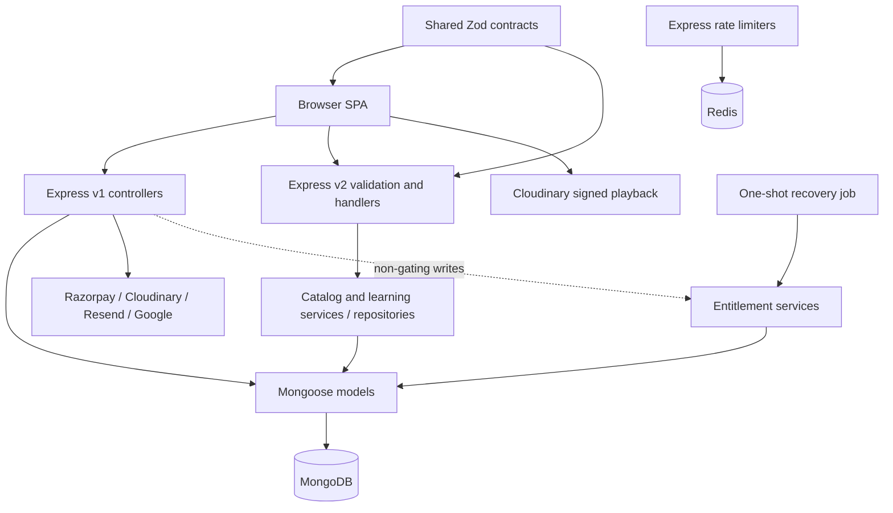

# Architecture

## Composition and boundaries

The API is one deployable process, not microservices. Provider calls are synchronous request-side operations with bounded helpers where implemented. No application message broker, Socket.IO/WebSocket endpoint, permanent worker pool, or generic background queue was found. Entitlement recovery is a separately invoked one-shot process.

## Frontend dependency direction

`apps/web/src/app` owns providers, store, router, and bootstrap. `pages` compose route screens. `widgets` compose reusable screen regions. `features` express user actions. `entities` own reusable domain state/API/presentation. `shared` owns framework-neutral helpers, transport, styling, and primitive UI. Imports may skip downward layers. Different features may not import each other; a page or widget composes them instead. Public `index.js` entries make domain surfaces discoverable. `@/` resolves to `apps/web/src` in Vite and TypeScript.

`scripts/check-architecture.mjs` validates direction, selected public boundaries, and raw transport restrictions for UI/pages. It scans JS-family extensions (not all future TS files) and only bounded backend directories. This is a useful guard, not a formal dependency proof or a complete linter for old controllers. Current check reports 218 frontend and 29 bounded backend source files; tests/support are handled according to script exclusions.

## Backend paths

| Layer                    | Responsibility                                                                     | Concrete examples                                                                          |
| ------------------------ | ---------------------------------------------------------------------------------- | ------------------------------------------------------------------------------------------ |
| Entry/bootstrap          | Own environment loading, dependencies, startup, shutdown                           | `apps/api/index.js`, `bootstrap/createApiRuntime.js`, `bootstrap/createServerLifecycle.js` |
| App composition          | HTTP middleware, router mounts, terminal handlers                                  | `app/createApp.js`, `app/registerRoutes.js`                                                |
| v1 controllers           | Validation, authorization predicates, orchestration, direct model/provider calls   | `controllers/Auth.js`, `Course.js`, `payments.js`, `profile.js`                            |
| v2 boundary              | Strict request parsing and controller adaptation                                   | `routes/CatalogV2.js`, `LearningV2.js`, `shared/http/validateV2Request.js`                 |
| Domains                  | Business decisions, mapping, data access separation                                | `domains/catalog/*`, `domains/learning/*`                                                  |
| Operational domains      | Read-only consistency classification and non-authoritative entitlement convergence | `domains/enrollment/*`, `domains/entitlement/*`                                            |
| Persistence/integrations | Schema constraints, connection management, SDK wrappers                            | `models/*`, `config/*`, `utils/*`                                                          |

The intended modular-monolith design in ADR 0011 is only partly migrated. There are no implemented feature modules under `apps/api/modules` yet. Large controllers are current business logic, not thin wrappers one can ignore.

## State and authority

| Question                                              | Current authority                                                             |
| ----------------------------------------------------- | ----------------------------------------------------------------------------- |
| Who is signed in and allowed to act?                  | Verified JWT identity plus freshly loaded User state/role/sessionVersion      |
| Which paid lessons may this Student open?             | Course's `studentsEnroled` membership plus curriculum membership              |
| Which courses does the enrolled dashboard list?       | Student User's `courses` mirror                                               |
| What was bought, for how much, and with which policy? | Immutable Purchase snapshots and verified provider state                      |
| Which lessons are complete?                           | Unique CourseProgress per learner/course, intersected with current curriculum |
| Does Entitlement grant access?                        | Not yet; it records sidecar state for migration/recovery                      |
| What is the checkout total?                           | Backend current Course prices captured into integer-paise Purchase line items |
| What does the browser cache?                          | RTK Query catalog/learning responses; local cart metadata, not authorization  |
| What does Redis cache?                                | No product cache; Redis stores shared rate-limit counters                     |

## Contract boundary

`packages/contracts/src/common.js`, domain schemas, and `registry.js` feed `openapi.js`. Strict DTOs prevent accidental credential, financial-provider, or protected-media leakage in v2. Request schemas parse into locals because Express 5's query property must not be reassigned. Catalog and learning services validate their outputs. Catalog accepts legacy image strings; this specific compatibility rule should not be replaced with a generic URL assumption.

OpenAPI describes only `GET /api/v2/courses`, `GET /api/v2/learning/courses/{courseId}`, and `PUT /api/v2/learning/courses/{courseId}/lessons/{lessonId}/progress`. Auth/commerce/admin contract definitions are future boundaries; v1 responses can differ. The broad `progressUpdateRequestSchema` is not the live PUT body: the wired learning operation accepts an empty object and marks the path lesson complete.

## Consistency and failure design

Checkout reservations and unique indexes prevent competing active purchases; compare-and-set updates protect state transitions. Enrollment still writes several collections sequentially with compensation, so a crash can leave mirrors inconsistent. The enrollment audit classifies evidence and explicitly refuses automatic repair. Entitlement recovery uses revisions, leases, DB time, bounded scans, private checkpoints, and evidence rechecks; it never repairs legacy mirrors or changes current authorization.

A processed provider refund is persisted before legacy access cleanup completes, making retries possible. Account deletion is also resumable: a pending flag restricts the account until media/data cleanup and anonymization succeed. These are application state machines, not distributed transactions.

## Deployment separation

Local development runs Vite/API separately; local Compose runs web/API in different containers and uses an absolute browser API URL. The release Nginx proxy instead expects API and web to share task loopback. Same-origin and separate-origin public configurations have explicit environment validators. See [DOCKER](DOCKER.md) and [DEPLOYMENT](DEPLOYMENT.md) before treating these layouts as interchangeable.

## Design history

`docs/architecture/0001` through `0011` record incremental productization, catalog, contracts, React/TS, Router, Tailwind, Mongoose, learning, audit, entitlement design, and workspace modularization. Earlier paths/version statements describe their historical stage. ADR 0010 contains substantial **proposed** migration behavior beyond current Stage 2. Current source and later implementation evidence take precedence.
