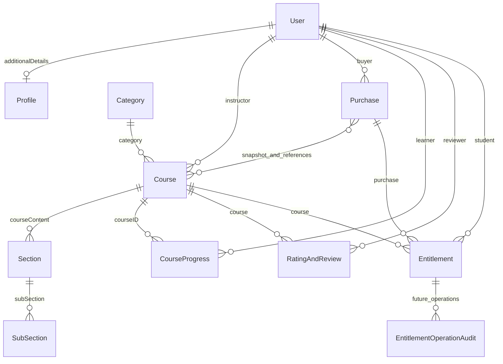

# Database and persistence

## Technology and connection management

MongoDB with Mongoose 9.9.1; local/integration Compose uses MongoDB 8. `apps/api/config/database.js` sets bounded query/driver timeouts, pool limits, connection readiness events, and explicit disconnect. `utils/mongoDeployment.js` validates URI/deployment posture and supplies one-shot options. Production uses TLS/authenticated non-loopback targets and disables automatic index creation; indexes are an explicit release operation. MongoDB deployment existence, backups, replicas, and cloud ACLs are not verified by source inspection.

## Conceptual model

These are conceptual cardinalities, not enforced foreign keys. Course↔User enrollment and Category/User↔Course arrays duplicate some relationships. Section has no parent Course field; ownership is resolved through Course.courseContent, then Section.subSection. Native ObjectIds, not merely ID-looking strings, matter to operational financial evidence.

## Model inventory

All definitions live in `apps/api/models`.

| Model file / registered name                                 | Important stored fields                                                                                                                                                                                                                                                                                 | Constraints, responsibility, consumers                                                                                                                                          |
| ------------------------------------------------------------ | ------------------------------------------------------------------------------------------------------------------------------------------------------------------------------------------------------------------------------------------------------------------------------------------------------- | ------------------------------------------------------------------------------------------------------------------------------------------------------------------------------- |
| `User.js` / `user`                                           | Names, normalized email, hidden password/googleId, authProviders, accountType, active/approved, instructorApprovalStatus/review audit, Profile reference, courses/courseProgress arrays, avatar/publicId, sessionVersion, policyAcceptances, deletion/payment locks, reset hash/expiry and legacy token | Unique email and sparse Google identity; instructor queue index; sensitive select/serialization guards. Auth, all protected requests, enrollment, dashboards, account lifecycle |
| `Profile.js` / `Profile`                                     | Gender, dateOfBirth string, about, contactNumber                                                                                                                                                                                                                                                        | User.additionalDetails reference; bounded fields; no automatic timestamps. Profile CRUD/deletion                                                                                |
| `OTP.js` / `OTP`                                             | Unique normalized email, hidden otpHash, attempts, expiresAt, createdAt                                                                                                                                                                                                                                 | TTL index expiresAt with expireAfterSeconds 0; app also checks expiry/attempts. Signup only                                                                                     |
| `Category.js` / `Category`                                   | Name, description, courses mirror, timestamps                                                                                                                                                                                                                                                           | Unique trimmed name up to 120; description up to 1,000. Public category lists, course authoring/catalog                                                                         |
| `Course.js` / `Course`                                       | Instructor/category refs, name/description/benefits, price, thumbnail + hidden publicId, tags/instructions, ordered courseContent, ratingAndReviews, `studentsEnroled`, optional level/language, status, everPublishedAt, archivedAt/by                                                                 | Draft/Published/Archived; positive bounded INR major-unit price; metadata bounds; instructor/category/status/catalog indexes. Commerce, catalog, learning, authoring            |
| `Section.js` / `Section`                                     | sectionName, subSection refs, timestamps                                                                                                                                                                                                                                                                | Bounded title, ordered lessons. Parent ownership through Course                                                                                                                 |
| `Subsection.js` / `SubSection`                               | title, description, timeDuration string, videoUrl, hidden videoPublicId/videoFormat/videoDeliveryType, timestamps                                                                                                                                                                                       | Upload/authenticated metadata, bounded titles/descriptions. Media ownership/publishing/playback                                                                                 |
| `RatingandReview.js` / `RatingAndReview`                     | user, course, rating, review, timestamps                                                                                                                                                                                                                                                                | Rating integer 1–5, review bounded; unique user+course. Review create/public sanitized feed and catalog aggregation                                                             |
| `CourseProgress.js` / `courseProgress`                       | userId, `courseID`, completedVideos, timestamps                                                                                                                                                                                                                                                         | Unique userId+courseID; completion `$addToSet`; never grants access. Learning v1/v2, dashboards, deletion/refund cleanup                                                        |
| `Purchase.js` / `Purchase`                                   | User/course refs, immutable lineItems/course names/amounts, total paise/INR, receipt, provider IDs, checkout/idempotency keys, activeCourses, expiry, lifecycle/refund/lock/audit fields, immutable policy snapshot                                                                                     | Unique receipt/provider IDs and partial active reservation keys; retained financial history; see lifecycle below                                                                |
| `Entitlement.js` / `Entitlement`                             | schemaVersion, immutable student/course/purchase/source, isCurrent, status, revision, grant/revoke/cancel fields, private retry/lease/manual/migration/replacement metadata                                                                                                                             | Strict schema, write-once identity, state-policy validation, private transform; one episode per purchase/course and one current episode per learner/course                      |
| `EntitlementOperationAudit.js` / `EntitlementOperationAudit` | Immutable operation ID, entitlement/actor/action/reason/revision and requested/succeeded/failed/conflict outcome                                                                                                                                                                                        | Four indexes; provisioned/tested future private admin audit; no active public workflow                                                                                          |

## Index guarantees

`Course.js` has general status/category and instructor/created indexes plus named catalog indexes for newest/category-newest, price/category-price, and text search over name/tags/description. Derived rating/popularity/duration queries still need aggregation; an index on price does not accelerate every catalog sort.

User email/Google uniqueness prevents duplicate identities; Category name uniqueness does not by itself establish case-insensitive collation. OTP TTL is cleanup, not authorization expiry. Review and progress pair indexes are essential to idempotent creation/upsert under races. Purchase's sparse provider uniqueness prevents one captured provider payment/refund being attributed twice, and partial indexes for activeCourses/checkoutKey/idempotencyKey prevent conflicting active reservations. Entitlement has seven indexes covering immutable natural identity, current learner/course uniqueness, access scans, recovery and migration; its audit model has four.

`apps/api/scripts/create-indexes.js` uses createIndexes and diffIndexes across all 12 models. It refuses a mutation without confirmation and checks missing declarations. It does not run syncIndexes to destructively drop extra indexes. Tests with stubs confirm declarations; real database enforcement requires integration/preflight.

## Financial state and money

Course/catalog use major INR (for example a course price), while Purchase stores integer paise (`Math.round(price * 100)`) and immutable purchased names/amounts. Browser totals never authorize charges. Line-item snapshots support revenue history after a later price/name change. Policy versions, acknowledgement time, and refund window belong to the purchase snapshot.

Purchase states: `created`, `order_created`, `paid`, `fulfilled`, `failed`, `expired`, `payment_review`, `refund_pending`, `refund_requested`, `refunded`. A created order is not proof of capture; a capture must be matched by signature/provider evidence. `activeCourses` participates in reservations and lifecycle cleanup, not a universal course-access authority. Paid intermediate state can indicate interrupted fulfillment and must not be casually treated as completed enrollment. Refund request retains access; confirmed refund cleanup revokes it unless another qualifying purchase protects the course.

## Entitlement state and recovery

Provisioning may activate or cancel; active may revoke; terminal episodes do not reopen. Immutable provenance, revision fences, current-episode uniqueness, and write-once financial dates are enforced by model/policy/repository layers. Only qualifying purchases created and paid on/after `ENTITLEMENT_SIDECAR_STARTED_AT` are eligible for Stage 2 sidecars. Evidence checks require native IDs, exact course/line-item sets, bounded positive financials, eligible user/course, and appropriate timestamps/status.

Sidecar reserve/activation wraps legacy payment fulfillment under a shared five-second deadline and does not control payment success. Activation rechecks fulfilled purchase and legacy mirrors/progress. Refund/account deletion terminalize matching episodes. There is no historical backfill or active replacement-selection operation.

Recovery uses DB time, 60-second leases, revision compare-and-set, default batch 25 (max 100), approximately 45-second work budget, and bounded raw purchase cursor scans. Provisioning begins due after a minute; retry schedule escalates through 5 minutes, 30 minutes, 2 hours, and 12 hours, with five-attempt / 24-hour handoff boundaries. Operator reports are aggregate, with no identity/cursor logging. Scheduler state is a private atomic checkpoint. See runbook/source before operational use.

## Integrity limits and operational repair

MongoDB refs do not enforce relational integrity. Course/User/Category mirrors, curriculum references, progress and Purchase state can diverge after sequential-write failures. Existing compensation and unique indexes reduce but do not eliminate crash windows. Published/history-bearing course deletion archives instead of destroying learner content; curriculum physical deletion is restricted to safe unsold never-published drafts. Course completion is computed from surviving current lesson IDs, so stale progress does not inflate percentages.

Account deletion anonymizes and inactivates User while retaining Purchase/policy evidence, an intentional non-cascade relationship. Instructor course history blocks self-delete. Cloudinary and database writes cannot be committed in one atomic transaction; asset cleanup can fail independently.

The enrollment consistency domain classifies scenarios A–F (User-only mirror, Course-only/no qualifying purchase, qualifying purchase without mirrors, orphan progress, processed refund with surviving mirror, paid partial fulfillment) plus corrupt/missing references and intentional deletion cases. Reports can propose dry-run investigation but every proposal is unsafe for automatic repair. `backfill-security-fields.js` only fills legacy security/profile defaults; it is not an enrollment repair or a full migration framework.
