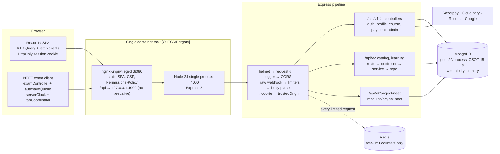

# 01 — Existing Architecture Audit (Prahit NEET mock examinations)

|                                             |                                                                                                                                                                      |
| ------------------------------------------- | -------------------------------------------------------------------------------------------------------------------------------------------------------------------- |
| Audit date                                  | 2026-10-10                                                                                                                                                           |
| Branch / commit                             | `project-neet` @ `262abbd` (1 commit ahead of `main`, 0 behind; identical to `origin/project-neet`)                                                                  |
| Working tree                                | 35 modified + ~45 untracked files, all branding/auth-scene/footer/e2e work. **No uncommitted change touches the NEET exam engine, its API module or its contracts.** |
| Runtime used for checks                     | Node `24.19.0` (`/opt/homebrew/opt/node@24/bin`); the machine default is Node 26, outside `engines: >=24 <25`                                                        |
| Application behaviour changed by this audit | **None.** This file is the only addition.                                                                                                                            |

## 0. How to read this document

Every claim carries an evidence label.

- **[O] Observed.** Seen in source, or produced by a command run during this audit.
- **[I] Inferred.** Reasoned from observed code but not executed or measured.
- **[C] Claimed.** Stated in existing documentation and **not** re-verified.

Paths are repository-relative. `neet/` abbreviates `apps/api/modules/project-neet/`.

**Headline finding.** This is not a greenfield build. Commit `262abbd` already ships a working **Project NEET** vertical slice:

- server-authoritative timer
- sequenced idempotent autosave
- compare-and-set attempt lifecycle
- server scoring
- practice and proctored modes
- event-only proctoring
- Playwright coverage

The right strategy is to **harden and extend that module**, not to build a parallel `domains/exams` stack. Section 7 grades the existing slice against the product brief.

---

## 1. Source discovery and extraction status

| Item                                                   | Status                                                                                                                           |
| ------------------------------------------------------ | -------------------------------------------------------------------------------------------------------------------------------- |
| Runnable repository                                    | **Present [O].** npm workspaces with `apps/web`, `apps/api` and `packages/contracts`. No reconstruction was needed or performed. |
| `PROJECT_CONTEXT.md`                                   | Present (10 KB). Its audit baseline is `7b367c0`, which predates the NEET commit.                                                |
| `STUDYNOTION_AI_CONTEXT.md`                            | Present (223 KB). A derived navigation aid that predates `262abbd`.                                                              |
| `STUDYNOTION_CODEBASE.md`                              | Present (2.3 MB). A Markdown source export. **Older than the live source; not used as a source of truth.**                       |
| `STUDYNOTION_GROWED_UI_UX_REDESIGN.md`                 | Present (62 KB). Redesign brief.                                                                                                 |
| `Project-NEET-—-Master-Context-&-Product-Research.txt` | **Missing [O].** Not found anywhere in the repo.                                                                                 |
| `docs/project-neet/IMPLEMENTATION_REPORT.md`           | Present. Self-reported delivery report for the existing NEET slice. Its claims are spot-verified below.                          |
| `docs/runbooks/`, `docs/decisions/`                    | Present but **empty [O]**.                                                                                                       |
| Stash                                                  | `stash@{0}`: "local env staging change before main sync". Not inspected for values; it may contain environment data.             |
| Backup branches                                        | `backup/local-main-before-sync`, `backup/pre-modernisation-staged-2026-07-27`                                                    |

### 1.1 Repository tree (abridged, depth 2–3)

```text
.
├── apps/
│   ├── api/                       Express 5 API + operational CLIs
│   │   ├── app/                   createApp.js, registerRoutes.js
│   │   ├── bootstrap/             createApiRuntime.js, createServerLifecycle.js
│   │   ├── config/                env.js, database.js, redis.js, razorpay.js, cloudinary.js
│   │   ├── controllers/           v1 "fat" controllers (payments.js = 2,113 lines) + CatalogV2/LearningV2
│   │   ├── domains/               catalog, learning, enrollment (audit), entitlement (sidecar)
│   │   ├── modules/project-neet/  ← existing NEET exam module (5.3k LOC)
│   │   ├── middleware/            auth.js, rateLimiters.js, trustedOrigin.js, …
│   │   ├── models/                12 Mongoose models
│   │   ├── routes/                v1 + CatalogV2/LearningV2 routers
│   │   ├── scripts/               seed, create-indexes, preflight-production, provision-admin, …
│   │   ├── shared/http/           validateV2Request, v2 envelopes, errorHandler
│   │   └── test/                  node:test unit + opt-in integration suites
│   └── web/                       React 19 SPA (Vite), nginx runtime image
│       └── src/{app,pages,widgets,features,entities,shared}   (FSD-style layers)
├── packages/contracts/            Zod 4 schemas + generated OpenAPI 3.1 (incl. src/neet.js, 741 lines)
├── e2e/                           Playwright specs (catalog, learning, project-neet, ui-transformation, live-stack)
├── scripts/                       check-architecture, scan-secrets, validate-release-pair, run-neet-integration
├── docs/                          ai-context/, architecture/ (ADRs 0001–0011), operations/, project-neet/, growed-redesign/
├── compose.{local,integration,operations}.yml
└── playwright.{,live,neet,ui}.config.mjs
```

---

## 2. Verified technology stack

| Concern         | Historical claim                                        | Verified current state                                                                                                                                                                                     |
| --------------- | ------------------------------------------------------- | ---------------------------------------------------------------------------------------------------------------------------------------------------------------------------------------------------------- |
| Runtime         | Node 24                                                 | `engines >=24 <25`, `.nvmrc` 24, API image `node:24-bookworm-slim` (digest-pinned) **[O]**                                                                                                                 |
| Frontend        | React 19, React Router, Vite, Tailwind 4, RTK/RTK Query | Confirmed **[O]**. Router is v8 (ADR 0005). See §6.                                                                                                                                                        |
| Backend         | Express 5, Mongoose, Redis                              | Express 5, Mongoose 9, node-redis 6.1 **[O]**                                                                                                                                                              |
| Database        | MongoDB                                                 | Mongo 8.0 in Compose/CI. The NEET integration run used Homebrew mongod **7.0.37** standalone **[O]**. Production requires `w=majority`, TLS and primary reads (`utils/mongoDeployment.js:44-140`) **[O]**. |
| Redis use       | Rate limiting                                           | **Rate limiting and readiness only** (`config/redis.js`). No cache, queue or session store **[O]**.                                                                                                        |
| Contracts       | Zod + OpenAPI                                           | Zod 4 strict schemas, generated `openapi.json`, CI drift check **[O]**                                                                                                                                     |
| Payments        | Razorpay                                                | Orders, verify, webhook (HMAC on raw body), refunds, admin reconciliation **[O]**. Course-only (§4.6).                                                                                                     |
| Media           | Cloudinary                                              | Signed authenticated video delivery **[O]**. NEET question media is restricted to same-origin `/project-neet/media/*` paths **[O]**.                                                                       |
| Auth providers  | Email OTP, Google                                       | Confirmed **[O]**                                                                                                                                                                                          |
| Email           | Resend                                                  | Native `fetch`, 10 s timeout, awaited inline **[O]**                                                                                                                                                       |
| Testing         | Vitest, Playwright                                      | Vitest (jsdom), `node --test`, Playwright (4 configs), axe-core **[O]**                                                                                                                                    |
| CI              | GitHub Actions                                          | `ci.yml` (5 jobs) and `security.yml` (secret scan, dependency review, CodeQL). **No deploy job [O].**                                                                                                      |
| Deployment      | AWS                                                     | **[C]** ECS/Fargate same-origin task (nginx :8080 → loopback API :4000). The repository has **no IaC, task definitions or registry push [O]**.                                                             |
| Observability   | —                                                       | Custom redacting JSON logger only. **No metrics, tracing, APM or error reporting [O].**                                                                                                                    |
| Background jobs | —                                                       | **None.** No queue, cron or `setInterval` jobs in `apps/api` **[O]**.                                                                                                                                      |
| Load testing    | —                                                       | **None.** No k6, Artillery, autocannon or similar anywhere **[O]**.                                                                                                                                        |
| Transactions    | —                                                       | **None.** No `startSession`/`withTransaction` in `apps/api`. Consistency relies on single-document CAS plus compensation **[O]**.                                                                          |

---

## 3. Existing architecture



---

## 4. Platform backend (outside the NEET module)

### 4.1 Startup and lifecycle [O]

- `apps/api/index.js` → `bootstrap/createApiRuntime.js:4-15` → `app/createApp.js` and `bootstrap/createServerLifecycle.js`.
- `startServer` (`createServerLifecycle.js:22-37`):
  - connects Mongo, then Redis, then Cloudinary
  - calls `listen`
  - sets `requestTimeout` 120 s, `headersTimeout` ≤ 60 s, `keepAliveTimeout` **5 s**, `maxRequestsPerSocket` 1000
- One Node process per container. No cluster or worker threads.
- Shutdown sequence (`createServerLifecycle.js:54-95`):
  - flips readiness to 503
  - closes the server and destroys Redis and Mongo
  - force-exits after 10 s
  - **There is no drain delay** between the readiness flip and `server.close()`.
- Health endpoints:
  - `GET /health/live` (`createApp.js:74`)
  - `GET /health/ready` (`createApp.js:83-97`) reads cached `isReady` flags for Mongo, Redis, Cloudinary and shutdown.

### 4.2 Middleware order [O]

`createApp.js:21-108` with `registerRoutes.js:29-68`:

1. `trust proxy`, then helmet (HSTS in production).
2. Request ID: accepts a valid client `x-request-id`, otherwise generates a UUID.
3. HTTP request logger: one synchronous JSON line per request.
4. CORS allow-list with `credentials: true`.
5. `/health/*`.
6. `POST /api/v1/payment/webhook`: `webhookLimiter` → `express.raw(256kb)`, registered **before** JSON parsing.
7. `/api/v1` uses `apiLimiter`.
8. `/api/v2` uses `normalizeV2ErrorEnvelope` and `v2ApiLimiter`. The latter skips the shared limiter **only** for `/project-neet/attempts/*`.
9. `express.json(100kb, strict)`, then `urlencoded`, then `cookieParser`.
10. `requireTrustedBrowserOrigin` on v1 and v2. Mutations require an allow-listed `Origin`; with no `Origin`, only `sec-fetch-site: cross-site` is rejected (`middleware/trustedOrigin.js:15-35`).
11. Routers are mounted at `registerRoutes.js:60-68`:
    - `/api/v2/learning`
    - `/api/v2/project-neet`
    - `/api/v2` (catalog, which owns the v2 catch-all 404)
    - the v1 routers
12. `notFoundHandler`, then `errorHandler`.

### 4.3 Authentication and authorisation [O]

- **Token source** (`utils/auth.js:67-71`): `Authorization: Bearer`, then the HttpOnly cookie (default name `studynotion_session`), then the legacy `token` cookie.
- **JWT.** HS256 with fixed issuer and audience and a **fixed 12-hour lifetime with no refresh** (`utils/auth.js:5,13-30`).
- **Every authenticated request performs a primary MongoDB read** (`middleware/auth.js:38-40`).
  - The read is `User.findById(...).select(... +policyAcceptances)`.
  - It is a **non-lean** Mongoose document with no cache.
  - It rejects on a missing or inactive user, an unapproved user, or a `sessionVersion` mismatch.
- **Additional gates.**
  - `deletionPending` returns 423.
  - A missing current policy acceptance returns **428**. The check compares against the hard-coded `CURRENT_TERMS_VERSION = "2026-07-18"` in `utils/policyAcceptance.js:1`.
- **Roles.** `isStudent`, `isInstructor` and `isAdmin` are exact `accountType` matches (`auth.js:118-139`). Admin accounts come only from `scripts/provision-admin.js`.
- **Session revocation is global.** Logout, a password reset and an admin instructor review all `$inc sessionVersion` (`controllers/Auth.js:548-566`). This invalidates the user's sessions **on every device**.

### 4.4 Rate limiting (`middleware/rateLimiters.js`) [O]

The library is express-rate-limit 8 on rate-limit-redis 6.

- Keys are SHA-256 hashes of the client IP (with IPv6 subnet grouping), a request field, or the user ID.
- Production requires Redis. Other environments fall back to an in-memory store per process.
- **`passOnStoreError: false`** (`:90`): store failures propagate.

| Limiter                                                         | Window    | Limit                   | Key            |
| --------------------------------------------------------------- | --------- | ----------------------- | -------------- |
| `apiLimiter`: all v1 plus non-attempt v2, **one shared bucket** | 15 min    | 500                     | IP             |
| login IP / identity                                             | 15 min    | 30 / 10                 | IP / email     |
| signup, OTP, reset, contact                                     | 15–60 min | 3–10                    | IP / email     |
| `paymentLimiter`                                                | 1 min     | 20                      | user           |
| `webhookLimiter`                                                | 1 min     | 300                     | IP             |
| `neetAttemptIpLimiter`: runs **before** auth                    | 15 min    | **30,000** (≈ 33 req/s) | IP             |
| `neetAttemptUserLimiter`                                        | 1 min     | 240                     | user           |
| `neetAttemptSessionLimiter`                                     | 1 min     | 120                     | user + attempt |
| `neetRegistrationLimiter`                                       | 60 min    | 30                      | user           |

**Redis failure mode [O, verified].** The failure follows this chain:

1. `config/redis.js:24-27` returns an `Error` from `reconnectStrategy` after 10 retries, so node-redis stops reconnecting.
2. The dead client stays cached in the module-level `client` (`:13-15`) and is never recreated after startup.
3. `sendCommand` then throws `"Redis is not ready"` (`:76-78`).
4. Every rate-limited route returns **500 `INTERNAL_ERROR`** (`shared/http/errorHandler.js`) **until the process restarts**.

That covers NEET autosave, heartbeat and submit, as well as login.

### 4.5 Configuration [O]

- **`config/env.js`** validates at require time and throws on any violation. Production checks enforce:
  - HTTPS same-site origins
  - `rediss://` with a password
  - Razorpay key prefix matched to the deployment tier
  - `MONGODB_AUTO_INDEX=false`
  - `TRUST_PROXY` between 1 and 10
- **Mongo** (`config/database.js:8,38-48`): `maxPoolSize` **20** (cap 200), `minPoolSize` 1, server selection 10 s, CSOT `timeoutMS` 15 s, wait queue 10 s, global `maxTimeMS` 15 s.
- **Indexes.** Production does **not** auto-index. New indexes must go through `scripts/create-indexes.js` (`MIGRATION_CONFIRM=create-indexes`), which also runs a `diffIndexes` verification reused by `preflight-production.js`. NEET models are already registered there (`create-indexes.js:25`).

### 4.6 Payments and access [O]

- **`capturePayment`** (`controllers/payments.js:544+`) runs these steps:
  1. Validates Published courses.
  2. Rejects courses the student is already enrolled in.
  3. Applies `Idempotency-Key` and `checkoutKey` partial-unique indexes.
  4. Takes a 30 s per-user CAS lock.
  5. Creates the immutable `Purchase` (integer paise) and then the Razorpay order.
- **Webhook** (`:820-950`): timing-safe HMAC check on the raw body. Handles `payment.captured` and `order.paid`. Idempotency comes from status CAS and a unique `razorpayPaymentId`. There is **no event-ID dedupe store**.
- **Fulfilment** (`:345-519`) goes `paid` → `enrollStudent` → `fulfilled`, then sends email inline.
  - `enrollStudent` performs a `$addToSet` on `Course.studentsEnroled`, `User.courses` and `User.courseProgress`.
  - It also upserts `CourseProgress`.
- **Access authority.** `Course.studentsEnroled` is what grants access (`domains/learning/learningRepository.js:13-16`).
  - `Entitlement` is a **non-authoritative sidecar** whose failures are swallowed (`payments.js:98-116`).
- **Product typing.**
  - The only product type is Course: `Purchase.lineItems.course` and `Entitlement.courseId` are required Course references.
  - **[I]** Reusing Purchase/Entitlement as NEET exam-access authority would be incorrect. Fulfilment hard-wires course side effects, and Entitlement is not authoritative.
  - **Reusable for NEET:** the Razorpay helpers, timeout wrapper, idempotency-index pattern, raw-webhook mount and admin reconciliation pattern.

### 4.7 Layering and import rules [O]

- **v1** controllers import models directly.
- **v2** is layered: route → controller → service → repository → mapper (`domains/catalog`, `domains/learning`).
- `modules/project-neet` follows domain/services/repositories/http/models with a public `index.js`.
- `scripts/check-architecture.mjs:239-312` enforces these backend rules:
  - `shared` must not import `app`, `bootstrap`, `domains` or `modules`.
  - `domains` and `modules` must not import `app` or `bootstrap`.
  - Cross-module imports must go through `index.js`.
  - `controllers/`, `routes/` and `models/` are **not** checked.
- Frontend layer rules: see §6.

### 4.8 Admin capabilities [O]

`routes/Admin.js:16` applies `auth, isAdmin` to:

- instructor approval
- payment reconciliation (typed confirmation phrase plus a note)
- category creation

There is **no admin capability for NEET** (content, papers, proctoring review) and **no general admin audit log**. `EntitlementOperationAudit` exists but is inert.

---

## 5. End-to-end request flows

### 5.1 Reference v2 flow: `GET /api/v2/courses` [O]

1. **Client query.** `pages/catalog/index.jsx:118` calls `useGetCoursesInfiniteQuery`.
2. **RTK Query.** `entities/catalog/api/catalogApi.js:89-113` uses `fetchBaseQuery({credentials:"include", timeout:15000})`. The URL comes from `shared/api/endpoints.js:23,110`.
3. **Edge middleware.** helmet → requestId → logger → CORS.
4. **v2 entry.** `normalizeV2ErrorEnvelope` → `apiLimiter` (one Redis EVALSHA).
5. **Parsing and origin.** Body parsers, then `trustedOrigin` (GET passes).
6. **Router.** `routes/CatalogV2.js:12-21` → `validateV2Request({query})`, which writes `res.locals.v2Input`.
7. **Controller.** `controllers/CatalogV2.js:10-42`.
8. **Service.** `domains/catalog/catalogService.js:8-35` (cursor decode).
9. **Repository.** `catalogRepository.js:279-281` runs `Course.aggregate` with `$lookup` and `maxTimeMS` 15 s.
10. **Response.** The mapper output is Zod-validated against `catalogCourseListResponseSchema`. The API returns `200 {success, requestId, data:{items, pageInfo}}` with `Cache-Control: private, no-store`.
11. **Client validation.** The client re-validates with `parseCatalogResponse`, then the component renders.

### 5.2 NEET answer save: `PUT /api/v2/project-neet/attempts/:id/responses` [O]

1. **Client queue.** `features/neet-exam/model/autosaveQueue.js` coalesces writes per question. It debounces 700 ms, caps the wait at 3 s, batches up to 50 writes and keeps one request in flight.
2. **Client request.** `entities/neet/api/neetClient.js` sends `{sessionId, responses:[{questionId, selectedOption, markedForReview, timeSpentMs, seq}]}`.
3. **Edge middleware.** helmet → requestId → logger → CORS.
4. **v2 entry.** `v2ApiLimiter` skips the shared bucket for this path. The body is then parsed and the origin checked.
5. **NEET gate.** `neet/http/routes.js:40-46,71` runs `neetAttemptIpLimiter` → `auth` (Mongo user read) → `isStudent` → user limiter → user+attempt limiter. That is **3 Redis round trips plus 1 Mongo read** before any exam logic.
6. **Validation.** `validateV2Request` applies the strict `neetSaveResponsesRequestSchema`: at most 50 writes, no duplicate question IDs, bounded `seq`.
7. **Controller.** `neet/http/controller.js` `execute()` wraps the operation.
8. **Service.** `neet/services/attemptService.js:453-515` `saveResponses` issues **one atomic `findOneAndUpdate`**.
   - The filter is `{_id, userId, status: IN_PROGRESS, activeSessionId, expiresAt > now, responses.questionId $all}`.
   - It uses `arrayFilters` that apply each element only when `stored.seq < incoming.seq`.
   - It applies `$max lastSeq`.
9. **Response.** The service returns the server state of the written questions plus `serverNow`.
   - The global `AutosaveStatus` reports "saved" only when nothing is pending or in flight (`features/neet-exam/model/autosaveQueue.js:123-129,177-185`).
   - **However, the per-question radio and OMR bubble show "Answered" optimistically on click** (`examController.js:203-206`). There is no per-question pending marker.
10. **Failure handling.** If the CAS does not match, the attempt is re-read to classify the error: `SESSION_SUPERSEDED`, `ATTEMPT_SUBMITTED` (expired, finalised lazily), or `QUESTION_NOT_IN_PAPER`.

---

## 6. Frontend platform and design system

Paths are relative to `apps/web/src/`.

### 6.1 Boot, routing and state [O]

**Boot chain**

- `index.html:54` → `app/main.jsx` → `app/bootstrap.jsx:6-17` → `AppProviders` (Redux, `BrowserRouter`, ErrorBoundary, Toaster; `app/providers/AppProviders.jsx:7-15`) → `App` → `SessionBootstrap` → `AppShell` → `AppRouter`.
- `AppShell` (`widgets/app-shell/AppShell.jsx:15,43`) hides the global Navbar on `/project-neet*`.

**Routes** (`app/router/AppRouter.jsx`)

- Every page is `React.lazy`.
- Public NEET pages:
  - `/project-neet`
  - `/project-neet/mocks`
- Student-only NEET pages, via `studentPage()` = `PrivateRoute` + `RoleRoute[Student]` (`:11-15, :74-87`):
  - `/project-neet/mocks/:testId/start`
  - `/project-neet/attempts/:attemptId`
  - `/project-neet/attempts/:attemptId/result`
- Admins cannot open NEET exam pages. A wrong role is silently redirected to `/dashboard/my-profile`.

**Session restore**

- `restoreSession()` → `GET /profile/getUserDetails` using the HttpOnly cookie.
- `auth.token` is a boolean placeholder.
- `installSessionResponseIntegration` maps 401, 423 and 428 to Redux (`features/authentication/model/sessionResponseIntegration.js:24-58`).

**Store** (`app/store/rootReducer.js:11-19`)

- Slices: `auth`, `profile`, `course`, `cart`, `viewCourse`.
- RTK Query APIs: `catalogApi`, `learningApi`.
- NEET does **not** use RTK Query or axios.

**NEET transport** (`entities/neet/api/neetClient.js:53-142`)

- Raw `fetch` with `credentials:"include"` and `no-store`.
- AbortController timeouts: 15 s; 10 s for heartbeat; 30 s for submit.
- **Zod validation of every response.**
- Typed `NeetRequestError` carries `retryAfterMs` and `retryable`.
- Exam-time calls opt out of the app-wide 401 sign-out (`signalSession:false`).

**Architecture rules** (`scripts/check-architecture.mjs:10-235`)

- Layer ranks: shared < entities < features < widgets < pages < app.
- **Features may not import other features.** Exam and proctoring are therefore composed at page level (`pages/neet-exam/index.jsx`).
- UI files may not import axios or `httpClient`.
- Legacy folder names are forbidden.

### 6.2 Current Prahit design system [O]

| Aspect          | Current Prahit (source of truth)                                                                                                                                                                                                                                                                                                                                       |
| --------------- | ---------------------------------------------------------------------------------------------------------------------------------------------------------------------------------------------------------------------------------------------------------------------------------------------------------------------------------------------------------------------- |
| Tokens          | `shared/styles/education.css:2-37` (`--sn-*`) mapped into Tailwind 4 `@theme inline` (`shared/styles/globals.css:132-199`)                                                                                                                                                                                                                                             |
| Brand blue      | `--sn-brand` `#1971cd` (overridden at `:12` by an equivalent `lab()`), action `#1463b5`, hover `#1352a6`, deep `#0f3f86`, blue-soft `#f2f7ff`                                                                                                                                                                                                                          |
| Accents         | mint `#e5f6ee`, peach `#fff0e8`, sun `#ffd23f`, coral `#f0645a`. Status colours: success `#1f7a52`, warning `#9a5b07`, danger `#b42335`.                                                                                                                                                                                                                               |
| Surfaces        | White canvas, muted `#f5f8fc`, ink `#101010`, border `#e5e5e5`. **Light only.** `color-scheme: light` is forced (`globals.css:232`), with no `dark:` classes and no `prefers-color-scheme` rules.                                                                                                                                                                      |
| Type            | Poppins 400–700, self-hosted via fontsource (`AppShell.jsx:8-11`). The auth scene uses Bricolage Grotesque.                                                                                                                                                                                                                                                            |
| Shape and depth | Radius 0.625 rem / 1 rem. Shadows `0 8px 30px rgb(16 24 40 / .06)`, lift `0 14px 40px / .1`.                                                                                                                                                                                                                                                                           |
| Components      | `Button` (`sn-btn` primary/secondary/outline/ghost/destructive; 44 px min height, 8 px radius, weight 500; `education.css:225-299`), `sn-card`/`-raised`/`-tint`/`sn-panel`, `AccessibleDialog` (focus trap, inert siblings, stacking), `FlaskLoader`/`PageLoadingFallback`, `StatusPanel`, `PageIntro`, `ProductCollage("science")`, `ConfirmationModal`, `FormField` |
| Brand mark      | "Glossy Jelly Blob Duo" (`shared/assets/brand/prahit-jelly-duo.webp`, `shared/ui/BrandLogo.jsx`), echoed by the WebGL capsule characters on Home (`pages/home/ui/hero/capsuleScene.js:55-56`). The auth screens use a yeti mascot scene, still in progress per `docs/growed-redesign/PROGRESS.md`. **Most of this branding is uncommitted working-tree work.**         |
| Motion          | No framer-motion/GSAP. `three` is lazy-loaded for the Home capsules and NEET helix. There is a global reduced-motion kill-switch (`globals.css:277-286`) plus JS capability checks (`widgets/neet-hero/lib/heroCapabilities.js:17-56`). `useRevealOnScroll` is IntersectionObserver-based.                                                                             |
| Inconsistency   | A third brand blue, `#075ba4`, is used as `theme-color` (`index.html:10`, `manifest.json`).                                                                                                                                                                                                                                                                            |

### 6.3 NEET area versus Prahit brand [O]

The NEET area is a **separate visual system**, scoped by `widgets/neet-shell/styles/projectNeet.css` (`pn-*`).

**Naming and logo**

- The product is called "Project NEET" throughout:
  - wordmark: `widgets/neet-shell/ui/NeetLogo.jsx:32-45`
  - exam header: `features/neet-exam/ui/ExamShell.jsx:249-258`
  - error copy: `entities/neet/lib/errors.js:13,54`
  - consent text: `features/neet-proctoring/ui/ProctorConsentPanel.jsx:31`
- It uses its own ECG-pulse logo. The Prahit logo does not appear inside NEET.
- The global navbar and footer are replaced by the NEET shell. The only route back is a text link, "← Prahit" (`ProjectNeetShell.jsx:51-56`).

**Palette**

- Accent is `#1a66cc` rather than `#1971cd`/`#1463b5`.
- The exam uses a warm paper canvas `#f8f7f3` with a **teal accent `#0d6e66`**.
- Subject colours: physics `#1a66cc`, chemistry `#9d4c1c`, botany `#1f7a52`, zoology `#9c3562`.

**Components**

- `pn-btn`: 14 px radius, weight 700, coloured shadow.
- `pn-card`: gradient.
- `pn-skeleton`/`pn-spinner` are used instead of FlaskLoader.
- `NeetResourceStatus` is used instead of StatusPanel.
- `.pn-display` sets tracking to −0.035 em and line-height to 0.95, against `sn-display` at −0.01 em / 1.15.
- A stale comment still refers to the "StudyNotion ivory foundation".

**Aligned parts**

- Poppins is used for the experience pages.
- `NeetHero` reuses `sn-container`, `sn-hero-grid` and `ProductCollage`.

**Navigation entry points**

- The navbar catalog dropdown and the footer link to "Project NEET".
- The student dashboard sidebar has **no** NEET entry.

**Verdict**

- The exam-taking UI itself is good: calm, legible (Atkinson Hyperlegible Next), with non-colour-only OMR states.
- The brand layer around it diverges from Prahit and should be re-skinned onto `--sn-*` tokens and the Prahit mark. It should not be rebuilt.

### 6.4 Content honesty [O]

- No fabricated metrics, testimonials, percentiles or rank predictions appear on live NEET or Home pages.
- Hard-coded stats such as "5K Active Students…" exist in `pages/about/ui/Stats.jsx:1-6`, but that file is **dead code** (it has no importers). `pages/home/ui/sections/NeetCallout.jsx` is also unused.
- **Two overclaims in the NEET landing copy:**
  - "answers wait safely on your device" if Wi-Fi drops (`pages/neet-landing/index.jsx:25`). This is false across tabs and crashes; see F-3 in §7.5.
  - Practice mode includes "a detailed result" (`:163-166`). The result is summary-only.

### 6.5 Candidate data collected [O]

- `CandidateDetailsForm` requires **full name, email and mobile phone**:
  - prefilled from the profile (`features/neet-onboarding/lib/candidateValidation.js:37-43`)
  - stored on every attempt (`NeetAttempt.js:202-206`)
  - the phone number has no stated purpose
- There is no age capture and no guardian flow. The under-18 notice in the consent panel is advisory text only (`ProctorConsentPanel.jsx:121-125`).

---

## 7. The existing Project NEET slice — graded against the product brief

### 7.1 Inventory [O]

| Layer       | Files                                                                                                                                                                                                                                                                                                 |
| ----------- | ----------------------------------------------------------------------------------------------------------------------------------------------------------------------------------------------------------------------------------------------------------------------------------------------------- |
| API module  | `neet/{config,content,domain,http,models,repositories,services}`, 27 files, ~5.3k LOC                                                                                                                                                                                                                 |
| Models      | `NeetMockTest`, `NeetQuestion`, `NeetAttempt` (embedded paper, responses, result, proctoring), `NeetProctorEvent` (180-day TTL)                                                                                                                                                                       |
| Contracts   | `packages/contracts/src/neet.js` (741 lines), exported as `@studynotion/contracts/neet`, included in OpenAPI                                                                                                                                                                                          |
| API surface | `/api/v2/project-neet/{tests, tests/:id, attempts, attempts/:id, …/ready, …/start, …/session, …/responses, …/heartbeat, …/proctor-events, …/submit, …/result}`                                                                                                                                        |
| Web         | `pages/neet-{landing,mocks,onboarding,exam,result}`, `features/neet-{exam,onboarding,proctoring}`, `entities/neet`, `widgets/neet-{shell,hero}`                                                                                                                                                       |
| Content     | `neet/content/sampleQuestionBank.js`. **Self-declared "not reviewed by subject-matter experts"**; numerical items are template-generated. Three sample mocks: a 25-minute mini, a **180-question / 180-minute full mock** (Physics, Chemistry, Botany, Zoology × 45) and a 15-minute proctored drill. |
| Seeding     | `apps/api/scripts/seed-project-neet.js`, guarded by `STUDYNOTION_DEMO_SEED_MODE` and a disposable-confirmation variable                                                                                                                                                                               |

### 7.2 What is sound and should be kept [O]

1. **Server-authoritative timing.**
   - `start` writes `startedAt` and `expiresAt` exactly once with a CAS from READY (`attemptService.js:386-431`).
   - Network grace is fixed at 0 for new attempts (`:387`).
   - Every write requires `expiresAt > now` on the **server** clock (`:482`).
2. **Explicit state machine** with CAS predicates derived from a transition table (`neet/domain/attemptStateMachine.js`):
   - `REGISTERED → READY → IN_PROGRESS → SUBMITTING → SUBMITTED | AUTO_SUBMITTED`
   - plus `EXPIRED` and `TERMINATED`
3. **Lost-update protection.** Per-question `seq` with `arrayFilters` `seq < incoming` makes retries idempotent, and an older write can never overwrite a newer one (`attemptService.js:453-488`).
4. **Single logical submission.**
   - Submission is two CAS steps: `IN_PROGRESS → SUBMITTING` freezes answers, then `SUBMITTING → final` writes the result once (`services/lifecycle.js:24-120`).
   - Any later reader completes an interrupted finalisation (`ensureFresh`, `:126-180`).
   - Submit-vs-expiry and save-vs-submit races are covered by real-Mongo tests.
5. **One open attempt per student per test.** Enforced by a partial unique index on `isOpen` (`NeetAttempt.js:273`). A concurrent registration that loses on the index converges on the winner (`attemptService.js:160-166`).
6. **Single active session.**
   - Each start or resume claims `activeSessionId`.
   - The old tab is locked by the server predicate, and BroadcastChannel coordination happens client-side.
   - A takeover after a crash or sleep (previous session silent for more than 120 s) is **not** treated as a policy event (`attemptService.js:285-342`).
7. **Answer-key secrecy.**
   - `answerKey` and `explanation` are `select:false` and stripped in `toJSON`/`toObject` (`NeetQuestion.js:83-122`).
   - Student questions use an explicit projection (`repositories/testRepository.js:34-37`).
   - The strict contracts cannot represent keys.
   - Cross-user access returns 404.
8. **Stateless API for exam state.** No in-process timers or maps hold exam state, so horizontal scaling is safe **[I]**.
9. **Embedded responses on the attempt document.** This is the right trade-off for a bounded 180-question paper. It gives single-document atomicity for save and freeze without transactions, of which the platform has none.
10. **Event-only proctoring with no media upload** (`mediaStorage: "NONE"`, enforced in `resolveProctorPolicy`).
    - Uncertain camera, face and audio signals **cannot** contribute to automatic submission, even with stored overrides (`domain/proctorPolicy.js:20-28,123-126`).
    - Practice mode never requests devices.

### 7.3 Gap matrix against the brief

| Brief requirement                                                                                 | State                                    | Evidence / note                                                                                                                                                                                                                                                                                                                                                                                                                                                  |
| ------------------------------------------------------------------------------------------------- | ---------------------------------------- | ---------------------------------------------------------------------------------------------------------------------------------------------------------------------------------------------------------------------------------------------------------------------------------------------------------------------------------------------------------------------------------------------------------------------------------------------------------------- |
| Full NEET 180 Q / 180 min / 720 marks                                                             | **Partial.** Sample only.                | Configuration is correct (4 sections × 45, +4/−1). The content is unreviewed sample material.                                                                                                                                                                                                                                                                                                                                                                    |
| Physics, Chemistry and Biology 60-minute sprints (45 Q)                                           | **Missing (configuration plus content)** | The model supports single-section tests (`NeetMockTest.sections` 1–12); none is seeded.                                                                                                                                                                                                                                                                                                                                                                          |
| Versioned exam pattern                                                                            | **Partial**                              | `NeetMockTest.version` and per-test marking exist. There is no pattern registry or academic-year field.                                                                                                                                                                                                                                                                                                                                                          |
| Multiple accepted answers                                                                         | **Supported**                            | `answerKey.correctOptionKeys[]` (`NeetQuestion.js:39-48`, `scoring.js:85`)                                                                                                                                                                                                                                                                                                                                                                                       |
| Question cancellation / bonus marks                                                               | **Missing**                              | Scoring has only CORRECT, INCORRECT and UNANSWERED outcomes (`domain/scoring.js:80-91`).                                                                                                                                                                                                                                                                                                                                                                         |
| Answer-key correction and rescoring                                                               | **Missing**                              | Results are written once (`lifecycle.js:73-84`) and `NEET_SCORING_VERSION` is a constant. There is no key version and no rescore job.                                                                                                                                                                                                                                                                                                                            |
| **Frozen paper per attempt**                                                                      | **Defective**                            | The paper snapshot stores only `questionId`, `revision` and marks (`NeetAttempt.js:24-49`). Question text is re-read **live** on every session build (`attemptService.js:91-101` → `testRepository.js:34`). Answer keys are read **live** at finalisation (`lifecycle.js:38`). `revision` is recorded but never enforced. Editing a question mid-exam changes what active students see and the key they are scored against. The module README acknowledges this. |
| Reusable question bank                                                                            | **Missing**                              | `NeetQuestion.testId` is required and immutable (`NeetQuestion.js:49-55`). Each question belongs to one test.                                                                                                                                                                                                                                                                                                                                                    |
| Taxonomy (chapter, microtopic, concept, difficulty)                                               | **Missing**                              | There is only a free-text `topic` (`:94`). There is no per-question difficulty.                                                                                                                                                                                                                                                                                                                                                                                  |
| Review workflow (draft → reviewed → approved) and source/licence metadata                         | **Missing**                              | `status` is `ACTIVE                                                                                                                                                                                                                                                                                                                                                                                                                                              | RETIRED` only (`:95-100`). |
| Admin question bank, import, paper assembly, publish                                              | **Missing**                              | Content arrives only through the seed script. There are no admin endpoints or UI.                                                                                                                                                                                                                                                                                                                                                                                |
| Accessibility time accommodations                                                                 | **Missing**                              | `expiresAt = startedAt + durationSeconds` with no per-attempt extension (`attemptService.js:388`).                                                                                                                                                                                                                                                                                                                                                               |
| Server timer, autosave, resume, idempotent submit                                                 | **Implemented**                          | §7.2                                                                                                                                                                                                                                                                                                                                                                                                                                                             |
| Mode A / Mode B on the same engine, mode locked after start                                       | **Implemented**                          | Mode changes are allowed only in pre-start states and reset consent (`attemptService.js:201-234`).                                                                                                                                                                                                                                                                                                                                                               |
| Results: score, counts, accuracy, subject breakdown, time used                                    | **Implemented**                          | `toResult` (`services/dto.js:208-238`)                                                                                                                                                                                                                                                                                                                                                                                                                           |
| Results: question-wise review, explanations, topic performance, comparison with previous attempts | **Missing**                              | `result.questions[]` is **stored but never exposed**. Explanations are never shown.                                                                                                                                                                                                                                                                                                                                                                              |
| Attempt history                                                                                   | **Partial**                              | `GET /attempts` returns the latest 20 with **no pagination cursor** (`attemptService.js:172-199`).                                                                                                                                                                                                                                                                                                                                                               |
| Proctoring review status independent of submission                                                | **Missing**                              | Warnings live on the attempt. There is no review state, reviewer notes, decision or appeal.                                                                                                                                                                                                                                                                                                                                                                      |
| Admin proctor review dashboard                                                                    | **Missing**                              | None                                                                                                                                                                                                                                                                                                                                                                                                                                                             |
| Fair proctoring (no automatic penalty)                                                            | **Conflicts with the brief**             | Auto-submit is on by default (R-6), and a page refresh counts as a violation (F-1, §7.5).                                                                                                                                                                                                                                                                                                                                                                        |
| Background expiry / finalisation                                                                  | **Lazy only**                            | Correctness does not depend on a worker. However, abandoned attempts remain `IN_PROGRESS` in the database until someone reads them, which skews analytics and operations views.                                                                                                                                                                                                                                                                                  |
| Exam access, payments, entitlements                                                               | **Missing**                              | No NEET product, purchase or access control. Every published test is open to any Student.                                                                                                                                                                                                                                                                                                                                                                        |
| Product analytics                                                                                 | **Missing**                              | None                                                                                                                                                                                                                                                                                                                                                                                                                                                             |
| Mock Recovery domain                                                                              | **Missing**                              | The per-question outcomes stored in `result.questions[]` are a usable seed.                                                                                                                                                                                                                                                                                                                                                                                      |
| Load testing (1,000 concurrent)                                                                   | **Missing**                              | No tooling, scripts or results.                                                                                                                                                                                                                                                                                                                                                                                                                                  |
| NEET in CI                                                                                        | **Missing**                              | The NEET integration suite (real Mongo) and NEET e2e are **not run in CI**. The NEET e2e is **fully mocked** (`e2e/project-neet.spec.js:38` intercepts `**/api/**`).                                                                                                                                                                                                                                                                                             |

### 7.4 Additional observations [O unless marked]

- **Hot-path reads are not cached.**
  - Each `start` and `resume` re-reads 180 question documents (`findStudentQuestions`).
  - Each finalisation re-reads 180 answer keys (`findAnswerKeys`).
  - The published paper is effectively immutable, so both are cacheable once the paper is truly frozen **[I]**.
- **Large response validation.** Every response, including the ~180-question exam session, is Zod `safeParse`d before sending (`http/controller.js:33`). This is a CPU cost to measure under the start storm **[I]**.
- **Save response size.** The save CAS projects the full `responses` array (`attemptService.js:487`) and the service then filters it to the written questions. That moves about 20 KB from Mongo per save where ~1 KB is needed **[I]**.
- **Candidate PII duplicated per attempt.** Each registration copies `fullName`, `email` and `phone` (`NeetAttempt.js:202-206`). This duplicates the user profile and requires a phone number from likely-minor users. Its retention is undefined.
- **Proctor events are not atomic with policy state.** The event insert and the attempt policy update span two documents. A crash between them leaves an uncounted event; this is acknowledged in the implementation report.
- **Brand drift.** The module, routes, UI copy and shell are branded "Project NEET" / StudyNotion, and the contracts package is `@studynotion/contracts`. See §6 for the visual divergence.
- **README warning.** `neet/README.md` itself warns "do not edit/reseed active papers or keys". That is an operational constraint which an admin UI would violate.

### 7.5 End-to-end flow verification

The four core flows were traced through client and server source. F-1 to F-3 were re-checked line by line after the frontend review flagged them.

**Status key.**

- ✅ **Correct:** the property holds in the code as traced.
- ⚠️ **Holds with a defect:** the property holds, but a defect is listed with it.
- ❌ **Broken:** the property does not hold.

#### Timer

| Step                                                                                                       | Location                           | Status           |
| ---------------------------------------------------------------------------------------------------------- | ---------------------------------- | ---------------- |
| Server writes `startedAt` / `expiresAt` once, through a CAS from READY                                     | `attemptService.js:386-431`        | ✅               |
| Client display derives from `expiresAt` plus a monotonic `performance.now()` anchor, with RTT/2 correction | `model/serverClock.js:6-37`        | ✅               |
| The anchor is refreshed by start, resume, save, heartbeat and submit (500 ms render tick)                  | `examController.js:298-315,335`    | ✅               |
| Changing the local wall clock cannot extend time                                                           | Server predicate `expiresAt > now` | ✅               |
| Accessibility extensions                                                                                   | —                                  | ❌ Not supported |

#### Autosave

| Step                                                                                                | Location                       | Status                                                                                                                |
| --------------------------------------------------------------------------------------------------- | ------------------------------ | --------------------------------------------------------------------------------------------------------------------- |
| Per-question latest-wins coalescing; debounce 700 ms, max wait 3 s, batch 50, one request in flight | `autosaveQueue.js:21,30,33,96` | ✅                                                                                                                    |
| Backoff from 1 s to 15 s with jitter; honours `Retry-After`                                         | `autosaveQueue.js:158-165`     | ✅                                                                                                                    |
| Server: one atomic `findOneAndUpdate`; each element applied only if `stored.seq < incoming.seq`     | `attemptService.js:453-488`    | ✅                                                                                                                    |
| Stale or duplicate retries cannot overwrite newer answers                                           | Real-Mongo test                | ✅                                                                                                                    |
| Pending writes persisted to `localStorage` on every enqueue                                         | `autosaveQueue.js:65,176`      | ⚠️ See F-3                                                                                                            |
| Offline → online recovery                                                                           | `useExamEngine.js:20-21`       | ⚠️ Relies only on the browser `online` event. An offline `flush()` does not reschedule (`autosaveQueue.js:90-93`).    |
| Question is displayed as saved only after acknowledgement                                           | `examController.js:203-206`    | ⚠️ The header status is truthful; the per-question state is optimistic.                                               |
| `timeSpentMs` per question                                                                          | `examController.js:203`        | ❌ Never computed. The client spreads the server value back unchanged, so time-per-question analytics would be empty. |

#### Submission

| Step                                                                                                     | Location                                         | Status                                                                                                           |
| -------------------------------------------------------------------------------------------------------- | ------------------------------------------------ | ---------------------------------------------------------------------------------------------------------------- |
| Manual submit drains the queue for up to 10 s; on failure, offers "retry" or "submit saved answers only" | `examController.js:249-262`                      | ✅                                                                                                               |
| `IN_PROGRESS → SUBMITTING` freezes answers; `SUBMITTING → final` writes the result once                  | `lifecycle.js:24-120`                            | ✅                                                                                                               |
| Concurrent and duplicate submits converge on a single result                                             | Real-Mongo test                                  | ✅                                                                                                               |
| A premature client `TIME_EXPIRED` is rejected                                                            | `attemptService.js:581-582`                      | ✅                                                                                                               |
| Answers entered in the last ~3 s before expiry                                                           | `examController.js:249,264`                      | ❌ See F-2                                                                                                       |
| `save-error` phase                                                                                       | `examController.js:103-105`                      | ⚠️ One-way: the student cannot return to answering.                                                              |
| A write rejected as invalid                                                                              | `examController.js:177`; `ExamShell.jsx:355-365` | ⚠️ Moves the exam to phase `error`. Inputs are disabled and there is no heartbeat or auto-submit until a reload. |

#### Scoring

| Step                                                                | Location                   | Status           |
| ------------------------------------------------------------------- | -------------------------- | ---------------- |
| Uses the server paper snapshot, per-question marks and private keys | `domain/scoring.js:18-163` | ✅               |
| Supports multiple accepted answers                                  | `domain/scoring.js:85`     | ✅               |
| A missing key aborts finalisation rather than mis-scoring           | `domain/scoring.js:58-64`  | ✅               |
| Keys read live, not from a frozen key version                       | `lifecycle.js:38`          | ❌ See R-2       |
| Cancellation, bonus marks and rescoring                             | —                          | ❌ Not supported |

#### Proctoring (Mode A)

| Step                                                                                                                     | Location                                                 | Status     |
| ------------------------------------------------------------------------------------------------------------------------ | -------------------------------------------------------- | ---------- |
| Explicit consent, then explicit device buttons, using a WeakSet media grant; practice mode never requests devices        | `features/neet-proctoring/lib/mediaAccess.js:8-40`       | ✅         |
| Signals: visibility, blur/focus, fullscreen, copy/paste, network, track ended or muted                                   | `lib/adapters/*`                                         | ✅         |
| On-device signals: FaceDetector counts where available, otherwise luminance-based obstruction; band-limited audio energy | `lib/detectors/*`                                        | ✅         |
| No recording or upload: no MediaRecorder or canvas export in `src`; server forces `mediaStorage:"NONE"`                  | —                                                        | ✅         |
| The server decides severity, warnings and policy submission; uncertain signals can never submit                          | `proctorPolicy.js`                                       | ✅         |
| Refreshing the page is counted as a violation                                                                            | `examController.js:108-110`; `attemptService.js:285-341` | ❌ See F-1 |
| Default auto-submit after more than 3 counted warnings                                                                   | `defaults.js:55-64`                                      | ❌ See R-6 |
| Escape from a dialog in fullscreen, or OS and permission prompts causing blur, count as violations                       | —                                                        | ⚠️ [I]     |

#### Verified client defects

**F-1 — High (fairness). Refreshing a proctored exam is counted as cheating.**

- Every `activate()` mints a fresh session ID, even on a same-tab refresh (`examController.js:108-110`).
- `claimSession` treats a takeover from a session active within the last 120 s as `DUPLICATE_SESSION` (`attemptService.js:285-341`).
- That rule is counted (`warnEvery: 1`, `defaults.js:196-203`).
- So four refreshes or "Resume here" clicks, spaced more than 20 s apart, auto-submit the attempt.
- The UI's own recovery path for the `error` phase is a reload.
- The consent panel's list of counted violations omits this rule (`ProctorConsentPanel.jsx:103-111`).

**F-2 — High (answer loss). The last seconds of answers are not flushed at expiry.**

- The `TIME_EXPIRED` path skips `queue.drain()` and calls `queue.stop()` (`examController.js:249,264`).
- With the 700 ms debounce and 3 s max wait, a selection made in the final ~3 s may never be sent, even though the server would still have accepted it before `expiresAt`.
- No test covers this.

**F-3 — High (answer loss). Unsent answers are unrecoverable in a new tab or after a crash.**

- The queue key embeds the per-tab session ID kept in `sessionStorage` (`lib/examStorage.js:4-5,102-104`).
- A new tab reads the `…:queue:legacy` key and finds nothing.
- Orphaned queues are never cleared (`clear()` removes only the current session, `:109-114`). They persist in plaintext on shared computers.
- These answers were never server-acknowledged, so the "zero acknowledged-answer loss" invariant still holds. The landing-page promise does not.

**Other client defects (medium and low)**

- **Re-render load:** the shell re-renders twice a second, and the palette's `memo` is defeated by an inline handler (`ExamShell.jsx:220-240`).
- **Palette mounted twice.**
- **Keyboard cost:** 180 palette tab stops, with no roving tabindex.
- **Wrong device in an event:** "Continue without it" always reports `CAMERA_INTERRUPTED` (`pages/neet-exam/index.jsx:112-117`).
- **Onboarding repeats registration** for existing attempts (`pages/neet-onboarding/index.jsx:27,112-120`).
- **Raw labels shown:** enum labels such as "AUTO SUBMITTED" are rendered directly (`pages/neet-mocks/index.jsx:90`).
- **Dead code:** `ensureExamSessionId` and `findPeerWithSession`.

---

## 8. Infrastructure, CI and tests

### 8.1 Containers and edge [O]

- **API image.** `node:24-bookworm-slim` (digest-pinned), `npm ci --omit=dev`, non-root, `HEALTHCHECK` on `/health/ready`, `CMD node index.js`.
- **Web image.**
  - Multi-stage build to `nginx-unprivileged:1.29-alpine` (non-root, :8080).
  - `apps/web/nginx.conf` proxies `/api` to `127.0.0.1:4000` with **no upstream keepalive**, 120 s timeouts and no `limit_req`.
  - It sends `Permissions-Policy: camera=(self), microphone=(self)`, with no `fullscreen` or `display-capture` directive. It also sets a strict CSP with `connect-src 'self' <api origin>`.
- **Compose.**
  - `compose.local.yml` runs Mongo 8 and Redis 7.4 (tmpfs) with **no CPU or memory limits and no replica settings**.
  - The local browser calls the API on an absolute `:4000` URL, so local Compose does not exercise the nginx `/api` proxy.
- **Docs.** `docs/operations/deployment.md` describes ECS same-origin staging **[C]** and calls the repository state "staging-ready, not deployed or production ready".

### 8.2 CI [O]

- **`ci.yml`** runs:
  - client: audit, OpenAPI drift, format, lint, typecheck, unit tests, production and staging builds, release-pair validation
  - server: audit and unit tests
  - catalog integration: Mongo 8 and Redis 7.4 services, 7 suites
  - catalog e2e
  - container build and smoke
- **`security.yml`** runs the secret scan, dependency review and CodeQL.
- **Not in CI:** NEET integration, NEET e2e, the UI and live Playwright configurations, and any deployment.

### 8.3 Baseline quality gates (run during this audit, Node 24.19.0, working tree as-is) [O]

| Gate                                                                                                                                   | Result                                                                                                                                                                          |
| -------------------------------------------------------------------------------------------------------------------------------------- | ------------------------------------------------------------------------------------------------------------------------------------------------------------------------------- |
| `npm run contracts:openapi:check`                                                                                                      | Pass                                                                                                                                                                            |
| `npm run contracts:test`                                                                                                               | Pass, 18/18                                                                                                                                                                     |
| `npm run lint` (ESLint + architecture: 355 frontend / 55 backend files)                                                                | Pass                                                                                                                                                                            |
| `npm run typecheck`                                                                                                                    | Pass, but **near-vacuous**: `allowJs: true, checkJs: false`, so effectively only `vite.config.ts` is type-checked                                                               |
| `npm run test:frontend`                                                                                                                | Pass, 61 files, **271/271**                                                                                                                                                     |
| `npm run test:backend`                                                                                                                 | Pass, 558 passed, 0 failed, 8 opt-in integration suites skipped                                                                                                                 |
| `npm run format:check`                                                                                                                 | **Fail: 21 files.** 16 are tracked files that **already fail at `262abbd`**; 5 are untracked verification JSON files. CI's `client` job therefore fails on this branch **[I]**. |
| `npm run test:neet:integration` (disposable mongod on an ephemeral port and temp dbpath; verified not to touch the developer database) | Pass, 6/6 (ownership/state, submit vs expiry, save vs submit, concurrent tabs, proctor consent)                                                                                 |
| `CI=1 npm run test:neet:e2e` (mocked API)                                                                                              | Pass, 31 passed, 2 skipped (fake-device test is desktop-Chromium only)                                                                                                          |

The running local Compose stack, developer `mongod` and Redis were not touched.

---

## 9. Reusable components

**Backend (reuse as-is):**

- bootstrap/lifecycle, health endpoints
- request IDs, the redacting logger
- `validateV2Request`, the v2 envelopes, the error handler
- the contracts/OpenAPI pipeline
- `requireTrustedBrowserOrigin`, CORS
- `createLimiter` with hashed user keys
- `auth`/`isStudent`/`isAdmin` (correct, but costly per request)
- production env and Mongo-URI hardening
- `create-indexes` with `diffIndexes` verification
- Razorpay signature, timeout and idempotency primitives
- the admin typed-confirmation pattern
- architecture checks

**NEET module (keep and harden):**

- state machine, lifecycle, CAS repository
- sequenced autosave, scoring core, paper builder
- proctor policy engine (with changed defaults)
- strict contracts
- HTTP and integration test harnesses, including the disposable-mongod runner

**Frontend (reuse):**

- _Shared UI:_ `AccessibleDialog`, `FlaskLoader`, `StatusPanel`, `PageIntro`, `Button`/`sn-btn`, `ConfirmationModal`, `FormField`, `ProductCollage`, `BrandLogo`, `useRevealOnScroll`.
- _NEET data layer:_ `neetClient` (contract-validated fetch), `useNeetResource`, `describeNeetError`, `NeetRichText` (safe sub/superscript), `responseState`, `NeetMockCard`.
- _Exam components:_ `ExamTimer`, `QuestionCard`, `QuestionPalette` (five OMR states), `AutosaveStatus`, `SubjectTabs`, `SubmitSummary`.
- _Engine:_ `serverClock`, `autosaveQueue` (after the fixes for F-2 and F-3), `tabCoordinator`.
- _Proctoring:_ event queue and adapters, `SystemCheckPanel`, `ProctorConsentPanel`.

---

## 10. Architectural risks (ranked)

| #    | Risk                                                                                                                                                                                                                                                                                                                                                                                                                                                                                                                         | Severity                                 | Evidence                   |
| ---- | ---------------------------------------------------------------------------------------------------------------------------------------------------------------------------------------------------------------------------------------------------------------------------------------------------------------------------------------------------------------------------------------------------------------------------------------------------------------------------------------------------------------------------- | ---------------------------------------- | -------------------------- |
| R-1  | **Redis outage → exam outage.** After ~10 reconnect failures (seconds), every rate-limited request returns 500 until the process restarts. Students cannot save, heartbeat or submit.                                                                                                                                                                                                                                                                                                                                        | **Critical**                             | §4.4 [O]                   |
| R-2  | **Paper not frozen.** Live question text and answer keys mean any content edit during an exam window silently alters active and future-scored attempts.                                                                                                                                                                                                                                                                                                                                                                      | **Critical** (once admin editing exists) | §7.3 [O]                   |
| R-3  | **Mid-exam session breakers.** A 12 h JWT with no refresh; logout on any device kills all sessions; bumping `CURRENT_TERMS_VERSION` makes every exam call return 428; rolling deploys have no drain delay; Node `keepAliveTimeout` 5 s behind a load balancer [I: 502 risk].                                                                                                                                                                                                                                                 | High                                     | §4.1, §4.3 [O]             |
| R-4  | **Shared-IP throttling.** The NEET per-IP ceiling is ≈ 33 req/s. A coaching centre or school NAT with a few hundred students during the start and submit bursts can hit it. All non-attempt v1/v2 traffic (login, profile, test listing) shares **500 per 15 min per IP**, and 30 failed logins lock a whole NAT out of login.                                                                                                                                                                                               | High                                     | §4.4 [O numbers, I impact] |
| R-5  | **Unmeasured capacity.** One Node process per task, Mongo pool 20, a per-request auth DB read (~200–400 reads/s at 1,000 users [I]), uncached 180-document reads per start/finalise, Zod on large payloads, and no load-test evidence at all.                                                                                                                                                                                                                                                                                | High                                     | §4, §7.4                   |
| R-6  | **Proctoring auto-submits by default.** `autoSubmit.enabled: true` and `maxWarnings: 3` (`neet/config/defaults.js:56-60`). `TAB_HIDDEN` warns on every occurrence (20 s cooldown). The 4th counted warning moves the attempt to `SUBMITTING` with reason `PROCTOR_POLICY` (`services/proctorService.js:161-164`). This is an automated adverse decision with no human review, which conflicts with the brief's fairness requirements. Defaults also require **camera and microphone** plus on-device face and audio signals. | High (product/legal)                     | [O]                        |
| R-7  | **Minors' data.** Proctoring is behavioural monitoring. The DPDP Act 2023 §9(3) restricts tracking and behavioural monitoring of children unless an exemption applies (DPDP Rules 2025, Fourth Schedule, educational-institution carve-out). Whether Prahit qualifies needs legal review. Candidate phone/email/name are copied per attempt. There is no guardian-consent flow.                                                                                                                                              | High (legal)                             | [I: requires counsel]      |
| R-8  | **Content readiness.** All questions are unreviewed sample content. There is no admin pipeline, so an expert-reviewed paper cannot be produced without engineering work.                                                                                                                                                                                                                                                                                                                                                     | High (business)                          | §7.1                       |
| R-9  | **No observability.** No metrics, traces or alerting, so there is no visibility during an exam-day incident.                                                                                                                                                                                                                                                                                                                                                                                                                 | High (operations)                        | §2                         |
| R-10 | **CI blind spots.** NEET real-backend tests are not in CI. The NEET e2e is fully mocked. Typecheck is near-vacuous. `format:check` already fails on the branch.                                                                                                                                                                                                                                                                                                                                                              | Medium                                   | §8                         |
| R-11 | **No job runner.** Deferred scoring, rescoring, retention sweeps and analytics roll-ups have no home.                                                                                                                                                                                                                                                                                                                                                                                                                        | Medium                                   | §4 [O]                     |
| R-12 | **Payments are course-hard-wired.** Exam access must not ride on Course enrolment or the non-authoritative Entitlement sidecar.                                                                                                                                                                                                                                                                                                                                                                                              | Medium                                   | §4.6                       |
| R-13 | **Client answer-loss and fairness defects.** Final-seconds answers are not flushed at expiry (F-2). Unsent answers are stranded on tab close or crash (F-3). A proctored refresh counts as a violation (F-1).                                                                                                                                                                                                                                                                                                                | **High**                                 | §7.5 [O]                   |
| R-14 | **Brand divergence.** NEET runs its own name, logo, palette and component styles, and much of the current Prahit branding is still uncommitted. Re-skinning before the brand settles risks double work.                                                                                                                                                                                                                                                                                                                      | Medium                                   | §6.3                       |

---

## 11. Compatibility concerns

- **Module path and branding.** `/api/v2/project-neet/*` and `@studynotion/contracts/neet` are live contract paths, and the browser routes are under `/project-neet/*`. Renaming them (for example to `/api/v2/exams`) needs a compatibility window or a deliberate breaking change while there is no production traffic **[I: confirm none]**.
- **Index changes** must ship through `scripts/create-indexes.js` because production disables `autoIndex`.
- **v1 response shapes are mixed.** New work stays on the v2 envelope, and `normalizeV2ErrorEnvelope` already maps legacy auth and limiter errors.
- **Global session revocation** is existing v1 behaviour relied on by security flows. An exam-scoped protection must be additive, not a change to logout semantics.
- **Course purchase flow** must stay untouched. A NEET product needs its own access authority (R-12).
- **Architecture-check rules** must hold. Frontend: `app → pages → widgets → features → entities → shared`. Backend: `modules` must not import `app` or `bootstrap`, and cross-module imports go through `index.js`.

---

## 12. Integration points for new work

| Need             | Integration point                                                                                                                                                                                                                                                                                                                                             |
| ---------------- | ------------------------------------------------------------------------------------------------------------------------------------------------------------------------------------------------------------------------------------------------------------------------------------------------------------------------------------------------------------- |
| Exam API surface | Extend `neet/` and keep its mount at `registerRoutes.js:61`, behind the existing `v2ApiLimiter` exemption                                                                                                                                                                                                                                                     |
| Admin APIs       | A new admin router inside the module, gated by `auth, isAdmin`, with its own limiter                                                                                                                                                                                                                                                                          |
| Contracts        | Extend `packages/contracts/src/neet.js` (or split it into `neet-admin.js`) and regenerate OpenAPI                                                                                                                                                                                                                                                             |
| Indexes          | Register new models in `neet/models/index.js`, which `create-indexes.js` already picks up                                                                                                                                                                                                                                                                     |
| Access/payments  | A new NEET product/grant model, reusing the Razorpay primitives from `controllers/payments.js` without touching course fulfilment                                                                                                                                                                                                                             |
| Frontend         | Existing pages `pages/neet-*`, features `neet-exam`/`neet-onboarding`/`neet-proctoring`, entity `entities/neet`. Admin pages slot into the existing Admin branch of the dashboard (`AppRouter.jsx:148-243`) behind `RoleRoute[Admin]`. Add a NEET entry to `widgets/dashboard-sidebar/model/links.js`. Features stay isolated and are composed at page level. |
| Background work  | A new worker entry point (same image, different `CMD`), only where justified (rescoring, sweeps)                                                                                                                                                                                                                                                              |
| Load tests       | A new top-level `load/` directory (k6) plus a seeded disposable environment                                                                                                                                                                                                                                                                                   |

---

## 13. Observed facts versus assumptions

| Statement                                                                       | Basis                                                                                                                                                                                                     |
| ------------------------------------------------------------------------------- | --------------------------------------------------------------------------------------------------------------------------------------------------------------------------------------------------------- |
| The NEET engine enforces server time, sequenced saves and idempotent submission | **[O]** code plus a passing real-Mongo integration suite (6/6)                                                                                                                                            |
| Answer keys never reach the browser before submission                           | **[O]** projections, `select:false`, strict contracts, HTTP tests                                                                                                                                         |
| The system supports 1,000 concurrent exam takers                                | **Unknown.** No measurement exists.                                                                                                                                                                       |
| Production runs on AWS ECS/Fargate                                              | **[C]** Docs only. There is no IaC in the repository.                                                                                                                                                     |
| Mongo/Redis production tier and HA                                              | **Unknown**                                                                                                                                                                                               |
| The NEET UG 2026 pattern is 180 Q / 720 marks / +4 −1                           | Consistent across secondary sources. **The duration is disputed**: most sources say 180 min, one reports 195 min. The NTA bulletin page returned HTTP 403 during this audit and must be checked manually. |
| Proctoring detects cheating                                                     | **No.** It records browser and device signals only. The code and report both say so.                                                                                                                      |
| Sample questions are academically correct                                       | **No claim.** They are self-declared as unreviewed.                                                                                                                                                       |

---

## 14. Missing prerequisites

1. **Expert-reviewed, legally usable question content** for at least one full mock and three subject sprints, with a named reviewer per subject.
2. **Legal review** of proctoring for under-18 users (DPDP §9 and the Rules), of guardian consent and of a retention schedule, before Mode A is offered to minors.
3. **Pricing and packaging decision** for the commercial MVP.
4. **Production topology facts:** task count and size, load balancer idle timeout, Mongo tier, Redis tier and HA. Alternatively, a decision to provision them.
5. **A disposable load-test environment** that mirrors production sizing (k6 is not installed).
6. **NTA bulletin verification** of the current duration (180 vs 195 minutes).
7. **The missing `Project-NEET-—-Master-Context-&-Product-Research.txt`**, if it contains product research that should inform requirements.
