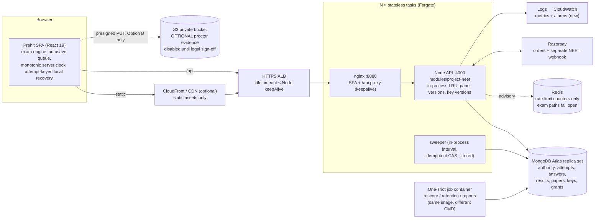

# 03 — Target System Architecture (PROPOSED, awaiting approval)

> Status: **Proposal.** No production code has changed.
> Builds on the evidence in [01-existing-architecture-audit.md](01-existing-architecture-audit.md). Finding IDs (R-n, F-n) refer to that document.

## 1. Principle: harden the existing slice, do not rebuild it

The existing `apps/api/modules/project-neet` module and its `apps/web` counterparts already implement most of the critical engine correctly:

- server-authoritative deadline
- CAS lifecycle
- sequenced idempotent saves
- single-result submission
- key secrecy
- event-only proctoring

A parallel `domains/exams` stack would duplicate verified behaviour and its tests. Every proposal below is therefore an **extension or correction** of that module, kept inside the modular monolith.

## 2. Architecture decisions

| ID  | Decision                                                                                                                                                                                                                                                                                             | Rationale / alternatives rejected                                                                                                                                                                                                                                                                                                                                            |
| --- | ---------------------------------------------------------------------------------------------------------------------------------------------------------------------------------------------------------------------------------------------------------------------------------------------------- | ---------------------------------------------------------------------------------------------------------------------------------------------------------------------------------------------------------------------------------------------------------------------------------------------------------------------------------------------------------------------------- |
| D1  | **Extend `modules/project-neet`. No new services.**                                                                                                                                                                                                                                                  | Measured load (see 08) is well within one stateless API tier plus MongoDB. Microservices, Kafka and Kubernetes add cost without a measured need.                                                                                                                                                                                                                             |
| D2  | **Keep answers embedded in `NeetAttempt.responses[]`.**                                                                                                                                                                                                                                              | A paper is bounded at ≤ 200 questions. One document gives atomic save, freeze and score with no transactions, which the platform has none of. A separate `AttemptAnswer` collection would need a transaction or a two-phase freeze, plus extra indexes and roughly 180× the documents. Revisit only if papers exceed ~500 questions or per-answer audit history is required. |
| D3  | **Introduce an immutable `NeetPaperVersion` and a private, versioned `NeetAnswerKeyVersion`. Attempts pin both.**                                                                                                                                                                                    | Fixes R-2. Content becomes cacheable in process (immutable ID → LRU), removing ~180 document reads per start and per finalise. Corrections create a new key version and an audited rescore; nothing is mutated in place.                                                                                                                                                     |
| D4  | **Turn `NeetQuestion` into a reusable bank item** with revisions, taxonomy, review workflow and provenance.                                                                                                                                                                                          | Today questions are bound to one test (`testId` immutable) with no taxonomy or review state. The brief requires expert review, licensing metadata and paper assembly.                                                                                                                                                                                                        |
| D5  | **Proctoring MVP = event-only (Option A).** Policy outcomes become **flags for human review, never automatic submission**.                                                                                                                                                                           | See §5. Fixes R-6 and F-1. Media snapshots (Option B) are deferred behind legal sign-off. Continuous recording (Option C) is rejected for the MVP.                                                                                                                                                                                                                           |
| D6  | **Finalise on the request path, plus a per-replica sweeper.** No queue infrastructure.                                                                                                                                                                                                               | The existing two-step CAS is already idempotent and crash-safe. With cached keys, a submit costs ~4 small Mongo operations; at 1,000 submits in 5 s that is ~1k ops/s (see 08). The sweeper finalises abandoned expired attempts so reports are accurate. Concurrent sweepers are harmless because of the CAS. Rescoring runs as a bounded batch job from the same image.    |
| D7  | **Redis remains advisory.** Exam hot-path limiters fail **open**, with an in-process fallback. Redis reconnects forever. Readiness depends on Mongo, not Redis.                                                                                                                                      | Fixes R-1. Integrity is guaranteed by `userId` + `activeSessionId` + status predicates in Mongo, not by rate limits. Login, OTP, payment and admin limiters stay fail-closed. MongoDB stays the only authority for accepted answers.                                                                                                                                         |
| D8  | **NEET access uses a NEET-owned `NeetAccessGrant` and `NeetOrder`, with a separate Razorpay webhook endpoint.**                                                                                                                                                                                      | Fixes R-12 without touching course `Purchase` fulfilment. Razorpay supports multiple webhook URLs, and each handler ignores orders it does not own. The signature, timeout and idempotency primitives are reused from `controllers/payments.js`.                                                                                                                             |
| D9  | **Exam-session protection.** At start/resume, re-issue the session cookie when its remaining lifetime is less than the exam time left plus 30 min (same `sessionVersion`). Exempt in-progress exam calls (save, heartbeat, submit, result) from the 428 policy gate. Logout semantics are unchanged. | Fixes the R-3 session breakers without weakening revocation. A logout on another device still ends the session; the UI explains how to sign back in, and the deadline and saved answers are intact.                                                                                                                                                                          |
| D10 | **Authenticated hot paths: a lean, projected user read** (`.lean()`, no `policyAcceptances`), behind the same revocation checks. Add a cache only if load tests show it is needed.                                                                                                                   | Cuts per-request auth cost (R-5) without changing security semantics.                                                                                                                                                                                                                                                                                                        |
| D11 | **Frontend: re-skin, do not rebuild.** Map `pn-*` tokens onto `--sn-*`, adopt the Prahit mark and naming, and keep the calm exam layout and five-state OMR. Add no animation library.                                                                                                                | The exam UI is sound. Only the brand layer diverges (R-14).                                                                                                                                                                                                                                                                                                                  |
| D12 | **Ship as one deployable.** Optional workers (sweeper, rescore) use the same image with a different command.                                                                                                                                                                                         | Matches the existing Dockerfile and operations conventions (`compose.operations.yml`).                                                                                                                                                                                                                                                                                       |

## 3. Target topology

## 4. Engine changes

### 4.1 Server

1. **Frozen paper (D3).**
   - `start` pins `paperVersionId` and `answerKeyVersionId`.
   - The session build and finalisation read the pinned versions through an LRU cache. The live `NeetQuestion` is never read at exam time.
2. **Scoring v2.**
   - Per-question key status: `ACTIVE | CANCELLED | BONUS`.
   - Cancelled questions award a configurable policy (default: full marks to all candidates, or dropped from the maximum; this is a decision).
   - Results become versioned: `result.version` and `resultHistory[]`.
   - Rescoring is admin-triggered, audited and batch-bounded.
3. **Accommodations.**
   - `accommodation: {extraSeconds, reasonCode, approvedBy, approvedAt}` is set by an admin **before** start.
   - `expiresAt = startedAt + duration + extraSeconds`.
4. **Proctor policy (D5).**
   - `autoSubmit.enabled` defaults to `false`.
   - Threshold events set `review.status = FLAGGED`.
   - `DUPLICATE_SESSION` is counted only when the previous session is still live **and** a different browser instance holds it (see 4.2), never on a same-tab refresh.
5. **Sweeper (D6).** Every 60 s ± jitter, each replica:
   - selects ≤ 100 attempts matching `{isOpen: true, status: IN_PROGRESS, expiresAt < now − 30 s}`, using the new partial index
   - runs `ensureFresh` on each.
6. **Hot-path efficiency.**
   - The save CAS projects only `lastSeq`, `expiresAt` and `status`.
   - The acknowledgement returns the server state of the written questions from the update result.
   - Exam calls use a lean auth read (D10).
7. **Redis resilience (D7).**
   - Unbounded reconnect with capped backoff.
   - Exam limiters use `passOnStoreError: true` with a per-process fallback limiter.
   - `/health/ready` depends on Mongo only.
   - A new `/health/deps` exposes Redis state for alarms.
8. **NAT-safe limits (R-4).**
   - The NEET per-IP ceiling is raised to a flood guard of ~200 req/s per IP. The per-user and per-attempt budgets are the real controls.
   - Test listing moves to edge caching.
   - Final numbers are set from load tests.
9. **Data minimisation.**
   - Stop copying phone and email onto attempts. Keep a display name only, or a reference to the user (decision).

### 4.2 Client

1. **F-2: final-seconds flush.**
   - Debounce shrinks to 0 when less than 15 s remain.
   - On reaching zero, the client makes a best-effort `flush()` that resolves before `submit(TIME_EXPIRED)`.
   - The server's deadline stays authoritative.
2. **F-3: durable recovery across tabs.**
   - Pending writes are keyed by `attemptId`, not by session. **Implemented in M2 with synchronous `localStorage` rather than IndexedDB:** a synchronous write completes before a crash can interrupt it, whereas an IndexedDB transaction may still be in flight, and the queue is small (one entry per question).
   - Recovery happens on any new session for the same user and attempt.
   - The storage is cleared on submission or on a server acknowledgement covering a higher `seq`.
   - There is an explicit "clear on shared computer" path.
3. **F-1: stable session on refresh.**
   - Reuse the tab's `sessionStorage` session ID on a same-tab refresh. A fresh ID is minted only for a new tab or window, or an explicit takeover.
   - The server treats a resume with the **same** session ID as a reconnect, not a takeover.
4. **Per-question truthfulness.**
   - Each palette and question shows a small "saving" marker until acknowledged.
   - The global status is unchanged.
5. **Recover, don't freeze.**
   - The `error` and `save-error` phases offer "Return to exam" while time remains.
   - Heartbeat and the deadline continue in every non-final phase.
6. **Record `timeSpentMs`**, measured on the monotonic clock while a question is focused.
7. **Rendering.**
   - Isolate the 500 ms timer tick into `ExamTimer` state.
   - Stabilise palette callbacks.
   - Mount the palette once.
   - Use roving tabindex in the palette.
8. **Wording.** Fix the landing-page overclaims. Rename "Proctored" to **"Monitored mode"** unless and until the capability matches a "proctored" definition.

## 5. Proctoring recommendation

| Option                                   | What it is                                                                                                                                                | Bandwidth at 1,000 concurrent              | Storage per 1,000-student 3-hour sitting                                           | Main costs / risks                                                                            | Verdict                              |
| ---------------------------------------- | --------------------------------------------------------------------------------------------------------------------------------------------------------- | ------------------------------------------ | ---------------------------------------------------------------------------------- | --------------------------------------------------------------------------------------------- | ------------------------------------ |
| A. Event-only (exists)                   | Visibility, focus, fullscreen, clipboard, network, track-health, on-device face-count/obstruction and audio-level **signals**; no media leaves the device | Worst case ≈ 250 KB/s, typically < 50 KB/s | ≤ 0.9 MB per attempt worst case (3,000-event cap), typically < 0.1 MB; 180-day TTL | Weak deterrent; signals are not proof                                                         | **MVP**                              |
| B. A + consented low-frequency snapshots | 320×240 JPEG (~20 KB) once a minute, uploaded by presigned PUT direct to S3                                                                               | ≈ 2.7 Mbit/s total                         | ≈ 3.6 GB                                                                           | Images of likely minors (DPDP §9), retention and deletion duties, reviewer time               | Later, **only after legal sign-off** |
| C. Continuous webcam + screen recording  | SFU/media servers plus recording                                                                                                                          | ≈ 0.5–1 Gbit/s sustained                   | ≈ 1 TB                                                                             | Media infrastructure, cost, reviewer hours (3 h of video per student), highest legal exposure | **Rejected for MVP**                 |

**MVP rules:**

- No automatic submission or cancellation.
- Technical faults (network, device) are never counted.
- Flagged attempts go to a human review queue with notes, a decision and an appeal.
- Every reviewer view is audit-logged.
- Biometric identification, gaze inference and emotion inference are out of scope.
- **For users under 18, Mode A is offered only after counsel confirms the applicable DPDP exemption or a guardian-consent flow exists** (decision J-2).

## 6. API surface (deltas to `/api/v2/project-neet`)

All new endpoints use the existing conventions:

- `validateV2Request`
- the `{success, requestId, data}` envelope
- strict Zod contracts in `packages/contracts/src/neet*.js`
- OpenAPI generation

Exact schemas will be written in `05-api-contracts.md` at the start of M2.

**Student**

| Method + path                  | Purpose                                                                                                              | Notes                                                                     |
| ------------------------------ | -------------------------------------------------------------------------------------------------------------------- | ------------------------------------------------------------------------- |
| `GET /attempts?cursor=&limit=` | Paginated history                                                                                                    | Keyset on `{userId, createdAt, _id}`                                      |
| `GET /attempts/:id/review`     | Question-wise review after scoring: content, selected answer, accepted keys, explanation, outcome, time              | Scored attempts only. Uses the pinned key version and the paper snapshot. |
| `GET /attempts/:id/result`     | **Extended** with versioned result, topic breakdown (when taxonomy is approved) and comparison with previous attempt |                                                                           |
| `GET /me/access`               | Active NEET grants                                                                                                   |                                                                           |

**Admin**

Admin routes are in a new router under the module, gated by `auth, isAdmin` with their own limiter and audit logging.

| Method + path                                | Purpose                                                        |
| -------------------------------------------- | -------------------------------------------------------------- |
| `GET/POST/PATCH /admin/questions`            | Bank CRUD. Each edit creates a new revision.                   |
| `POST /admin/questions/import:preview`       | Import preview (CSV/JSON)                                      |
| `POST /admin/questions/import:commit`        | Import commit                                                  |
| `POST /admin/questions/:id/review`           | Review transition: `DRAFT → IN_REVIEW → APPROVED` / `REJECTED` |
| `GET/POST/PATCH /admin/tests`                | Test offerings (pattern, modes, access tier, availability)     |
| `POST /admin/tests/:id/papers`               | Assemble and validate                                          |
| `POST /admin/papers/:id/publish`             | Publish an immutable version                                   |
| `POST /admin/papers/:id/answer-keys`         | Key correction → new version plus a rescore job                |
| `GET /admin/attempts?review=FLAGGED&cursor=` | Proctor review queue                                           |
| `POST /admin/attempts/:id/review`            | Decision with notes (appealable)                               |
| `POST /admin/attempts/:id/accommodation`     | Pre-start time extension                                       |

**Commerce**

| Method + path             | Purpose                                                                          |
| ------------------------- | -------------------------------------------------------------------------------- |
| `GET /products`           | Published NEET products                                                          |
| `POST /orders`            | Creates a Razorpay order. Server-priced; requires `Idempotency-Key`.             |
| `POST /orders/:id/verify` | Client-side signature verification fast path                                     |
| `POST /payments/webhook`  | Raw-body HMAC. Mounted before JSON parsing, mirroring `registerRoutes.js:36-41`. |

**Access enforcement.** `POST /attempts` checks `NeetAccessGrant` for paid tests. Free tests need no grant.

## 7. UI/UX direction (summary; full detail in 07 at M4)

- **Source of truth.** Use the current Prahit `--sn-*` tokens, Poppins, `sn-btn`/`sn-card`, the Jelly Duo mark, FlaskLoader and `AccessibleDialog`. Keep NEET-specific additions **semantic** only:
  - subject identities (physics, chemistry, botany, zoology)
  - OMR state colours
  - exam canvas
- **Branding timing.** Do not re-skin until the uncommitted auth/brand work is committed (R-14).
- **Motion by context:**

| Context    | Motion level                                                               |
| ---------- | -------------------------------------------------------------------------- |
| Discovery  | Expressive (the existing lazy helix/capsule with reduced-motion fallbacks) |
| Onboarding | Subtle transitions                                                         |
| **Exam**   | **None decorative**                                                        |
| Results    | One controlled score reveal and progress transitions                       |

- **Pages.** Reuse the existing pages:
  - landing
  - mocks
  - onboarding: mode, consent, system check, instructions
  - exam
  - result
- **Pages to add:**
  - question review
  - attempt history (paginated)
  - admin question bank
  - admin papers
  - admin review queue
- **Accessibility (WCAG 2.2 AA):**
  - roving-tabindex palette
  - exam keyboard shortcuts with on-screen help
  - live-region timer milestones (already present)
  - readable maths and chemistry via a vetted renderer (KaTeX with `trust:false`, sanitised) when content requires it
- **Device support.** Proctored (Monitored) mode is desktop Chromium/Firefox/Edge only, disclosed before consent. Practice mode is fully responsive.
